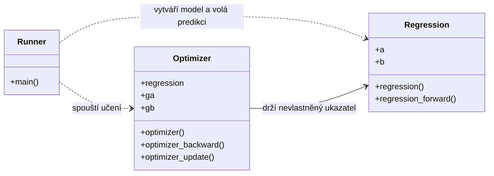

# Specifikace experimentu lineární regrese

- **Projekt:** `001-LinearRegression`
- **Větev:** `experiment/001-linear-regression`
- **Stav dokumentu:** pracovní návrh; MSE a SGD jsou zvoleny jako výchozí směr, podrobnosti učení a akceptace čekají na společný brainstorming
- **Zdroj pravdy:** tento Markdown soubor
- **Datum:** 2026-11-25
- **Revize:** 10

## 1. Účel dokumentu

Experiment má ukázat, jak navrhnout a ověřit malý systém strojového učení v čistém C bez specializovaného frameworku. Model prokládá body v dvourozměrném grafu přímkou. Hlavním cílem první fáze je společně rozhodnout architekturu, způsob učení, ověřování a měření zdrojů před napsáním algoritmu.

Dokument zaznamenává potvrzené předpoklady zadané vlastníkem odděleně od návrhů a otevřených rozhodnutí. Vlastník navrhl oddělení modelu od optimalizátoru, MSE a stochastický gradientní sestup (SGD). Ještě nejsou určeny detaily trénovacího postupu ani jeho akceptační kritéria.

## 2. Rozsah a hranice

### 2.1 Potvrzený rozsah

- Vstupem dopředného výpočtu je skalár $x$, výstupem odhad $\hat y$.
- Model má dva parametry typu `float`: sklon $a$ a posun $b$.
- Dopředný výpočet vychází ze vztahu $\hat y=ax+b$; vztah $\hat y=ax$ je jeho případ s $b=0$.
- Projekt používá C bez frameworku pro strojové učení a cílem je úsporný výpočet na dostupném hardwaru.
- Zdrojový kód, veřejné rozhraní, testy a platformní pravidla překladu budou oddělené podle kořenového `AGENTS.md`.

### 2.2 Zatím neurčený rozsah

Výchozí metodou učení je SGD se čtvercovou ztrátou; $a$ i $b$ se mají učit. Pro první prototyp je určena trojice učicích bodů; dosud nejsou určeny jejich uložení v programu, pořadí zpracování, hodnota rychlosti učení, počet průchodů, ukončení, diagnostika, přesnost a rozsah podporovaných vstupů. Není rozhodnuto o mini dávkách ani o paralelizaci. V této fázi se neimplementuje trénování ani dopředný výpočet.

### 2.3 Učicí sada prototypu

První prototyp používá záměrně zjednodušený převod kilometrů na míle. Jde o přesně zadanou syntetickou úlohu s poměrem $0{,}625=\frac{5}{8}$ míle na kilometr, nikoli o požadavek na přesný fyzikální převod.

| Bod | Vstup $x$ [km] | Cíl $y$ [míle] |
|---|---:|---:|
| 1 | $1$ | $0{,}625$ |
| 2 | $3$ | $1{,}875$ |
| 3 | $5$ | $3{,}125$ |

Všechny tři dvojice jsou určeny k učení; hodnoty zadal vlastník repozitáře dne 2026-11-25. Způsob uložení a předání při běhu se ještě určí. Pro první verzi se předpokládá, že předaná trénovací data jsou platná. Nezavádí se průběžná kontrola jejich hodnot v dopředném výpočtu ani v kroku optimalizátoru.

## 3. Terminologie a jednotky

| Symbol | Význam | Jednotka |
|---|---|---|
| $x$ | Vstupní souřadnice bodu. | Kilometr. |
| $y$ | Pozorovaná výstupní souřadnice bodu. | Míle. |
| $\hat y$ | Odhad výstupu vrácený modelem. | Míle. |
| $a$ | Sklon přímky, váha násobící vstup. | Míle na kilometr. |
| $b$ | Posun přímky na výstupní ose. | Míle. |
| Reziduum | Rozdíl mezi pozorovaným a odhadnutým výstupem. | Míle. |

## 4. Teorie modelu a koncept učení

Přímka v této úloze převádí jeden vstup na jeden odhad:

$$
\hat y(x)=ax+b
$$

Pro $b=0$ prochází přímka počátkem souřadnic. Změna $a$ mění její sklon, změna $b$ ji posouvá. Při prokládání bodů je třeba určit, jak měřit rozdíl mezi $y$ a $\hat y$ a podle jakého pravidla měnit parametry. Tato dvě rozhodnutí nejsou vlastností samotné dopředné funkce.

Jde o afinní transformaci s identickou aktivací. Sigmoidový neuron používá tutéž transformaci před nelineární aktivací $\sigma(ax+b)$; bez aktivace je výstupem přímo $ax+b$. Myšlenka učení z gradientu se přenáší i na neuronové sítě, ale konkrétní derivace a chování více vrstev se po přidání aktivací mění.

Pro $N>0$ trénovacích bodů je zvoleným výchozím měřítkem střední čtvercová chyba:

$$
\hat y_i=ax_i+b,\qquad
\operatorname{MSE}(a,b)=\frac{1}{N}\sum_{i=1}^{N}(\hat y_i-y_i)^2
$$

Pro SGD s jedním bodem je čtvercová ztráta $e_i(a,b)=(\hat y_i-y_i)^2$. Složky gradientu v aktuálních hodnotách parametrů a aktualizační krok jsou:

$$
\begin{aligned}
g_a &= \frac{\partial e_i}{\partial a}=2(\hat y_i-y_i)x_i,\\
g_b &= \frac{\partial e_i}{\partial b}=2(\hat y_i-y_i),\\
a' &= a-\eta g_a,\\
b' &= b-\eta g_b.
\end{aligned}
$$

$\eta>0$ je rychlost učení. Gradient $\nabla e_i=(g_a,g_b)^\mathsf{T}$ vyjadřuje místní sklon ztráty v současném bodě $(a,b)$, nikoli přesný rozdíl ztrát mezi dvěma vzdálenými nastaveními parametrů. Krok v opačném směru obvykle snižuje ztrátu při vhodném $\eta$; příliš velký krok ji může zvýšit. Při SGD se aktualizuje po jednotlivých bodech. Gradient celé MSE je průměrem gradientů všech bodů; jeho použití pro jedinou aktualizaci by byl dávkový gradientní sestup. Analytické nejmenší čtverce zůstávají možnou kontrolní základnou, nikoli vybranou metodou trénování.

### 4.1 Teoretická referenční přímka pro učicí sadu

Za předpokladu zvoleného afinního modelu určují již dva různé vstupy jedinou přímku procházející těmito body. Třetí bod soulad se stejnou přímkou potvrzuje:

$$
a_\star=\frac{1{,}875-0{,}625}{3-1}=0{,}625,\qquad
b_\star=0{,}625-a_\star\cdot1=0
$$

Pro $a_\star$ a $b_\star$ je teoretická MSE na této sadě nulová a očekávaný vztah je $\hat y=0{,}625x$. Tři přesné body postačují jako kontrolní úloha pro tento dvouparametrový model. Samy o sobě nedokazují chování při šumu, odlehlých bodech ani u jiných vztahů; SGD navíc dosáhne referenčních parametrů jen s vhodným průběhem učení.

## 5. Požadavky na architekturu řešení

### 5.1 Model `Regression`

Modul modelu nezná optimalizátor. Veřejná struktura obsahuje pouze dva učitelné parametry. Dohodnuté rozhraní má tuto podobu:

```c
typedef struct {
    float a;
    float b;
} Regression;

Regression regression(void);
float regression_forward(Regression *self, float x);
```

`regression()` vrací strukturu hodnotou, bez dynamické alokace. Pro $a$ a $b$ zvlášť zavolá `rand()` a jeho celočíselný výsledek lineárně převede do intervalu $[-1,1]$:

$$
a_0=2\frac{r_a}{\mathrm{RAND\_MAX}}-1,\qquad
b_0=2\frac{r_b}{\mathrm{RAND\_MAX}}-1,\qquad
r_a,r_b\in\{0,\ldots,\mathrm{RAND\_MAX}\}
$$

`Runner` nastaví `srand(seed)` jednou před vytvořením modelu; konstruktor generátor znovu neseeduje. Konkrétní semínko a zdroj bodů zůstávají otevřené. Rozložení a posloupnost hodnot závisí na implementaci `rand()`, takže testy mezi platformami nesmějí předpokládat stejná konkrétní náhodná čísla. `regression_forward` přijímá ukazatel na model a skalár $x$, vrací `float` podle $\hat y=ax+b$ a parametry nemění.

### 5.2 Optimalizátor `Optimizer`

Optimalizátor uchovává gradienty pro poslední zpracovaný bod a nevlastněný ukazatel na model. Veřejná hlavička `include/regression/optimizer.h` používá `include/regression/regression.h`; opačná závislost nevzniká. Dohodnuté rozhraní má tuto podobu:

```c
typedef struct {
    Regression *regression;
    float ga;
    float gb;
} Optimizer;

Optimizer optimizer(Regression *regression);
float optimizer_backward(Optimizer *self, float x, float y);
void optimizer_update(Optimizer *self, float lr);
```

`optimizer` vrací strukturu hodnotou a uloží ukazatel na existující `Regression`. Model musí přežít optimalizátor; ani jeden z těchto objektů nevyžaduje dynamickou alokaci. Dva `float` gradienty zůstávají v `Optimizer`, aby model uchovával pouze své parametry. Konstruktor nastaví `ga = gb = 0`. Dokud `optimizer_backward` nevypočte nové gradienty, `optimizer_update` model nezmění. Oproti předávání modelu do každé funkce stojí toto rozhodnutí jeden uložený ukazatel a vyžaduje dodržet jeho životnost, ale odpovídá zvolenému podpisu `optimizer_update`.

`optimizer_backward` použije uložený model a `regression_forward`, pro jeden bod vypočte $e=(\hat y-y)^2$, uloží $g_a$ a $g_b$ podle oddílu 4 do `self->ga` a `self->gb` a vrátí $e$ jako `float`. Gradienty při dalším volání přepíše; v tomto kroku model nemění. `optimizer_update` teprve potom upraví $a$ a $b$ podle uložených gradientů a rychlosti učení $\mathrm{lr}=\eta$. Platnost `lr` a chování při neplatných vstupních hodnotách je třeba ještě určit.

### 5.3 UML pohled na moduly

Diagram popisuje role modulů v C, nikoli objektovou hierarchii. Zobrazuje nyní potvrzené atributy, operace a směry závislostí; přesný tok trénovacích dat a vnitřní běh `Runner` se doplní po dalším brainstormingu. Operace v symbolech jsou volné funkce C uvedené v oddílech 5.1 a 5.2, nikoli metody struktur.



| Modul | Soubor / rozhraní | Odpovědnost |
|---|---|---|
| `Runner` | `src/main.c` | Jednou nastaví semínko, vytvoří model a optimalizátor na zásobníku, řídí postup učení a vyhodnocení. Původ dat a podoba výstupu se ještě určí. |
| `Regression` | `src/regression.c`, `include/regression/regression.h` | Uchovává $a$, $b$, inicializuje je a počítá dopředný výstup; nezná zbývající moduly. |
| `Optimizer` | `src/optimizer.c`, `include/regression/optimizer.h` | Odkazuje na model, počítá ztrátu a gradienty a provádí krok SGD. |

`tests/main.c` je spouštěč jednotkových testů, nikoli `Runner` experimentu. Vlastnictví trénovacích bodů, přesný řídicí cyklus a případné chyby vstupů zůstávají otevřené; po jejich odsouhlasení se upraví diagram, popis modulů i odpovídající požadavky a kontroly.

### 5.4 Vstupní předpoklady prototypu

`Runner` vytvoří `Regression` a `Optimizer` jako lokální hodnoty v `main`, typicky uložené na zásobníku:

```c
Regression model = regression();
Optimizer training = optimizer(&model);
```

`Regression` vznikne dříve než `Optimizer` a oba objekty žijí po celý běh učení. Volání používají jejich adresy; `Regression *` uložený v optimalizátoru proto po tuto dobu míří na platný model. `regression_forward`, `optimizer_backward` a `optimizer_update` neprovádějí při každém průchodu opakované kontroly `NULL` u těchto ukazatelů. Platný ukazatel a správná životnost jsou jejich smluvní předpoklady. Porušení předpokladu znamená v C nedefinované chování, nikoli zaručený okamžitý pád.

Pro první verzi se předpokládají také konečné hodnoty parametrů, $x$ a $y$; trénovací data se průběžně nevalidují. Samotná afinní funkce může přijmout i záporné konečné $x$, přestože ukázková sada kilometrů obsahuje jen nezáporné vzdálenosti. Pravidla pro neplatné $\mathrm{lr}$ a numerické přetečení zůstávají otevřená. Tento experiment dynamickou alokaci nepotřebuje; pro budoucí experimenty platí jednorázová kontrola výsledku `lib/alloc` bez opakovaného testování ukazatele v horké části algoritmu.

Výchozí platformou je `linux_x86_64` a připravuje se `win32_x86_64`. `Makefile` a platformní konfigurace zatím nesmějí hlásit úspěšný build nebo test, protože implementace neexistuje.

## 6. Výpočetní optimalizace a paralelizace

Optimalizace parametrů modelu řeší matematickou úlohu prokládání bodů. Optimalizace jejího výpočtu je samostatná technická úloha: volba rozložení bodů v paměti, průchodů daty, redukce součtů, vektorizace a případné rozdělení mezi vlákna. Před návrhem těchto změn se musí nejprve ustálit referenční sekvenční chování a měřítka přesnosti.

U jednoduchého modelu se dvěma parametry může režie obecného frameworku nebo paralelního plánování převážit samotný výpočet. To je hypotéza k měření, nikoli již dosažený výsledek. Každá optimalizace musí být porovnána se stejným problémem, daty, přesností a hardwarem.

## 7. Předběžné normativní požadavky

| ID | Požadavek | Stav |
|---|---|---|
| LR-001 | Typ `Regression` musí uchovávat `a` a `b` jako `float`. | Odvozeno přímo ze zadání. |
| LR-002 | Dopředná funkce musí vrátit $\hat y=ax+b$. | Odvozeno přímo ze zadání. |
| LR-003 | Varianta bez posunu musí být reprezentovatelná jako $b=0$. | Odvozeno přímo ze zadání. |
| LR-004 | Produkční kód nesmí záviset na frameworku pro strojové učení. | Potvrzené pravidlo repozitáře. |
| LR-005 | Jednotkové testy musí ověřit dopřednou funkci a později zvolenou metodu učení. | Potvrzené pravidlo repozitáře. |
| LR-006 | Volba trénovacího algoritmu a akceptačních kritérií musí být schválena před jejich implementací. | Potvrzené pravidlo repozitáře. |
| LR-007 | Překlad musí podporovat `linux_x86_64` a `win32_x86_64`. | Požadavek na připravovanou implementaci. |
| LR-008 | Modul regrese nesmí záviset na optimalizátoru; optimalizátor používá veřejné rozhraní regrese. | Potvrzená architektura. |
| LR-009 | Ztráta pro $N>0$ bodů musí odpovídat MSE, tedy průměru druhých mocnin rozdílu $\hat y_i-y_i$. | Potvrzený výchozí směr; numerická smlouva se doplní. |
| LR-010 | SGD musí počítat gradient čtvercové ztráty vůči $a$ a $b$ a aktualizovat oba parametry v opačném směru. | Potvrzený výchozí směr; plán kroků se doplní. |
| LR-011 | `Runner` v `src/main.c` musí koordinovat použití `Regression` a `Optimizer`; závislosti mezi moduly musí odpovídat diagramu v oddílu 5.3. | Potvrzená architektura. |
| LR-012 | `regression()` musí vrátit hodnotovou strukturu s parametry v intervalu $[-1,1]$, získanými dvěma voláními `rand()` bez dynamické alokace. | Potvrzená architektura; numerické detaily se ověří. |
| LR-013 | `Optimizer` musí obsahovat nevlastněný ukazatel na `Regression` a vlastní `float` gradienty `ga` a `gb`, inicializované na nulu; model musí žít déle než optimalizátor. | Potvrzená architektura. |
| LR-014 | `optimizer_backward` musí vrátit čtvercovou ztrátu jednoho bodu, uložit gradienty do `Optimizer` a ponechat model beze změny. | Potvrzený postup SGD. |
| LR-015 | `optimizer_update` musí upravit $a$ a $b$ podle uložených gradientů a argumentu $\mathrm{lr}$. | Potvrzený postup SGD; vstupní smlouva $\mathrm{lr}$ se doplní. |
| LR-016 | První prototyp musí použít učicí dvojice $(1;0{,}625)$, $(3;1{,}875)$ a $(5;3{,}125)$ ve vztahu kilometrů k mílím. | Potvrzená učicí sada. |
| LR-017 | První verze musí považovat trénovací hodnoty $x$ a $y$ za platné vstupy a neprovádět jejich průběžnou validaci v modelu ani optimalizátoru. | Potvrzený vstupní předpoklad. |
| LR-018 | `Runner` musí vytvořit model a optimalizátor jako lokální hodnoty v `main`, předávat jejich adresy a udržet model živý po celou dobu používání optimalizátoru; horké funkce nesmějí opakovat `NULL` kontroly těchto ukazatelů. | Potvrzený přístup k životnosti a výkonu. |

Požadavky na konvergenci, přesnost parametrů, chování při porušení vstupních předpokladů a paměť budou doplněny po brainstormingu. Identifikátory zůstanou stabilní.

## 8. Akceptační scénáře a plán ověření

| ID | Požadavky | Vstup / podmínka | Očekávaný výsledek | Stav |
|---|---|---|---|---|
| LR-T01 | LR-001, LR-002 | $a=2$, $b=1$, $x=3$ | $\hat y=7$ | Plánováno; kód neexistuje. |
| LR-T02 | LR-002, LR-003 | $a=2$, $b=0$, $x=3$ | $\hat y=6$ | Plánováno; kód neexistuje. |
| LR-T03 | LR-002 | $a=-1$, $b=2$, $x=-2$ | $\hat y=4$ | Plánováno; kód neexistuje. |
| LR-T04 | LR-009 | Dva body s rozdíly $\hat y_i-y_i$ rovnými $-1$ a $-2$ | $\operatorname{MSE}=\frac{1+4}{2}=2{,}5$ | Plánováno; kód neexistuje. |
| LR-T05 | LR-010, LR-013, LR-014, LR-015 | $a=b=0$, $x=2$, $y=1$, $\mathrm{lr}=0{,}1$ | `backward` vrátí $e=1$ a uloží $g_a=-4$, $g_b=-2$ bez změny modelu; `update` nastaví $a'=0{,}4$, $b'=0{,}2$ | Plánováno; kód neexistuje. |
| LR-T06 | LR-008, LR-011 | Kontrola závislostí zdrojových modulů | `Runner` používá model a optimalizátor; `Optimizer` používá model; `Regression` nemá závislost na zbývajících dvou modulech. | Plánováno; kód neexistuje. |
| LR-T07 | LR-012 | Dvě volání `regression()` po `srand(seed)` s pevným semínkem | Oba parametry leží v $[-1,1]$; opakování se stejným semínkem na téže platformě vrátí stejnou dvojici modelů. | Plánováno; kód neexistuje. |
| LR-T08 | LR-013 | `Optimizer` vytvořený nad existujícím `Regression` | Uložený ukazatel směřuje na předaný model, `ga = gb = 0`; vytvoření nevyžaduje dynamickou alokaci. | Plánováno; kód neexistuje. |
| LR-T09 | LR-013, LR-015 | `optimizer_update` volaný po konstrukci, před `optimizer_backward` | Parametry modelu se nezmění. | Plánováno; kód neexistuje. |
| LR-T10 | LR-016 | Tři dvojice z oddílu 2.3 a referenční parametry $a=0{,}625$, $b=0$ | Všechny tři odhady se rovnají cílům a $\operatorname{MSE}=0$. | Teoretický očekávaný výsledek; kód neexistuje. |
| LR-T11 | LR-013, LR-018 | Kontrola `src/main.c` a volání modelu/optimalizátoru | Obě struktury jsou lokální v `main`, `Optimizer` drží adresu živého modelu a horké funkce neobsahují opakované kontroly `NULL`. | Plánováno; kód neexistuje. |

Další testy učení, reprodukovatelnosti, hraničních hodnot a výkonu budou určeny po upřesnění postupu SGD a dat. `tests/` bude používat projektový adaptovaný `unit.c`/`unit.h` a `make test` bude vracet chybu při selhání. Pro podporovanou platformu se zaznamenají skutečné příkazy, hardware a výsledky. Po implementaci se ověří sestavení a jednotkové testy pro Linux a Windows; samotné načtení konfiguračního souboru není ověřením překladu. Nyní nic z toho nelze vykazovat jako provedený test.

## 9. Rozhodnutí a otevřené otázky pro brainstorming

| ID | Otázka | Možnosti k diskusi |
|---|---|---|
| LR-OP-01 | Jaká je ztráta pro jeden krok SGD? | Rozhodnuto: $e_i=(\hat y_i-y_i)^2$, tedy MSE pro jeden bod. |
| LR-OP-02 | Jak řídit průchod SGD? | Pořadí bodů, pevná či proměnná rychlost učení, počet epoch, kritérium ukončení a případné mini dávky. |
| LR-OP-03 | Mají se učit oba parametry? | Rozhodnuto: $a$ i $b$; $b=0$ lze použít jako počáteční hodnotu. |
| LR-OP-04 | Odkud přicházejí body a jak jsou uloženy? | Rozhodnuto: první učicí sada má tři dvojice z oddílu 2.3. Otevřené: zdroj při běhu a reprezentace v `Runner`. |
| LR-OP-05 | Jaký je veřejný podpis dopředné funkce? | Rozhodnuto: `float regression_forward(Regression *self, float x)`. |
| LR-OP-06 | Jak posoudit výsledek? | Metriky, tolerance, degenerované vstupy, srovnávací základna a paměťové měření. |
| LR-OP-07 | Jak prezentovat proložení bodů? | Číselný výstup, export bodů a přímky pro graf nebo vlastní vizualizace. |
| LR-OP-08 | Jak zvolit semínko generátoru? | `Runner` volá `srand` před konstrukcí; konkrétní zdroj semínka a jeho výchozí hodnota se určí. |
| LR-OP-09 | Jak řešit neplatné vstupy a pořadí volání? | Rozhodnuto: `ga = gb = 0`, `update` před `backward` nic nezmění; trénovací $x$, $y$ a ukazatele na živé lokální objekty se považují za platné bez opakovaných kontrol. Otevřené: platnost $\mathrm{lr}$ a přetečení. |

Oddělení modelu od optimalizátoru, MSE a SGD odpovídají nynějšímu rozhodnutí vlastníka. SGD je vhodné jako jednoduchý výchozí postup pro pozdější zkoumání učení neuronů; pro dvouparametrovou regresi lze jeho výsledek později porovnat s analytickým řešením. Jeho výběr zatím není důkazem lepší rychlosti ani paměťové úspory. Před implementací je třeba odsouhlasit otevřené detaily a akceptační kritéria.

## 10. Výsledky testování a závěr

Neexistuje implementace ani jednotkové testy tohoto experimentu. Žádný algoritmus učení, numerická přesnost, rychlost ani spotřeba paměti proto nebyly ověřeny. Závěr o použitelnosti pro prokládání bodů nelze zatím formulovat ani odsouhlasit.

## 11. Vazba na připravovanou implementaci a údržba

| Oblast | Plánovaná cesta |
|---|---|
| Vstupní bod a řízení experimentu | `src/main.c` |
| Veřejný model a dopředný výpočet | `include/regression/regression.h`, `src/regression.c` |
| Ztráta a učení parametrů | `include/regression/optimizer.h`, `src/optimizer.c` |
| Jednotkové testy | `tests/test_regression.c`, `tests/unit.c`, `tests/unit.h`, `tests/main.c` |
| Překlad pro výchozí platformu | `Makefile`, `config/linux_x86_64.mk` |
| Překlad pro Windows | `config/win32_x86_64.mk` |

Změna modelové rovnice, podpisu, metody učení, numerické smlouvy nebo akceptačních kritérií musí být nejprve promítnuta do této specifikace. Po schválení rozhodnutí se stav dokumentu upraví a začnou se implementovat odpovídající moduly a testy.

## 12. Vysvětlující slovník odborných pojmů

- **Lineární regrese:** Hledání přímky, která pro dané body popisuje vztah mezi jednou vstupní a jednou výstupní hodnotou.
- **Sklon ($a$):** Parametr určující, o kolik se odhad $\hat y$ změní při jednotkové změně $x$.
- **Posun ($b$):** Hodnota odhadu v bodě $x=0$; při nulovém posunu přímka prochází počátkem.
- **Dopředný výpočet:** Použití již zadaných parametrů modelu pro výpočet $\hat y$ bez jejich změny.
- **Učení parametrů:** Postup, který z trénovacích bodů nastavuje $a$ a $b$ podle zvoleného kritéria.
- **Ztrátová funkce:** Číselné měřítko rozdílu mezi pozorovanými a odhadnutými hodnotami, které má učení zmenšovat.
- **Reziduum:** Rozdíl $y_i-\hat y_i$ pro jeden bod; jeho význam závisí na zvolené ztrátě.
- **Analytické nejmenší čtverce:** Výpočet parametrů ze souhrnných součtů bodů pro čtvercovou chybu za platných předpokladů.
- **Gradientní sestup:** Opakované posouvání parametrů proti gradientu ztráty; vyžaduje pravidlo kroku a ukončení.
- **SGD:** Stochastický gradientní sestup; zde aktualizace parametrů podle gradientu ztráty jednoho trénovacího bodu.
- **Gradient:** Vektor parciálních derivací ztráty podle parametrů $a$ a $b$ v jejich aktuálních hodnotách.
- **MSE:** Střední čtvercová chyba; průměr druhých mocnin rozdílů mezi odhadem a pozorováním.
- **Hyperparametr:** Hodnota určující postup učení, například rychlost učení $\eta$; není přímo součástí modelové přímky.
- **Sigmoidová aktivace:** Nelineární funkce aplikovaná na vážený součet neuronu; v této regresi se nepoužívá.
- **Identická aktivace:** Výstup se rovná vstupu aktivace, proto model vrací přímo $ax+b$.
- **Referenční sekvenční chování:** Jednovláknový výsledek určený pro kontrolu budoucích výkonnostních změn.
- **Runner:** Vstupní modul experimentu v `src/main.c`, který řídí spolupráci modelu a optimalizátoru.
- **UML diagram:** Grafické znázornění modulů, jejich rozhraní a směru závislostí; šipka s plnou čarou zde vyjadřuje uložený ukazatel na model.
- **Nevlastněný ukazatel:** Odkaz na existující `Regression` v `Optimizer`; optimalizátor model neuvolňuje a model musí po celou dobu odkazu existovat.
- **Semínko generátoru:** Hodnota předaná `srand`, která na stejné implementaci určuje opakovatelnou posloupnost výsledků `rand`.
- **Učicí sada:** Tři potvrzené dvojice kilometrů a mílí, z nichž bude prototyp upravovat parametry $a$ a $b$.
- **Vstupní předpoklad:** Podmínka, kterou musí splnit volající; první prototyp předpokládá platné trénovací hodnoty a ukazatele na živé objekty bez průběžné kontroly.
- **Životnost objektu:** Doba, po kterou lze přistupovat k lokální struktuře; `Regression` musí zůstat živý, dokud na něj odkazuje `Optimizer`.
- **Nedefinované chování:** Situace bez zaručeného výsledku podle pravidel C, například dereference neplatného ukazatele; program nemusí ihned skončit.
