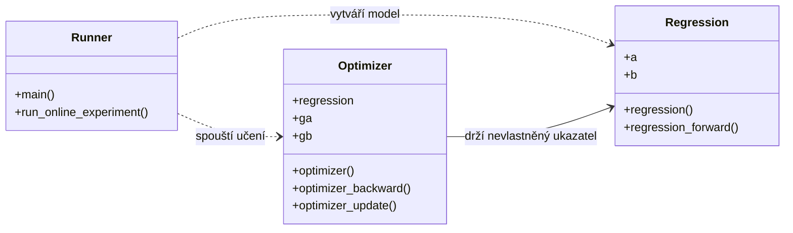
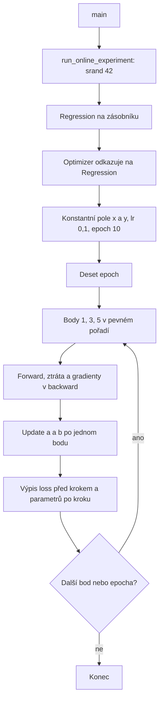

# Specifikace experimentu lineární regrese

- **Projekt:** `001-LinearRegression`
- **Větev:** `experiment/001-linear-regression`
- **Stav dokumentu:** implementovaný první online běh; závěr testování čeká na odsouhlasení vlastníkem
- **Zdroj pravdy:** tento Markdown soubor
- **Datum:** 2026-11-25
- **Revize:** 16

## 1. Účel dokumentu

Experiment má ukázat, jak navrhnout a ověřit malý systém strojového učení v čistém C bez specializovaného frameworku. Model prokládá body v dvourozměrném grafu přímkou. První fáze ověřuje schválenou architekturu, způsob učení a pozorovatelnost výpočtu; měření výkonu a další varianty následují až po vyhodnocení tohoto běhu.

Dokument zaznamenává potvrzené předpoklady zadané vlastníkem odděleně od návrhů a otevřených rozhodnutí. Vlastník navrhl oddělení modelu od optimalizátoru, MSE a stochastický gradientní sestup (SGD). První pozorovací běh má pevné pořadí vzorků, deset epoch a rychlost učení $\eta=0{,}1$. Skutečný průběh prvního běhu a jeho omezení jsou vyhodnoceny v oddílu 10.

## 2. Rozsah a hranice

### 2.1 Potvrzený rozsah

- Vstupem dopředného výpočtu je skalár $x$, výstupem odhad $\hat y$.
- Model má dva parametry typu `float`: sklon $a$ a posun $b$.
- Dopředný výpočet vychází ze vztahu $\hat y=ax+b$; vztah $\hat y=ax$ je jeho případ s $b=0$.
- Projekt používá C bez frameworku pro strojové učení a cílem je úsporný výpočet na dostupném hardwaru.
- Zdrojový kód, veřejné rozhraní, testy a platformní pravidla překladu budou oddělené podle kořenového `AGENTS.md`.

### 2.2 První pozorovací běh a další varianty

Výchozí metodou je SGD se čtvercovou ztrátou; učí se $a$ i $b$. Tři učicí dvojice budou ve dvou konstantních polích ve funkci `run_online_experiment()`. První běh zpracuje v každé z deseti epoch body v pořadí tabulky. Po každém bodu provede jeden dopředný výpočet, výpočet ztráty a gradientů a ihned aktualizuje parametry; nepoužívá mini dávky. Rychlost učení je po celý první běh $\eta=0{,}1$, bez předčasného ukončení. Výpis po každém bodu ukáže ztrátu a nové parametry. Následné změny rychlosti učení na obě strany budou samostatnými běhy; jejich konkrétní hodnoty a kritéria hodnocení se určí z pozorování. Paralelizace není součástí první verze.

### 2.3 Učicí sada prototypu

První prototyp používá záměrně zjednodušený převod kilometrů na míle. Jde o přesně zadanou syntetickou úlohu s poměrem $0{,}625=\frac{5}{8}$ míle na kilometr, nikoli o požadavek na přesný fyzikální převod.

| Bod | Vstup $x$ [km] | Cíl $y$ [míle] |
|---|---:|---:|
| 1 | $1$ | $0{,}625$ |
| 2 | $3$ | $1{,}875$ |
| 3 | $5$ | $3{,}125$ |

Všechny tři dvojice jsou určeny k učení; hodnoty zadal vlastník repozitáře dne 2026-11-25. V `run_online_experiment()` budou hodnoty uloženy ve dvou konstantních polích `x` a `y` stejné délky, odvozené z tabulky. Pro první verzi se předpokládá, že předaná trénovací data jsou platná. Nezavádí se průběžná kontrola jejich hodnot v dopředném výpočtu ani v kroku optimalizátoru.

## 3. Terminologie a jednotky

| Symbol | Význam | Jednotka |
|---|---|---|
| $x$ | Vstupní souřadnice bodu. | Kilometr. |
| $y$ | Pozorovaná výstupní souřadnice bodu. | Míle. |
| $\hat y$ | Odhad výstupu vrácený modelem. | Míle. |
| $a$ | Sklon přímky, váha násobící vstup. | Míle na kilometr. |
| $b$ | Posun přímky na výstupní ose. | Míle. |
| Reziduum | Rozdíl mezi pozorovaným a odhadnutým výstupem. | Míle. |

## 4. Teorie modelu a koncept učení

Přímka v této úloze převádí jeden vstup na jeden odhad:

$$
\hat y(x)=ax+b
$$

Pro $b=0$ prochází přímka počátkem souřadnic. Změna $a$ mění její sklon, změna $b$ ji posouvá. Při prokládání bodů je třeba určit, jak měřit rozdíl mezi $y$ a $\hat y$ a podle jakého pravidla měnit parametry. Tato dvě rozhodnutí nejsou vlastností samotné dopředné funkce.

Jde o afinní transformaci s identickou aktivací. Sigmoidový neuron používá tutéž transformaci před nelineární aktivací $\sigma(ax+b)$; bez aktivace je výstupem přímo $ax+b$. Myšlenka učení z gradientu se přenáší i na neuronové sítě, ale konkrétní derivace a chování více vrstev se po přidání aktivací mění.

Pro $N>0$ trénovacích bodů je zvoleným výchozím měřítkem střední čtvercová chyba:

$$
\hat y_i=ax_i+b,\qquad
\operatorname{MSE}(a,b)=\frac{1}{N}\sum_{i=1}^{N}(\hat y_i-y_i)^2
$$

Pro SGD s jedním bodem je čtvercová ztráta $e_i(a,b)=(\hat y_i-y_i)^2$. Složky gradientu v aktuálních hodnotách parametrů a aktualizační krok jsou:

$$
\begin{aligned}
g_a &= \frac{\partial e_i}{\partial a}=2(\hat y_i-y_i)x_i,\\
g_b &= \frac{\partial e_i}{\partial b}=2(\hat y_i-y_i),\\
a' &= a-\eta g_a,\\
b' &= b-\eta g_b.
\end{aligned}
$$

$\eta>0$ je rychlost učení. Gradient $\nabla e_i=(g_a,g_b)^\mathsf{T}$ vyjadřuje místní sklon ztráty v současném bodě $(a,b)$, nikoli přesný rozdíl ztrát mezi dvěma vzdálenými nastaveními parametrů. Krok v opačném směru obvykle snižuje ztrátu při vhodném $\eta$; příliš velký krok ji může zvýšit. Při SGD se aktualizuje po jednotlivých bodech. Gradient celé MSE je průměrem gradientů všech bodů; jeho použití pro jedinou aktualizaci by byl dávkový gradientní sestup. Analytické nejmenší čtverce zůstávají možnou kontrolní základnou, nikoli vybranou metodou trénování.

Pro první pozorovací běh lze odvodit chování jediného kroku na témž
bodu. Je-li reziduum $r_i=\hat y_i-y_i$, po aktualizaci obou parametrů
rychlostí $\eta$ platí:

$$
r_i'=\left[1-2\eta(x_i^2+1)\right]r_i.
$$

Pro $x_i=5$ a $\eta=0{,}1$ je násobek rezidua $-4{,}2$ a čtvercová
ztráta tohoto bodu by bez mezikroků na jiných bodech vzrostla
$17{,}64$krát. Pro $\eta=0{,}01$ je na stejném bodě násobek rezidua $0{,}48$
a jeho čtvercové ztráty $0{,}2304$. Jde o teoretické porovnání
jednotlivého kroku a varování před příliš velkým krokem,
nikoli o změřený průběh celé posloupnosti tří bodů.

### 4.1 Teoretická referenční přímka pro učicí sadu

Za předpokladu zvoleného afinního modelu určují již dva různé vstupy jedinou přímku procházející těmito body. Třetí bod soulad se stejnou přímkou potvrzuje:

$$
a_\star=\frac{1{,}875-0{,}625}{3-1}=0{,}625,\qquad
b_\star=0{,}625-a_\star\cdot1=0
$$

Pro $a_\star$ a $b_\star$ je teoretická MSE na této sadě nulová a očekávaný vztah je $\hat y=0{,}625x$. Tři přesné body postačují jako kontrolní úloha pro tento dvouparametrový model. Samy o sobě nedokazují chování při šumu, odlehlých bodech ani u jiných vztahů; SGD navíc dosáhne referenčních parametrů jen s vhodným průběhem učení.

## 5. Požadavky na architekturu řešení

### 5.1 Model `Regression`

Modul modelu nezná optimalizátor. Veřejná struktura obsahuje pouze dva učitelné parametry. Dohodnuté rozhraní má tuto podobu:

```c
typedef struct {
    float a;
    float b;
} Regression;

Regression regression(void);
float regression_forward(Regression *self, float x);
```

`regression()` vrací strukturu hodnotou, bez dynamické alokace. Pro $a$ a $b$ zvlášť zavolá `rand()` a jeho celočíselný výsledek lineárně převede do intervalu $[-1,1]$:

$$
a_0=2\frac{r_a}{\mathrm{RAND\_MAX}}-1,\qquad
b_0=2\frac{r_b}{\mathrm{RAND\_MAX}}-1,\qquad
r_a,r_b\in\{0,\ldots,\mathrm{RAND\_MAX}\}
$$

`run_online_experiment()` nastaví `srand(42)` před vytvořením modelu; konstruktor generátor znovu neseeduje. Budoucí dávkový běh použije vlastní `srand(42)`, aby na téže platformě začal ze stejného stavu. První běh používá body z oddílu 2.3. Rozložení a posloupnost hodnot závisí na implementaci `rand()`, takže testy mezi platformami nesmějí předpokládat stejná konkrétní náhodná čísla. `regression_forward` přijímá ukazatel na model a skalár $x$, vrací `float` podle $\hat y=ax+b$ a parametry nemění.

### 5.2 Optimalizátor `Optimizer`

Optimalizátor uchovává gradienty pro poslední zpracovaný bod a nevlastněný ukazatel na model. Veřejná hlavička `include/regression/optimizer.h` používá `include/regression/regression.h`; opačná závislost nevzniká. Dohodnuté rozhraní má tuto podobu:

```c
typedef struct {
    Regression *regression;
    float ga;
    float gb;
} Optimizer;

Optimizer optimizer(Regression *regression);
float optimizer_backward(Optimizer *self, float x, float y);
void optimizer_update(Optimizer *self, float lr);
```

`optimizer` vrací strukturu hodnotou a uloží ukazatel na existující `Regression`. Model musí přežít optimalizátor; ani jeden z těchto objektů nevyžaduje dynamickou alokaci. Dva `float` gradienty zůstávají v `Optimizer`, aby model uchovával pouze své parametry. Konstruktor nastaví `ga = gb = 0`. Dokud `optimizer_backward` nevypočte nové gradienty, `optimizer_update` model nezmění. Oproti předávání modelu do každé funkce stojí toto rozhodnutí jeden uložený ukazatel a vyžaduje dodržet jeho životnost, ale odpovídá zvolenému podpisu `optimizer_update`.

`optimizer_backward` použije uložený model a `regression_forward`, pro jeden bod vypočte $e=(\hat y-y)^2$, uloží $g_a$ a $g_b$ podle oddílu 4 do `self->ga` a `self->gb` a vrátí $e$ jako `float`. Gradienty při dalším volání přepíše; v tomto kroku model nemění. `optimizer_update` teprve potom upraví $a$ a $b$ podle uložených gradientů a rychlosti učení $\mathrm{lr}=\eta$. První běh předpokládá platné pevné `lr = 0.1f` a nepřidává kontrolu neplatných vstupů.

### 5.3 UML pohled na moduly

Diagram popisuje role modulů v C, nikoli objektovou hierarchii. Zobrazuje nyní potvrzené atributy, operace a směry závislostí; tok trénovacích dat a vnitřní běh `Runner` upřesňuje následující postup. Operace v symbolech jsou volné funkce C uvedené v oddílech 5.1 a 5.2, nikoli metody struktur.



| Modul | Soubor / rozhraní | Odpovědnost |
|---|---|---|
| `Runner` | `src/main.c` | Jednou nastaví semínko, vytvoří model a optimalizátor na zásobníku, řídí postup učení a výpis průběhu. `main` zavolá `run_online_experiment()`; ta použije konstantní pole tří učicích dvojic a po každém vzorku vypíše stav. |
| `Regression` | `src/regression.c`, `include/regression/regression.h` | Uchovává $a$, $b$, inicializuje je a počítá dopředný výstup; nezná zbývající moduly. |
| `Optimizer` | `src/optimizer.c`, `include/regression/optimizer.h` | Odkazuje na model, počítá ztrátu a gradienty a provádí krok SGD. |

`tests/main.c` je spouštěč jednotkových testů, nikoli `Runner` experimentu. Trénovací pole jsou lokální konstantní hodnoty `run_online_experiment()` v `src/main.c`. `main` tuto funkci pouze zavolá. Následující diagram
zachycuje první pozorovací běh; `optimizer_backward` sám volá
`regression_forward`, takže `Runner` neprovádí druhý dopředný výpočet.



Při výpisu je `loss` ztráta vypočtená z parametrů před `update`, zatímco
`a` a `b` jsou hodnoty po aktualizaci. Číslo epochy a vzorku musí výpis
jednoznačně označovat. Překladový a běhový postup nezavádí kontrolu
trénovacích hodnot ani numerické přetečení v horké cestě.

### 5.4 Vstupní předpoklady prototypu

`run_online_experiment()` vytvoří `Regression` a `Optimizer` jako lokální hodnoty na zásobníku; `main` tuto funkci zavolá:

```c
Regression model = regression();
Optimizer training = optimizer(&model);
```

`Regression` vznikne dříve než `Optimizer` a oba objekty žijí po celý běh učení. Volání používají jejich adresy; `Regression *` uložený v optimalizátoru proto po tuto dobu míří na platný model. `regression_forward`, `optimizer_backward` a `optimizer_update` neprovádějí při každém průchodu opakované kontroly `NULL` u těchto ukazatelů. Platný ukazatel a správná životnost jsou jejich smluvní předpoklady. Porušení předpokladu znamená v C nedefinované chování, nikoli zaručený okamžitý pád.

Pro první verzi se předpokládají také konečné hodnoty parametrů, $x$ a $y$; trénovací data se průběžně nevalidují. Samotná afinní funkce může přijmout i záporné konečné $x$, přestože ukázková sada kilometrů obsahuje jen nezáporné vzdálenosti. První běh předpokládá konečné pevné $\mathrm{lr}=0{,}1$; běhová kontrola rychlosti učení ani numerického přetečení se neprovádí. Při výskytu nekonečna nebo `NaN` jej diagnostika pouze zaznamená a plánovaných deset epoch doběhne. Předpoklad platného `lr` je smlouvou volajícího také pro `optimizer_update`. Tento experiment dynamickou alokaci nepotřebuje; pro budoucí experimenty platí jednorázová kontrola výsledku `lib/alloc` bez opakovaného testování ukazatele v horké části algoritmu.

Implementace byla schválena vlastníkem dne 2026-11-25. Překlad a testy proběhly na `linux_x86_64` a `win32_x86_64`; objekty a programy jsou oddělené v `.cache/$(PLATFORM)/`.

## 6. Výpočetní optimalizace a paralelizace

Optimalizace parametrů modelu řeší matematickou úlohu prokládání bodů. Optimalizace jejího výpočtu je samostatná technická úloha: volba rozložení bodů v paměti, průchodů daty, redukce součtů, vektorizace a případné rozdělení mezi vlákna. Před návrhem těchto změn se musí nejprve ustálit referenční sekvenční chování a měřítka přesnosti.

U jednoduchého modelu se dvěma parametry může režie obecného frameworku nebo paralelního plánování převážit samotný výpočet. To je hypotéza k měření, nikoli již dosažený výsledek. Každá optimalizace musí být porovnána se stejným problémem, daty, přesností a hardwarem.

## 7. Předběžné normativní požadavky

| ID | Požadavek | Stav |
|---|---|---|
| LR-001 | Typ `Regression` musí uchovávat `a` a `b` jako `float`. | Odvozeno přímo ze zadání. |
| LR-002 | Dopředná funkce musí vrátit $\hat y=ax+b$. | Odvozeno přímo ze zadání. |
| LR-003 | Varianta bez posunu musí být reprezentovatelná jako $b=0$. | Odvozeno přímo ze zadání. |
| LR-004 | Produkční kód nesmí záviset na frameworku pro strojové učení. | Potvrzené pravidlo repozitáře. |
| LR-005 | Jednotkové testy musí ověřit dopřednou funkci a později zvolenou metodu učení. | Potvrzené pravidlo repozitáře. |
| LR-006 | Volba trénovacího algoritmu a akceptačních kritérií musí být schválena před jejich implementací. | Potvrzené pravidlo repozitáře. |
| LR-007 | Překlad musí podporovat `linux_x86_64` a `win32_x86_64`. | Ověřeno překladem a testy obou platforem. |
| LR-008 | Modul regrese nesmí záviset na optimalizátoru; optimalizátor používá veřejné rozhraní regrese. | Potvrzená architektura. |
| LR-009 | `optimizer_backward` musí pro jeden bod vrátit čtvercovou ztrátu; průměr těchto ztrát pro $N>0$ bodů odpovídá MSE. | Potvrzená numerická smlouva. |
| LR-010 | SGD musí počítat gradient čtvercové ztráty vůči $a$ a $b$ a aktualizovat oba parametry v opačném směru. | Potvrzené online kroky po jednotlivých bodech. |
| LR-011 | `Runner` v `src/main.c` musí koordinovat použití `Regression` a `Optimizer`; závislosti mezi moduly musí odpovídat diagramu v oddílu 5.3. | Potvrzená architektura. |
| LR-012 | `regression()` musí vrátit hodnotovou strukturu s parametry v intervalu $[-1,1]$, získanými dvěma voláními `rand()` bez dynamické alokace. | Potvrzená architektura; numerické detaily se ověří. |
| LR-013 | `Optimizer` musí obsahovat nevlastněný ukazatel na `Regression` a vlastní `float` gradienty `ga` a `gb`, inicializované na nulu; model musí žít déle než optimalizátor. | Potvrzená architektura. |
| LR-014 | `optimizer_backward` musí vrátit čtvercovou ztrátu jednoho bodu, uložit gradienty do `Optimizer` a ponechat model beze změny. | Potvrzený postup SGD. |
| LR-015 | `optimizer_update` musí upravit $a$ a $b$ podle uložených gradientů a argumentu $\mathrm{lr}$. | Potvrzený postup SGD; první běh předpokládá platné $\mathrm{lr}$ bez průběžné kontroly. |
| LR-016 | První prototyp musí použít učicí dvojice $(1;0{,}625)$, $(3;1{,}875)$ a $(5;3{,}125)$ ve vztahu kilometrů k mílím. | Potvrzená učicí sada. |
| LR-017 | První verze musí považovat trénovací hodnoty $x$ a $y$ za platné vstupy a neprovádět jejich průběžnou validaci v modelu ani optimalizátoru. | Potvrzený vstupní předpoklad. |
| LR-018 | `run_online_experiment()` musí vytvořit model a optimalizátor jako lokální hodnoty, předávat jejich adresy a udržet model živý po celou dobu používání optimalizátoru; `main` tuto funkci zavolá; horké funkce nesmějí opakovat `NULL` kontroly těchto ukazatelů. | Potvrzený přístup k životnosti a výkonu. |
| LR-019 | `run_online_experiment()` musí zavolat `srand(42)` před `regression()`, poté vytvořit `Optimizer` nad lokálním modelem a uložit tři body do konstantních polí `x` a `y`. `main` tuto funkci pouze zavolá. | Potvrzený první běh. |
| LR-020 | Online experiment musí provést přesně deset epoch v pevném pořadí bodů 1, 3, 5 a po každém bodu zavolat `optimizer_backward` a `optimizer_update`, bez dávkování či předčasného zastavení. | Potvrzený první běh. |
| LR-021 | První běh musí používat pevné `lr = 0.1f` a po každém bodu vypsat číslo epochy, bodu, ztrátu před krokem a `a`, `b` po kroku. | Potvrzená diagnostika. |
| LR-022 | Horké funkce ani online experiment nebudou při prvním běhu průběžně kontrolovat platnost bodů, `lr` či numerické přetečení. | Potvrzený pozorovací režim. |

Kritéria konvergence a přesnosti parametrů se stanoví až z pozorovaných
výsledků prvního běhu; identifikátory požadavků zůstanou stabilní.
Závěry o použitelnosti budou navržené, dokud je vlastník výslovně neodsouhlasí.

## 8. Akceptační scénáře a plán ověření

| ID | Požadavky | Vstup / podmínka | Očekávaný výsledek | Stav |
|---|---|---|---|---|
| LR-T01 | LR-001, LR-002 | $a=2$, $b=1$, $x=3$ | $\hat y=7$ | Splněno na obou platformách: test_forward. |
| LR-T02 | LR-002, LR-003 | $a=2$, $b=0$, $x=3$ | $\hat y=6$ | Splněno na obou platformách: test_forward. |
| LR-T03 | LR-002 | $a=-1$, $b=2$, $x=-2$ | $\hat y=4$ | Splněno na obou platformách: test_forward. |
| LR-T04 | LR-009 | Dva body s rozdíly $\hat y_i-y_i$ rovnými $-1$ a $-2$ | $\operatorname{MSE}=\frac{1+4}{2}=2{,}5$ | Splněno na obou platformách: test_squared_loss_and_reference. |
| LR-T05 | LR-010, LR-013, LR-014, LR-015 | $a=b=0$, $x=2$, $y=1$, $\mathrm{lr}=0{,}1$ | `backward` vrátí $e=1$ a uloží $g_a=-4$, $g_b=-2$ bez změny modelu; `update` nastaví $a'=0{,}4$, $b'=0{,}2$ | Splněno na obou platformách: test_backward_and_update. |
| LR-T06 | LR-008, LR-011 | Kontrola závislostí zdrojových modulů | `Runner` používá model a optimalizátor; `Optimizer` používá model; `Regression` nemá závislost na zbývajících dvou modulech. | Ověřeno kontrolou závislostí a překladem na obou platformách. |
| LR-T07 | LR-012 | Dvě volání `regression()` po `srand(seed)` s pevným semínkem | Oba parametry leží v $[-1,1]$; opakování se stejným semínkem na téže platformě vrátí stejnou dvojici modelů. | Splněno na obou platformách: test_constructor. |
| LR-T08 | LR-013 | `Optimizer` vytvořený nad existujícím `Regression` | Uložený ukazatel směřuje na předaný model, `ga = gb = 0`; vytvoření nevyžaduje dynamickou alokaci. | Splněno na obou platformách: test_optimizer_initialization. |
| LR-T09 | LR-013, LR-015 | `optimizer_update` volaný po konstrukci, před `optimizer_backward` | Parametry modelu se nezmění. | Splněno na obou platformách: test_optimizer_initialization. |
| LR-T10 | LR-016 | Tři dvojice z oddílu 2.3 a referenční parametry $a=0{,}625$, $b=0$ | Všechny tři odhady se rovnají cílům a $\operatorname{MSE}=0$. | Splněno na obou platformách: test_squared_loss_and_reference. |
| LR-T11 | LR-013, LR-018, LR-019 | Kontrola `src/main.c` a volání modelu/optimalizátoru | Obě struktury jsou lokální v `run_online_experiment()`, `Optimizer` drží adresu živého modelu a horké funkce neobsahují opakované kontroly `NULL`. | Ověřeno kontrolou zdrojového kódu a překladem. |
| LR-T12 | LR-019, LR-020, LR-021 | Spuštění online experimentu se seedem 42 | Přesně 30 výpisů v pořadí deseti epoch a tří bodů, se ztrátou před a parametry po každém kroku. | Splněno na obou platformách: 30 řádků, správné pořadí, opakovatelný běh. |

Jednotkové testy používají sdílený `lib/unit` a ověřují výpočty bez závislosti na konkrétních hodnotách `rand()` jiné platformy. `tests/test_regression.c` mapuje LR-T01 až LR-T03 na `test_forward`, LR-T04 a LR-T10 na `test_squared_loss_and_reference`, LR-T05 na `test_backward_and_update`, LR-T07 na `test_constructor` a LR-T08 až LR-T09 na `test_optimizer_initialization`. LR-T06 a LR-T11 jsou kontrolou zdrojového kódu, LR-T12 integračním spuštěním. Příkazy a výsledky jsou v oddílu 10.

## 9. Rozhodnutí a otevřené otázky pro brainstorming

| ID | Otázka | Možnosti k diskusi |
|---|---|---|
| LR-OP-01 | Jaká je ztráta pro jeden krok SGD? | Rozhodnuto: $e_i=(\hat y_i-y_i)^2$, tedy MSE pro jeden bod. |
| LR-OP-02 | Jak řídit průchod SGD? | Rozhodnuto pro první běh: pevné pořadí 1, 3, 5, deset epoch, `lr = 0.1f`, aktualizace po bodu, bez mini dávek a předčasného ukončení. |
| LR-OP-03 | Mají se učit oba parametry? | Rozhodnuto: $a$ i $b$; $b=0$ lze použít jako počáteční hodnotu. |
| LR-OP-04 | Odkud přicházejí body a jak jsou uloženy? | Rozhodnuto: dvě lokální konstantní pole `x` a `y` v `run_online_experiment()` podle oddílu 2.3. |
| LR-OP-05 | Jaký je veřejný podpis dopředné funkce? | Rozhodnuto: `float regression_forward(Regression *self, float x)`. |
| LR-OP-06 | Jak posoudit výsledek? | Metriky, tolerance, degenerované vstupy, srovnávací základna a paměťové měření. |
| LR-OP-07 | Jak prezentovat proložení bodů? | První běh vypíše po každém vzorku epochu, bod, ztrátu před krokem a `a`, `b` po kroku. Graf nebo export mohou následovat po vyhodnocení. |
| LR-OP-08 | Jak zvolit semínko generátoru? | Rozhodnuto: Každý pozorovací běh volá `srand(42)` před vytvořením modelu. Výsledné hodnoty `rand()` se mohou mezi platformami lišit. |
| LR-OP-09 | Jak řešit neplatné vstupy a pořadí volání? | Rozhodnuto: `ga = gb = 0`, `update` před `backward` nic nezmění; trénovací $x$, $y$ a ukazatele na živé lokální objekty se považují za platné bez opakovaných kontrol. Pro první běh se `lr` ani přetečení neověřují; případný `NaN` či nekonečno se zaznamená jako pozorování. |
| LR-OP-10 | Způsobuje aktualizace po jednotlivých bodech kolísání jejich ztrát? | Hypotéza vlastníka; ověřit v dalším experimentu s dávkovým gradientem při stejných počátečních podmínkách. Přesné pravidlo dávkové aktualizace se nejprve společně stanoví. |

Oddělení modelu od optimalizátoru, MSE a SGD odpovídají nynějšímu rozhodnutí vlastníka. SGD je vhodné jako jednoduchý výchozí postup pro pozdější zkoumání učení neuronů; pro dvouparametrovou regresi lze jeho výsledek později porovnat s analytickým řešením. Jeho výběr zatím není důkazem lepší rychlosti ani paměťové úspory. Další běhy s menším a větším `lr` a jejich metriky se navrhnou po vyhodnocení prvního běhu.

## 10. Výsledky testování a závěr

Dne 2026-11-25 prošly z adresáře projektu příkazy
`make PLATFORM=linux_x86_64 -j4 test build` v WSL Arch a
`mingw32-make PLATFORM=win32_x86_64 -j4 test build` ve Windows.
Na obou platformách prošlo všech pět jednotkových případů bez selhání.
`make PLATFORM=linux_x86_64 exec` a
`mingw32-make PLATFORM=win32_x86_64 exec` vypsaly přesně 30 kroků
v pořadí deseti epoch a tří bodů. Opakované spuštění na každé platformě
vrátilo stejný text. Překlad používal `-std=c11 -O2 -Wall -Wextra -Werror -pedantic`. Linux: GCC 16.2.1 (WSL Arch); Windows: MSYS2 GCC 16.2.0.
Procesor: Intel Core i7-8565U. Síť ani externí modelové váhy se nepoužily.

Následující tabulka ukazuje každou aktualizaci; čísla jsou zaokrouhlena
na pět platných číslic. Ztráta je měřena **před** aktualizací daného bodu,
parametry $a$ a $b$ jsou hodnoty **po** ní. Přesný výpis vrátí `make exec`.
Počáteční model byl v Linuxu $(a,b)=(-0{,}93306011;-0{,}340071559)$,
ve Windows $(-0{,}98931855;-0{,}975585222)$. Rozdíl je dán platformní
implementací `rand()`.

| Epocha | Bod | Linux: ztráta | Linux: $a$ | Linux: $b$ | Windows: ztráta | Windows: $a$ | Windows: $b$ |
|---:|---:|---:|---:|---:|---:|---:|---:|
| 1 | 1 | 3.6029 | -0.55343 | 0.039555 | 6.7076 | -0.47134 | -0.4576 |
| 1 | 2 | 12.22 | 1.544 | 0.7387 | 14.037 | 1.7766 | 0.29172 |
| 1 | 3 | 28.449 | -3.7898 | -0.32805 | 36.601 | -4.2733 | -0.91826 |
| 2 | 1 | 22.494 | -2.8412 | 0.62051 | 33.832 | -3.1099 | 0.24504 |
| 2 | 2 | 95.611 | 3.0257 | 2.5761 | 120.12 | 3.4659 | 2.437 |
| 2 | 3 | 212.56 | -11.554 | -0.33975 | 276.95 | -13.176 | -0.89133 |
| 3 | 1 | 156.71 | -9.05 | 2.1639 | 215.86 | -10.237 | 2.0471 |
| 3 | 2 | 721.52 | 7.0667 | 7.5362 | 932.68 | 8.0866 | 8.1551 |
| 3 | 3 | 1579.6 | -32.678 | -0.41272 | 2066.9 | -37.376 | -0.93756 |
| 4 | 1 | 1136.7 | -25.935 | 6.3304 | 1516.2 | -29.589 | 6.8503 |
| 4 | 2 | 5380 | 18.075 | 21 | 7020.9 | 20.686 | 23.608 |
| 4 | 3 | 11718 | -90.173 | -0.64943 | 15354 | -103.23 | -1.1741 |
| 5 | 1 | 8362.7 | -71.884 | 17.64 | 11030 | -82.221 | 19.831 |
| 5 | 2 | 39955 | 48.048 | 57.617 | 52307 | 55.004 | 65.573 |
| 5 | 3 | 86867 | -246.68 | -1.3291 | 1.1388e+05 | -282.46 | -1.9203 |
| 6 | 1 | 61821 | -196.96 | 48.399 | 81229 | -225.46 | 55.081 |
| 6 | 2 | 2.9631e+05 | 129.65 | 157.27 | 3.8835e+05 | 148.44 | 179.72 |
| 6 | 3 | 6.4384e+05 | -672.75 | -3.2118 | 8.4422e+05 | -770.37 | -4.0468 |
| 7 | 1 | 4.5777e+05 | -537.43 | 132.1 | 6.0069e+05 | -615.36 | 150.96 |
| 7 | 2 | 2.1965e+06 | 351.81 | 428.52 | 2.8798e+06 | 402.84 | 490.36 |
| 7 | 3 | 4.7717e+06 | -1832.6 | -8.3676 | 6.2571e+06 | -2098.6 | -9.9234 |
| 8 | 1 | 3.3915e+06 | -1464.3 | 359.95 | 4.4484e+06 | -1676.8 | 411.9 |
| 8 | 2 | 1.628e+07 | 956.59 | 1166.9 | 2.1347e+07 | 1095.4 | 1336 |
| 8 | 3 | 3.5364e+07 | -4990.1 | -22.431 | 4.6373e+07 | -5714.4 | -26.002 |
| 9 | 1 | 2.5132e+07 | -3987.5 | 980.21 | 3.2959e+07 | -4566.2 | 1122.2 |
| 9 | 2 | 1.2065e+08 | 2603 | 3177 | 1.5821e+08 | 2980.8 | 3637.8 |
| 9 | 3 | 2.6208e+08 | -13586 | -60.742 | 3.4368e+08 | -15558 | -69.851 |
| 10 | 1 | 1.8625e+08 | -10856 | 2668.7 | 2.4424e+08 | -12432 | 3055.8 |
| 10 | 2 | 8.9417e+08 | 7085.1 | 8649.2 | 1.1725e+09 | 8113.3 | 9904.3 |
| 10 | 3 | 1.9423e+09 | -36986 | -165.06 | 2.547e+09 | -42354 | -189.29 |

Ztráta třetího bodu vzrostla v Linuxu z $28{,}4491615$ po první epoše
na $1{,}94229811\cdot10^9$ v desáté; ve Windows z $36{,}6010818$ na
$2{,}54699469\cdot10^9$. Obě posloupnosti se tedy při `lr = 0.1f`
od referenčních parametrů vzdalují. To je v souladu s odvozením
v oddílu 4: samotný krok na $x=5$ násobí jeho reziduum faktorem $-4{,}2$.
Odvození vysvětluje riziko velkého kroku, ale nenahrazuje měření celé
posloupnosti; v běhu se mezi opakováními bodu $x=5$ mění model i na
ostatních dvou bodech.

### 10.1 Doplňující pozorování při $\eta=0{,}01$

Dne 2026-11-25 vlastník v pracovním stromu změnil pouze `lr` v
`src/main.c` z `0.1f` na `0.01f`. Změna zdrojového souboru zatím
není commitnutá. Při stejných třech bodech, seedu 42 a deseti epochách
byl znovu spuštěn `make PLATFORM=linux_x86_64 exec` v WSL Arch a
`mingw32-make PLATFORM=win32_x86_64 exec` ve Windows. Oba běhy
vypsaly 30 kroků.

Pro srovnání epoch byla z hodnot $a$ a $b$ vypsaných po třetím bodu
vypočtena MSE celé trojice podle rovnice v oddílu 4. Jde o **odvozenou
hodnotu z výpisu zaokrouhleného na devět platných číslic**, nikoli o
samostatné měření MSE uvnitř programu. Hodnoty v tabulce jsou přibližné:

| Epocha | MSE po epoše, Linux | MSE po epoše, Windows |
|---:|---:|---:|
| 1 | 4,39579732 | 5,89804957 |
| 2 | 0,607367871 | 0,927163973 |
| 3 | 0,0831486471 | 0,196849255 |
| 4 | 0,011717784 | 0,0807702486 |
| 5 | 0,00237971834 | 0,058599886 |
| 6 | 0,00129182992 | 0,0525598163 |
| 7 | 0,00120112668 | 0,0499039603 |
| 8 | 0,00119302589 | 0,0481575106 |
| 9 | 0,00117605602 | 0,0467181322 |
| 10 | 0,0011508 | 0,0454066303 |

Na obou platformách tak MSE po každé epoše v tomto běhu klesla.
Po desáté epoše byly parametry v Linuxu přibližně
$(a,b)=(0{,}608672321;0{,}069956474)$ a ve Windows
$(0{,}726736009;-0{,}43864736)$; referencí je
$(0{,}625;0)$. Ztráta jednotlivého bodu před jeho aktualizací
není totéž co MSE modelu po epoše: ve Windows ztráta bodu $x=5$
po páté epoše dočasně vzrostla, přestože MSE celé sady dále klesala.

Pozorování podporuje vysvětlení, že `lr = 0.1f` způsobovalo
přestřelování minima a divergenci tohoto běhu; `lr = 0.01f`
vedlo za stejných podmínek k poklesu celkové ztráty. Odvození
faktoru $0{,}48$ pro jeden krok na $x=5$ je s tím slučitelné,
ale samo o sobě nezaručuje pokles MSE po celé epoše.


**Obrázek 1:** MSE celé učicí sady po každé epoše v mílích na druhou. Svislá osa je logaritmická; plná čára označuje Linux a přerušovaná Windows. Červeně je $\eta=0{,}1$, modře $\eta=0{,}01$. Hodnoty pro $0{,}1$ byly odvozeny z parametrů zaokrouhlených v tabulce výše na pět platných číslic, hodnoty pro $0{,}01$ pocházejí z tabulky v tomto oddílu. Graf je proto přibližný a zobrazuje MSE po epoše, nikoli jednotlivé `loss_before`.

**Hypotéza vlastníka k ověření:** Dočasné zvýšení ztráty jednotlivého
bodu souvisí s tím, že online SGD aktualizuje model po každém vzorku,
bez výpočtu gradientu nad celou dávkou. Tato příčina zatím nebyla
ověřena dávkovým během. Dávkový gradient může změnit průběh učení,
ale sám nezaručuje pokles ztráty každého bodu ani stabilitu při
libovolném `lr`.

Další experiment porovná online aktualizaci s dávkovou při stejných
bodech, počátečním seedu, počtu epoch a rychlosti učení. Budou se
sledovat MSE celé sady po každé epoše i ztráty jednotlivých bodů.
Před implementací se společně určí přesná definice dávkového
gradientu, způsob aktualizace a akceptační kritéria; tento dokument
zatím neoznačuje hypotézu za potvrzený závěr.

Známé hranice: jde o tři syntetické body, dvě ručně nastavené rychlosti
učení a deset epoch. Program neumí během jednoho spuštění srovnat
více hodnot `lr` ani dávkový běh. Nekontroluje vstupy ani numerické
přetečení. Finální MSE není přímo měřena programem; nebyla měřena
rychlost, spotřeba paměti ani srovnání s frameworkem. Z těchto dvou
běhů nelze vyvozovat obecnou vlastnost SGD ani chování mimo učicí sadu.

**Navržený závěr k odsouhlasení:** Implementace správně vykonává
schválené online kroky a poskytuje opakovatelný průběh na každé
platformě. Pro proložení zadaných bodů je konfigurace `lr = 0.1f`
po deseti epochách nepoužitelná, protože pozorovaná ztráta prudce
roste. Při `lr = 0.01f` MSE po každé z deseti epoch klesla, ale pro
hodnocení dostatečné přesnosti zatím nebyla stanovena tolerance.
Experiment je použitelný jako základ pro
zkoumání vlivu rychlosti učení a pozdější srovnání s dávkovou
aktualizací. Závěr zatím **není odsouhlasen vlastníkem**.

## 11. Vazba na implementaci a údržba

| Oblast | Zdrojový soubor |
|---|---|
| Vstupní bod a řízení experimentu | `src/main.c` |
| Veřejný model a dopředný výpočet | `include/regression/regression.h`, `src/regression.c` |
| Ztráta a učení parametrů | `include/regression/optimizer.h`, `src/optimizer.c` |
| Jednotkové testy | `tests/test_regression.c`, `tests/main.c`, `../lib/unit/src/unit.c`, `../lib/unit/include/unit/unit.h` |
| Překlad pro výchozí platformu | `Makefile`, `config/linux_x86_64.mk` |
| Překlad pro Windows | `config/win32_x86_64.mk` |

Změna modelové rovnice, podpisu, metody učení, numerické smlouvy nebo akceptačních kritérií musí být nejprve promítnuta do této specifikace. Další změna trénovací strategie, zejména dávkový běh, se nejprve upřesní ve specifikaci a projde společným rozhodnutím podle kořenového `AGENTS.md`.

## 12. Vysvětlující slovník odborných pojmů

- **Lineární regrese:** Hledání přímky, která pro dané body popisuje vztah mezi jednou vstupní a jednou výstupní hodnotou.
- **Sklon ($a$):** Parametr určující, o kolik se odhad $\hat y$ změní při jednotkové změně $x$.
- **Posun ($b$):** Hodnota odhadu v bodě $x=0$; při nulovém posunu přímka prochází počátkem.
- **Dopředný výpočet:** Použití již zadaných parametrů modelu pro výpočet $\hat y$ bez jejich změny.
- **Učení parametrů:** Postup, který z trénovacích bodů nastavuje $a$ a $b$ podle zvoleného kritéria.
- **Ztrátová funkce:** Číselné měřítko rozdílu mezi pozorovanými a odhadnutými hodnotami, které má učení zmenšovat.
- **Reziduum:** Rozdíl $y_i-\hat y_i$ pro jeden bod; jeho význam závisí na zvolené ztrátě.
- **Analytické nejmenší čtverce:** Výpočet parametrů ze souhrnných součtů bodů pro čtvercovou chybu za platných předpokladů.
- **Gradientní sestup:** Opakované posouvání parametrů proti gradientu ztráty; vyžaduje pravidlo kroku a ukončení.
- **SGD:** Stochastický gradientní sestup; zde aktualizace parametrů podle gradientu ztráty jednoho trénovacího bodu.
- **Gradient:** Vektor parciálních derivací ztráty podle parametrů $a$ a $b$ v jejich aktuálních hodnotách.
- **MSE:** Střední čtvercová chyba; průměr druhých mocnin rozdílů mezi odhadem a pozorováním.
- **Hyperparametr:** Hodnota určující postup učení, například rychlost učení $\eta$; není přímo součástí modelové přímky.
- **Sigmoidová aktivace:** Nelineární funkce aplikovaná na vážený součet neuronu; v této regresi se nepoužívá.
- **Identická aktivace:** Výstup se rovná vstupu aktivace, proto model vrací přímo $ax+b$.
- **Referenční sekvenční chování:** Jednovláknový výsledek určený pro kontrolu budoucích výkonnostních změn.
- **Runner:** Vstupní modul experimentu v `src/main.c`, který řídí spolupráci modelu a optimalizátoru.
- **UML diagram:** Grafické znázornění modulů, jejich rozhraní a směru závislostí; šipka s plnou čarou zde vyjadřuje uložený ukazatel na model.
- **Nevlastněný ukazatel:** Odkaz na existující `Regression` v `Optimizer`; optimalizátor model neuvolňuje a model musí po celou dobu odkazu existovat.
- **Epocha:** Jeden průchod všemi třemi trénovacími body; první běh jich provede deset.
- **Mini dávka:** Skupina bodů se společnou aktualizací gradientu; první běh ji nepoužívá.
- **Dávkový gradient:** Gradient vypočtený z celé zvolené skupiny bodů před společnou aktualizací parametrů; jeho konkrétní pravidlo bude před dalším experimentem určeno.
- **Semínko generátoru:** Hodnota předaná `srand`, která na stejné implementaci určuje opakovatelnou posloupnost výsledků `rand`.
- **Učicí sada:** Tři potvrzené dvojice kilometrů a mílí, z nichž bude prototyp upravovat parametry $a$ a $b$.
- **Vstupní předpoklad:** Podmínka, kterou musí splnit volající; první prototyp předpokládá platné trénovací hodnoty a ukazatele na živé objekty bez průběžné kontroly.
- **Životnost objektu:** Doba, po kterou lze přistupovat k lokální struktuře; `Regression` musí zůstat živý, dokud na něj odkazuje `Optimizer`.
- **Nedefinované chování:** Situace bez zaručeného výsledku podle pravidel C, například dereference neplatného ukazatele; program nemusí ihned skončit.
- **Přestřelení minima:** Příliš velký krok, který na bodu $x=5$ překročí oblast nižší ztráty a obrátí znaménko rezidua.
- **Divergence:** Růst chyby při opakovaných krocích; při `lr = 0.1f` se v tomto běhu zvětšovala ztráta bodu $x=5$.
- **MSE po epoše:** Průměr čtvercových chyb všech tří bodů vyhodnocených se stejnými parametry po dokončení epochy.
- **Logaritmická osa:** Stupnice grafu, na níž stejný krok znamená stejný násobek MSE; umožňuje zobrazit rostoucí i klesající běh v jednom obrázku.
