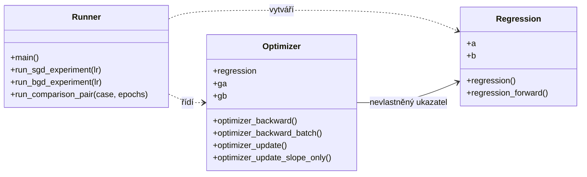
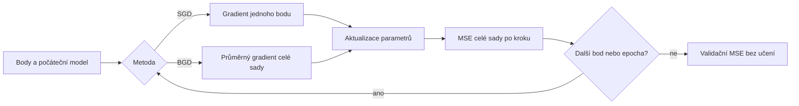
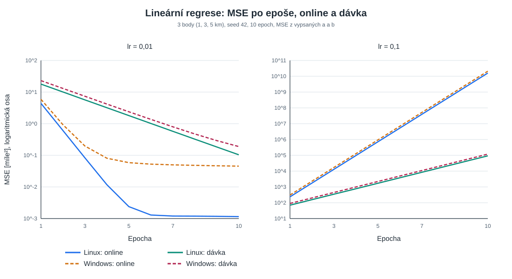
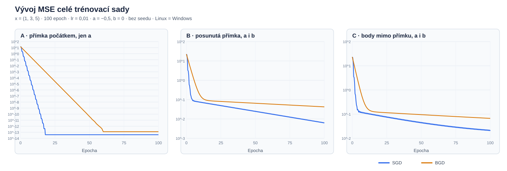
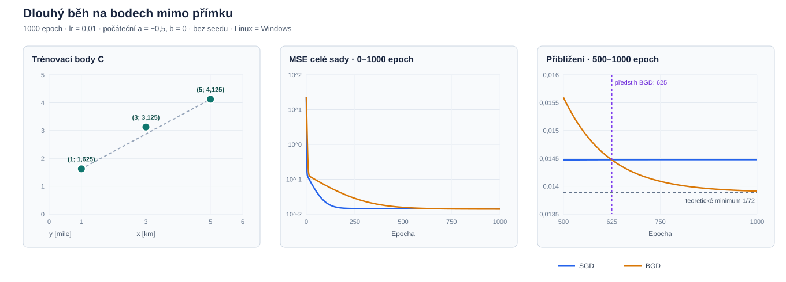

# Specifikace experimentu lineární regrese

- **Projekt:** `001-LinearRegression`
- **Revize:** 30
- **Stav závěru:** odsouhlasen; experiment uzavřen

## 1. Cíl

Projekt ověřuje, jak v C bez frameworku oddělit afinní model
$\hat y=ax+b$ od optimalizátoru a jak se jeho parametry učí pomocí
SGD a BGD. Srovnává vliv rychlosti učení, geometrie bodů a počtu
epoch. Slouží jako malý referenční krok pro pozdější modely neuronů.
Výkon ani spotřeba paměti se zde neměřily.

## 2. Podmínky experimentu

Všechna měření používají tři vstupy $x=(1;3;5)$ km. Základní sada
je zjednodušený převod $y=0{,}625x$ v mílích; nejde o přesný fyzikální
převod. SGD prochází body v uvedeném pořadí a aktualizuje model
po každém bodu. BGD vypočte průměrný gradient všech tří bodů a
aktualizuje model jednou za epochu.

| Běh | Trénovací $y$ [míle] | Učené parametry | Počátek | $\eta$ | Epochy |
|---|---|---|---|---:|---:|
| Základní | $(0{,}625;1{,}875;3{,}125)$ | $a,b$ | `srand(42)` | $0{,}01$ a $0{,}1$ | 10 |
| A | $(0{,}625;1{,}875;3{,}125)$ | jen $a$; $b=0$ | $(-0{,}5;0)$ | $0{,}01$ | 100 |
| B | $(1{,}625;2{,}875;4{,}125)$ | $a,b$ | $(-0{,}5;0)$ | $0{,}01$ | 100 |
| C | $(1{,}625;3{,}125;4{,}125)$ | $a,b$ | $(-0{,}5;0)$ | $0{,}01$ | 100 |
| C1000 | stejná sada jako C | $a,b$ | $(-0{,}5;0)$ | $0{,}01$ | 1000 |

A je přesná přímka počátkem, B přesná přímka s posunem $1$.
Prostřední bod C je o $0{,}25$ míle nad přímkou B; všechny tři body C
proto neleží na jedné přímce. C1000 ověřuje, zda se po delším učení
BGD dostane blíže k minimu MSE než cyklické SGD s konstantním $\eta$.

Model se po tréninku vyhodnotí na dosud nepoužitých vstupech
$x_{\mathrm{val}}=(2;4;6)$ km. Pro základní běh a A jsou cíle
$(1{,}25;2{,}5;3{,}75)$, pro B, C a C1000
$(2{,}25;3{,}5;4{,}75)$ míle. Validační cíle C sledují původní
přímku $0{,}625x+1$ bez odchylky prostředního trénovacího bodu.
Body $2$ a $4$ km testují interpolaci, $6$ km jednoduchou
extrapolaci.

## 3. Teorie a matematika

### 3.1 Model a ztráta

Pro $N>0$ bodů, reziduum $r_i=\hat y_i-y_i$ a odhad
$\hat y_i=ax_i+b$ platí

$$
\operatorname{MSE}(a,b)=\frac{1}{N}\sum_{i=1}^{N}r_i^2.
$$

SGD používá čtvercovou ztrátu jednoho bodu $e_i=r_i^2$.
Její gradient a následná aktualizace jsou

$$
\begin{aligned}
\frac{\partial e_i}{\partial a}&=2r_ix_i,&
\frac{\partial e_i}{\partial b}&=2r_i,\\
a'&=a-\eta\frac{\partial e_i}{\partial a},&
b'&=b-\eta\frac{\partial e_i}{\partial b}.
\end{aligned}
$$

BGD používá gradient MSE celé sady, vypočtený se stejnými parametry
modelu před aktualizací:

$$
\frac{\partial\operatorname{MSE}}{\partial a}
=\frac{2}{N}\sum_{i=1}^{N}r_ix_i,\qquad
\frac{\partial\operatorname{MSE}}{\partial b}
=\frac{2}{N}\sum_{i=1}^{N}r_i.
$$

Gradient ukazuje místní směr změny ztráty. Zmenšení ztráty vyžaduje
vhodné $\eta$; samotná volba BGD nestabilní rychlost učení neopraví.
Pro uvedené vstupy je matice druhých derivací
$H=\frac{2}{3}\begin{pmatrix}35&9\\9&3\end{pmatrix}$.
Její největší vlastní číslo je přibližně $24{,}905$, takže pro
stabilitu BGD vychází
$0<\eta<2/24{,}905\approx0{,}0803$. Hodnota $0{,}1$ je nad mezí.
U jediného bodu $x=5$ násobí krok SGD jeho reziduum faktorem
$1-2\eta(5^2+1)$: při $\eta=0{,}1$ je to $-4{,}2$, při
$\eta=0{,}01$ hodnota $0{,}48$.

### 3.2 Přesné a nekolineární body

Základní sada a A mají optimum $(a,b)=(0{,}625;0)$ s nulovou MSE.
Při učení pouze $a$ na A platí

$$
a'-a_\star=(a-a_\star)(1-2\eta x_i^2).
$$

Pro $\eta=0{,}01<1/25$ každý jednobodový krok v A zmenšuje
odchylku od společného optima. V B se učí dva navzájem působící
parametry; zlepšení právě zpracovaného bodu proto nemusí zlepšit
celou sadu.

Pro C je analytické optimum nejmenších čtverců

$$
a_\star=\frac{5}{8},\qquad b_\star=\frac{13}{12},\qquad
\operatorname{MSE}_{\min}
=\frac{1}{3}\left(\frac{1}{144}+\frac{1}{36}
+\frac{1}{144}\right)=\frac{1}{72}>0.
$$

V optimu je gradient celé MSE nulový, ale jednotlivá rezidua jsou
$(\frac{1}{12};-\frac{1}{6};\frac{1}{12})$. Při konstantním
$\eta$ se tak cyklické SGD může dále pohybovat kolem minima;
BGD používá gradient společného cíle. Kdyby se $\eta$ postupně
snižovalo nebo se měnilo pořadí bodů, výsledek SGD by se mohl změnit.

## 4. Architektura programu

`Regression` uchovává pouze $a,b$ a nezná optimalizátor.
`Optimizer` drží nevlastněný ukazatel na model a poslední gradienty
$g_a,g_b$. `Runner` v `src/main.c` vytváří oba objekty na zásobníku,
řídí trénování a vyhodnocuje validaci.



Veřejné rozhraní tvoří tyto struktury a funkce C:

```c
typedef struct {
    float a;
    float b;
} Regression;

Regression regression(void);
float regression_forward(Regression *self, float x);

typedef struct {
    Regression *regression;
    float ga;
    float gb;
} Optimizer;

Optimizer optimizer(Regression *regression);
float optimizer_backward(Optimizer *self, float x, float y);
float optimizer_backward_batch(Optimizer *self, const float *x,
        const float *y, size_t count);
void optimizer_update(Optimizer *self, float lr);
void optimizer_update_slope_only(Optimizer *self, float lr);
```

`regression()` vrací hodnotovou strukturu; dva výsledky `rand()`
převede do intervalu $[-1,1]$. Pevně inicializované běhy A–C
`rand()` nepoužívají. `optimizer()` rovněž vrací strukturu hodnotou:
uloží ukazatel na model a nevyplněné gradienty se inicializují na
nulu. `optimizer_backward()` vrací ztrátu bodu a přepíše gradienty,
`optimizer_backward_batch()` vrací MSE dávky a průměrné gradienty.
Ani jedna z těchto funkcí model nemění. `optimizer_update()` upraví
$a,b$; varianta `slope_only` pouze $a$.

Model musí žít déle než optimalizátor; platné ukazatele, nenulový
počet bodů a konečné vstupy jsou předpoklady volajícího. V horkých
funkcích se znovu netestují. Dynamická alokace ani HAL nejsou
potřeba. Případná optimalizace výpočtu nebo paralelizace vyžaduje
samostatné měření a nemění cíl optimalizace parametrů modelu.

## 5. Metodologie experimentu



Původní čtyři běhy používají deset epoch a seed 42 nastavený zvlášť
před konstrukcí modelu. A–C používají 100 epoch, C1000 tisíc.
Diagnostické přepočítání MSE po každém kroku slouží k pozorování,
nikoli k měření rychlosti trénování.

## 6. Požadavky a ověření

| ID | Požadavek a rozhodující ověření |
|---|---|
| LR-001, LR-002 | `Regression` má dva `float` parametry a vrací $ax+b$; `test_forward` ověřuje kladný i záporný vstup. |
| LR-008 | Model nezávisí na optimalizátoru; směry závislostí odpovídají diagramu. |
| LR-012 | Konstruktor vytvoří $a,b\in[-1,1]$ bez alokace; `test_constructor` ověřuje rozsah a opakovatelnost seedu na jedné platformě. |
| LR-013 | `Optimizer` odkazuje na živý model a začíná s $g_a=g_b=0$; `test_optimizer_initialization`. |
| LR-014, LR-015 | Z bodu $(x,y)=(2;1)$ při $a=b=0$ vyjde ztráta $1$, gradient $(-4;-2)$ a po kroku $\eta=0{,}1$ model $(0{,}4;0{,}2)$; `test_backward_and_update`. |
| LR-023, LR-025 | Batch vrací MSE a průměrné gradienty bez změny modelu; `test_bgd_gradient_and_update` a `test_bgd_single_and_reference`. |
| LR-028, LR-029 | Validace používá jiné vstupy až po trénování a nemění parametry. |
| LR-031, LR-032 | A–C mají 100 epoch; v A zůstává $b=0$; `test_slope_only_update` a výstupy Runneru. |
| LR-035, LR-036 | C1000 má 1000 epoch; pro $(a,b)=(5/8;13/12)$ je MSE $1/72$ a gradient v toleranci `float` nulový; `test_scattered_batch_optimum` a výstupy Runneru. |
| LR-007 | Projekt se překládá a testuje na `linux_x86_64` a `win32_x86_64`. |

Každý projektový test se spouští cílem `make test`; příkazy pro
překlad a spuštění jsou v `README.md`. Úplný výpis jednotlivých
trénovacích kroků poskytuje program.

## 7. Průběh a výsledky experimentu

### 7.1 Rychlost učení na přesné přímce

Základní čtyři běhy mají kvůli rozdílné implementaci `rand()` různé
počáteční parametry v Linuxu a Windows. V každé platformě ale
SGD a BGD začínají stejně. Tabulka uvádí MSE celé sady po
desáté epoše a MSE na validačních bodech. Trénovací MSE je
přibližně dopočtená ze zaokrouhlených vypsaných parametrů.

| Platforma | $\eta$ | Metoda | Trénovací MSE | Validační MSE |
|---|---:|---|---:|---:|
| Linux | $0{,}01$ | SGD | $0{,}0011508$ | $0{,}000732498$ |
| Linux | $0{,}01$ | BGD | $0{,}10368$ | $0{,}171337$ |
| Windows | $0{,}01$ | SGD | $0{,}0454066$ | $0{,}0286057$ |
| Windows | $0{,}01$ | BGD | $0{,}188701$ | $0{,}163702$ |
| Linux | $0{,}1$ | SGD | $1{,}59972\cdot10^{10}$ | $2{,}55857\cdot10^{10}$ |
| Linux | $0{,}1$ | BGD | $92589{,}2$ | $144946$ |
| Windows | $0{,}1$ | SGD | $2{,}09776\cdot10^{10}$ | $3{,}35513\cdot10^{10}$ |
| Windows | $0{,}1$ | BGD | $119323$ | $186732$ |



Při $\eta=0{,}01$ klesala MSE obou metod; SGD mělo po deseti
epochách nižší chybu, provedlo však 30 aktualizací oproti 10 u BGD.
Při $\eta=0{,}1$ obě metody divergovaly. Nestabilitu tedy nelze
připsat jen jednobodovým aktualizacím.

### 7.2 Geometrie dat po 100 epochách

Následující hodnoty jsou přímá měření MSE po aktualizaci. Počet
růstů označuje kroky, při nichž MSE celé sady vzrostla; BGD
provedlo 100 aktualizací, SGD 300.

| Případ | Metoda | Růst MSE | Trénovací MSE | Validační MSE |
|---|---|---:|---:|---:|
| A | SGD | 0 | $3{,}91\cdot10^{-14}$ | $9{,}95\cdot10^{-14}$ |
| A | BGD | 0 | $1{,}23\cdot10^{-13}$ | $2{,}65\cdot10^{-13}$ |
| B | SGD | 96 | $0{,}006485$ | $0{,}004092$ |
| B | BGD | 0 | $0{,}042251$ | $0{,}034206$ |
| C | SGD | 97 | $0{,}021877$ | $0{,}004696$ |
| C | BGD | 0 | $0{,}066713$ | $0{,}053539$ |



Konkrétní krok v B (epocha 5, bod $x=5$) snížil ztrátu tohoto
bodu z $0{,}010320$ na $0{,}002378$, ale MSE celé sady zvýšil
z $0{,}087208$ na $0{,}092715$. To dokládá, že zlepšení
jednoho bodu nezaručuje zlepšení celé sady ani u přesné
posunuté přímky. A při pevném $b=0$ odpovídá odvozené monotonii.

### 7.3 Nekolineární body po 1000 epochách

Při stejných 1000 průchodech daty použilo SGD 3000 jednobodových
aktualizací a BGD 1000 dávkových. Každá metoda zpracovala 3000
bodových příspěvků do gradientu.

| Metoda | Růst MSE po kroku | Trénovací MSE | Validační MSE | Konečné $(a;b)$ |
|---|---:|---:|---:|---|
| SGD | 1864 | $0{,}0144769438$ | $0{,}00368483481$ | $(0{,}612783074;1{,}10619855)$ |
| BGD | 0 | $0{,}013912187$ | $0{,}00704373186$ | $(0{,}627643883;1{,}07324028)$ |



V epoše 624 měla BGD MSE $0{,}014476791$ oproti
$0{,}0144759761$ u SGD. Od epochy **625** měla BGD nižší
trénovací MSE až do konce. Přiblížila se k teoretickému minimu
$1/72\approx0{,}0138889$ více než SGD. Validační MSE byla
naopak nižší u SGD, protože validační cíle sledují přímku
bez odchylky prostředního trénovacího bodu.

## 8. Omezení a další otázky

Sady mají pouze tři syntetické body. C obsahuje jedinou
odchylku od přímky, nikoli obecný model šumu. SGD používá
pevné pořadí a konstantní $\eta$; při klesajícím $\eta$ nebo
promíchání bodů by se trajektorie změnila. Srovnání po
stejném počtu epoch neporovnává čas aktualizací ani paměť.
Další experiment může použít více rozptýlených bodů,
stanovit kritérium přesnosti a samostatně měřit výpočetní
výkon.

## 9. Vazba na zdrojový kód

| Oblast | Soubor |
|---|---|
| Model | `include/regression/regression.h`, `src/regression.c` |
| Optimalizátor | `include/regression/optimizer.h`, `src/optimizer.c` |
| Řízení a výstup běhů | `src/main.c` |
| Jednotkové testy | `tests/test_regression.c` |
| Překlad a dokumentace API | `Makefile`, `config/`, `Doxyfile` |

## 10. Závěr

Na této trojici nekolineárních bodů s pevným pořadím a
$\eta=0{,}01$ dosáhlo BGD po delším běhu nižší MSE celé
trénovací sady. To je slučitelné s pohybem cyklického SGD
kolem minima při konstantní rychlosti učení. Výsledek
neprokazuje obecnou převahu BGD, lepší validaci ani vyšší
výpočetní výkon. Pro daný účel je implementace použitelná
jako referenční model a kontrola výpočtu gradientů; přesnost
na jiné úloze zatím není stanovena.
**Závěr je odsouhlasen; experiment je uzavřen.**

## 11. Slovník

- **Afinní model:** Přímka $\hat y=ax+b$ se sklonem $a$ a posunem $b$.
- **Reziduum:** Rozdíl předpovědi a cíle, $\hat y_i-y_i$.
- **MSE:** Průměr čtverců reziduí; v tabulkách má jednotku míle$^2$.
- **Gradient:** Vektor parciálních derivací ztráty podle $a$ a $b$.
- **Rychlost učení $\eta$:** Násobek gradientu v aktualizačním kroku.
- **SGD:** Zde jednobodové kroky v pevném pořadí, bez promíchání.
- **Cyklické SGD:** Opakování tohoto pořadí při každé epoše.
- **BGD:** Jeden krok z průměrného gradientu všech bodů za epochu.
- **Epocha:** Jeden úplný průchod trénovacími body.
- **Validační sada:** Body nepoužité k učení, na nichž se měří hotový model.
- **Interpolace:** Odhad mezi krajními trénovacími vstupy.
- **Extrapolace:** Odhad za rozsahem trénovacích vstupů.
- **Nekolineární body:** Body, které neleží na jedné přímce.
- **Analytické optimum:** Parametry nalezené řešením rovnic pro minimum MSE.
- **Dolní mez MSE:** Nejmenší MSE dosažitelná daným modelem na dané sadě.
- **Nevlastněný ukazatel:** Odkaz na model, jehož životnost řídí Runner.
- **HAL:** Vrstva oddělující případný platformní kód; zde není potřebná.
