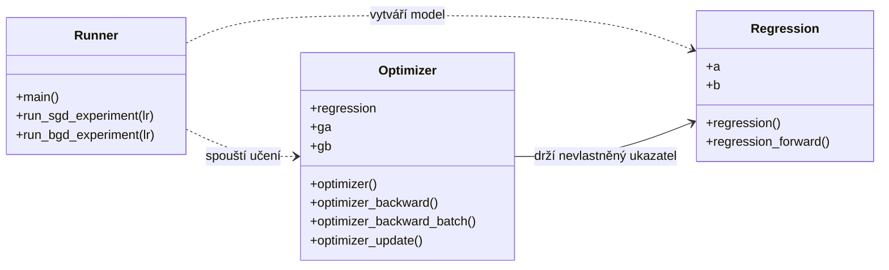
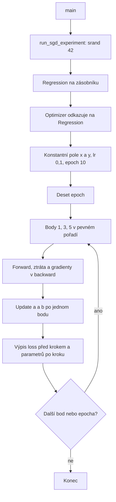
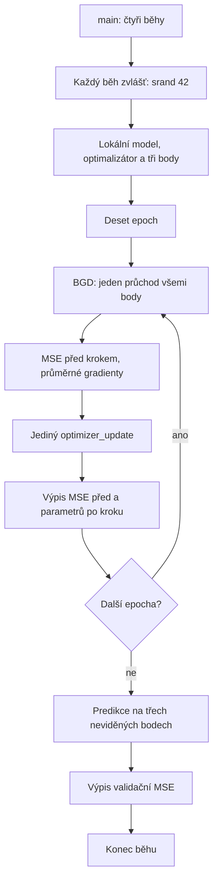
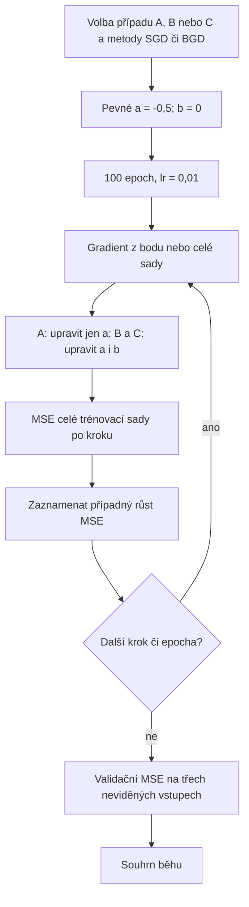
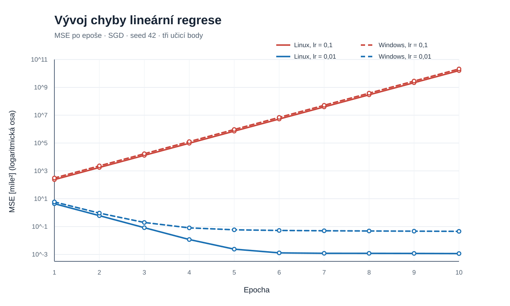

# Specifikace experimentu lineární regrese

- **Projekt:** `001-LinearRegression`
- **Větev:** `experiment/001-linear-regression`
- **Stav dokumentu:** původní i navazující běhy SGD, BGD a validace ověřeny; závěr čeká na odsouhlasení vlastníkem
- **Zdroj pravdy:** tento Markdown soubor
- **Datum:** 2026-11-25
- **Revize:** 26

## 1. Účel dokumentu

Cílem celé řady experimentů je vytvářet vlastní postupy a mechanismy pro programování modelů strojového učení v C bez frameworku určeného pro strojové učení. Hlavní motivací je co nejvyšší výkon na cílovém hardwaru a přímá kontrola nad algoritmem, pamětí a průběhem výpočtu. Vedlejším cílem vlastníka repozitáře je porozumět teoretickému i praktickému fungování strojového učení. Výkonnostní přínos je zatím výzkumným cílem, nikoli naměřeným výsledkem tohoto experimentu.

Primárním cílem první fáze je vytvořit model lineární regrese $\hat y=ax+b$ a ověřit mechanismy optimalizace jeho parametrů $a$ a $b$ v oddělených modulech. Sekundárně fáze porovnává jednobodové kroky SGD s dávkovými kroky BGD a zkoumá vliv rychlosti učení $\eta$ na průběh optimalizace. Převod kilometrů na míle poskytuje kontrolovatelný syntetický vztah; oddělené validační body ověřují výsledek mimo trénovací vstupy.

Dokument odděluje potvrzené návrhové volby vlastníka, naměřené výsledky a dosud neodsouhlasený výklad. Původní čtyři běhy používají seed 42, deset epoch a rychlosti učení $\eta=0{,}01$ a $0{,}1$. Šest navazujících běhů používá pevný počáteční model bez generátoru náhodných čísel, 100 epoch a $\eta=0{,}01$. Všechny běhy procházejí třemi trénovacími body v pevném pořadí. Výsledky, omezení a navržený závěr jsou v oddílu 10.

## 2. Rozsah a hranice

### 2.1 Potvrzený rozsah

- Vstupem dopředného výpočtu je skalár $x$, výstupem odhad $\hat y$.
- Model má dva parametry typu `float`: sklon $a$ a posun $b$.
- Dopředný výpočet vychází ze vztahu $\hat y=ax+b$; vztah $\hat y=ax$ je jeho případ s $b=0$.
- Projekt používá C bez frameworku pro strojové učení, aby bylo možné přímo řídit algoritmus, paměť a výpočet a usilovat o maximální výkon na dostupném hardwaru; výkonnostní přínos vyžaduje samostatné měření.
- Zdrojový kód, veřejné rozhraní, testy a platformní pravidla překladu budou oddělené podle kořenového `AGENTS.md`.

### 2.2 První pozorovací běh a další varianty

Výchozí metodou je SGD se čtvercovou ztrátou: po každém ze tří
bodů se aktualizují oba parametry modelu. BGD (dávkový gradientní sestup) počítá
průměrnou MSE a její gradienty ze všech bodů před jedinou aktualizací
v epoše. Runner nyní provádí obě metody pro $\eta=0{,}01$ i $0{,}1$,
vždy deset epoch a se zvlášť nastaveným seedem 42. Postup nemá
předčasné ukončení ani paralelizaci. Výstupy a výklad jsou v oddílu 10.

### 2.3 Učicí sada prototypu

První prototyp používá záměrně zjednodušený převod kilometrů na míle. Jde o přesně zadanou syntetickou úlohu s poměrem $0{,}625=\frac{5}{8}$ míle na kilometr, nikoli o požadavek na přesný fyzikální převod.

| Bod | Vstup $x$ [km] | Cíl $y$ [míle] |
|---|---:|---:|
| 1 | $1$ | $0{,}625$ |
| 2 | $3$ | $1{,}875$ |
| 3 | $5$ | $3{,}125$ |

Všechny tři dvojice jsou určeny k učení; hodnoty zadal vlastník repozitáře dne 2026-11-25. V obou funkcích Runneru jsou hodnoty uloženy ve dvou konstantních polích `x` a `y` stejné délky, odvozené z tabulky. Pro první verzi se předpokládá, že předaná trénovací data jsou platná. Nezavádí se průběžná kontrola jejich hodnot v dopředném výpočtu ani v kroku optimalizátoru.

### 2.4 Oddělená validační sada

Validační trojice je vybraná ze stejného zjednodušeného vztahu $y=0{,}625x$, ale její hodnoty $x$ se v trénovacích polích nevyskytují. Body $2$ a $4$ km leží mezi trénovacími vstupy, bod $6$ km leží za jejich rozsahem. Jde o kontrolu interpolace a jednoduché extrapolace, nikoli o nezávislé měření na reálných datech.

| Bod | Vstup $x_{\mathrm{val}}$ [km] | Cíl $y_{\mathrm{val}}$ [míle] | Poloha |
|---|---:|---:|---|
| 1 | $2$ | $1{,}25$ | Interpolace. |
| 2 | $4$ | $2{,}5$ | Interpolace. |
| 3 | $6$ | $3{,}75$ | Extrapolace. |

Validační pole `validation_x` a `validation_y` budou v obou funkcích Runneru deklarována hned za trénovacími poli. Optimalizátor se k nim během deseti epoch nedostane; vyhodnocení proběhne jednou až po poslední aktualizaci modelu. Výstupy validace nebudou měnit $a$, $b$, gradienty ani rychlost učení.

### 2.5 Navazující srovnání geometrie dat a počtu parametrů

Následující měření ověří hypotézu, že změna jednoho bodu v SGD může
zhoršit MSE celé sady, přestože se zlepší chyba právě použitého bodu.
Všechny případy používají vstupy $x=(1,3,5)$ km, počáteční
$(a,b)=(-0{,}5;0)$ na obou platformách, $\eta=0{,}01$, pevné pořadí
bodů a 100 epoch. SGD aktualizuje po každém bodu, BGD jednou za epochu.

| Případ | Učené parametry | Trénovací cíle $y$ [míle] | Geometrie |
|---|---|---|---|
| A | Pouze $a$; $b=0$ pevně. | $(0{,}625;1{,}875;3{,}125)$ | Přesná přímka počátkem. |
| B | $a$ a $b$. | $(1{,}625;2{,}875;4{,}125)$ | Přesná přímka s posunem $1$. |
| C | $a$ a $b$. | $(1{,}625;3{,}125;4{,}125)$ | Prostřední bod posunutý o $0{,}25$ míle; body neleží na přímce. |

Případ A používá stejný typ `Regression`, ale aktualizuje jen $a$;
$b$ zůstává po celou dobu nulové. Případy B a C používají současný
dvouparametrový postup. C se od B liší jen prostředním cílem, takže
vliv nesouladu bodů lze oddělit od vlivu druhého volného parametru.
Pevná inicializace eliminuje rozdílnou implementaci `rand()` jako
zdroj rozdílu mezi platformami.

Po poslední epoše se každý model ověří na $x=(2,4,6)$ km. Pro A
jsou validační cíle $(1{,}25;2{,}5;3{,}75)$, pro B a C
$(2{,}25;3{,}5;4{,}75)$ míle. V C validační cíle vyjadřují
neporušenou výchozí přímku $0{,}625x+1$, nikoli šum v učení.
Znamená to kontrolu chování vůči zvolené syntetické referenci,
nikoli důkaz obecné kvality na reálných datech.

## 3. Terminologie a jednotky

| Symbol | Význam | Jednotka |
|---|---|---|
| $x$ | Vstupní souřadnice bodu. | Kilometr. |
| $y$ | Pozorovaná výstupní souřadnice bodu. | Míle. |
| $\hat y$ | Odhad výstupu vrácený modelem. | Míle. |
| $a$ | Sklon přímky, váha násobící vstup. | Míle na kilometr. |
| $b$ | Posun přímky na výstupní ose. | Míle. |
| Reziduum | Rozdíl mezi pozorovaným a odhadnutým výstupem. | Míle. |

## 4. Teorie modelu a koncept učení

Přímka v této úloze převádí jeden vstup na jeden odhad:

$$
\hat y(x)=ax+b
$$

Pro $b=0$ prochází přímka počátkem souřadnic. Změna $a$ mění její sklon, změna $b$ ji posouvá. Při prokládání bodů je třeba určit, jak měřit rozdíl mezi $y$ a $\hat y$ a podle jakého pravidla měnit parametry. Tato dvě rozhodnutí nejsou vlastností samotné dopředné funkce.

Jde o afinní transformaci s identickou aktivací. Sigmoidový neuron používá tutéž transformaci před nelineární aktivací $\sigma(ax+b)$; bez aktivace je výstupem přímo $ax+b$. Myšlenka učení z gradientu se přenáší i na neuronové sítě, ale konkrétní derivace a chování více vrstev se po přidání aktivací mění.

Pro $N>0$ trénovacích bodů je zvoleným výchozím měřítkem střední čtvercová chyba:

$$
\hat y_i=ax_i+b,\qquad
\operatorname{MSE}(a,b)=\frac{1}{N}\sum_{i=1}^{N}(\hat y_i-y_i)^2
$$

Pro SGD s jedním bodem je čtvercová ztráta $e_i(a,b)=(\hat y_i-y_i)^2$. Složky gradientu v aktuálních hodnotách parametrů a aktualizační krok jsou:

$$
\begin{aligned}
g_a &= \frac{\partial e_i}{\partial a}=2(\hat y_i-y_i)x_i,\\
g_b &= \frac{\partial e_i}{\partial b}=2(\hat y_i-y_i),\\
a' &= a-\eta g_a,\\
b' &= b-\eta g_b.
\end{aligned}
$$

$\eta>0$ je rychlost učení. Gradient $\nabla e_i=(g_a,g_b)^\mathsf{T}$ vyjadřuje místní sklon ztráty v současném bodě $(a,b)$, nikoli přesný rozdíl ztrát mezi dvěma vzdálenými nastaveními parametrů. Krok v opačném směru obvykle snižuje ztrátu při vhodném $\eta$; příliš velký krok ji může zvýšit. Při SGD se aktualizuje po jednotlivých bodech. Gradient celé MSE je průměrem gradientů všech bodů; jeho použití pro jedinou aktualizaci je BGD. V tomto prototypu používá SGD pevné pořadí bodů 1, 3, 5, nikoli náhodné losování vzorků. Analytické nejmenší čtverce zůstávají možnou kontrolní základnou, nikoli vybranou metodou trénování.

Pro první pozorovací běh lze odvodit chování jediného kroku na témž
bodu. Je-li reziduum $r_i=\hat y_i-y_i$, po aktualizaci obou parametrů
rychlostí $\eta$ platí:

$$
r_i'=\left[1-2\eta(x_i^2+1)\right]r_i.
$$

Pro $x_i=5$ a $\eta=0{,}1$ je násobek rezidua $-4{,}2$ a čtvercová
ztráta tohoto bodu by bez mezikroků na jiných bodech vzrostla
$17{,}64$krát. Pro $\eta=0{,}01$ je na stejném bodě násobek rezidua $0{,}48$
a jeho čtvercové ztráty $0{,}2304$. Jde o teoretické porovnání
jednotlivého kroku a varování před příliš velkým krokem,
nikoli o změřený průběh celé posloupnosti tří bodů.

### 4.1 Teoretická referenční přímka pro učicí sadu

Za předpokladu zvoleného afinního modelu určují již dva různé vstupy jedinou přímku procházející těmito body. Třetí bod soulad se stejnou přímkou potvrzuje:

$$
a_\star=\frac{1{,}875-0{,}625}{3-1}=0{,}625,\qquad
b_\star=0{,}625-a_\star\cdot1=0
$$

Pro $a_\star$ a $b_\star$ je teoretická MSE na této sadě nulová a očekávaný vztah je $\hat y=0{,}625x$. Tři přesné body postačují jako kontrolní úloha pro tento dvouparametrový model. Samy o sobě nedokazují chování při šumu, odlehlých bodech ani u jiných vztahů; SGD navíc dosáhne referenčních parametrů jen s vhodným průběhem učení.

### 4.2 Teorie BGD (dávkového gradientního sestupu)

Vlastník opravil znaménko v návrhu ztráty: porovnává se rozdíl
$\hat y_i-y_i$, nikoli součet $\hat y_i+y_i$. Pro celou dávku
$N=3$ je zvolena skutečná MSE, tedy průměr čtvercových chyb.
Původně uvažované $\frac{1}{2}\sum_i r_i^2$ by nebylo MSE
a při stejném $\eta$ by změnilo velikost aktualizačního kroku.

$$
\begin{aligned}
r_i &= ax_i+b-y_i,\\
L(a,b)=\frac{1}{N}\sum_{i=1}^{N}r_i^2,\\
g_a &= \frac{\partial L}{\partial a}
    =\frac{2}{N}\sum_{i=1}^{N}r_ix_i,\\
g_b &= \frac{\partial L}{\partial b}
    =\frac{2}{N}\sum_{i=1}^{N}r_i,\\
a' &= a-\eta g_a,\qquad b'=b-\eta g_b.
\end{aligned}
$$

V dávkové variantě se všechna tři rezidua počítají se stejnými
parametry. Až potom proběhne jediná aktualizace. Při $N=1$ se
vzorce rovnají současné ztrátě a gradientům `optimizer_backward`.
Pro testovací model $a=b=0$ vychází $L=\frac{875}{192}$,
$g_a=-\frac{175}{12}$ a $g_b=-\frac{15}{4}$.

U této kvadratické MSE je matice druhých derivací
$H=\frac{2}{3}\begin{pmatrix}35&9\\9&3\end{pmatrix}$.
Její největší vlastní číslo je přibližně $24{,}905$, takže
teoretická mez stability dávkového sestupu s pevným krokem je
$0<\eta<\frac{2}{24{,}905}\approx0{,}0803$.
Hodnota $0{,}1$ je za touto mezí, $0{,}01$ pod ní. Jde o
teoretické očekávání pro gradient průměrné MSE, nikoli o naměřený
výsledek dávkového běhu.

### 4.3 Metrika výsledného modelu na neviděných bodech

Po dokončení učení se pro pevné parametry $a$ a $b$ vypočte
střední čtvercová chyba na validační množině:

$$
\operatorname{MSE}_{\mathrm{val}}(a,b)
=\frac{1}{N_{\mathrm{val}}}\sum_{i=1}^{N_{\mathrm{val}}}
(ax_{\mathrm{val},i}+b-y_{\mathrm{val},i})^2,\qquad
N_{\mathrm{val}}=3.
$$

Tato hodnota posuzuje hotový model na vstupech nepoužitých k
aktualizaci parametrů. Ztráta z trénovací sady ji nenahrazuje.
Protože validační cíle pocházejí ze stejné přesné přímky bez
šumu, nízká validační MSE neprokazuje chování na jiném vztahu
ani odolnost vůči chybám měření.

### 4.4 Očekávání pro tři případy

V A mají všechny body společné optimum $a_\star=0{,}625$.
Po kroku SGD na bodu $i$ platí

$$
a'-a_\star=(a-a_\star)(1-2\eta x_i^2).
$$

Je-li $0<\eta<1/x_i^2$, klesá absolutní odchylka $a$ od optima,
a proto klesá i MSE celé přesné sady. Pro největší $x=5$ je mez
$1/25=0{,}04$; zvolená hodnota $0{,}01$ je pod ní. U B se mění
$a$ i $b$, takže gradient jednoho bodu může zlepšit tento bod a
zhoršit celou sadu. U C body nemají společné nulové reziduum a
jednobodové gradienty mohou směřovat k různým dílčím optimům.
BGD používá gradient průměrné MSE celé sady; očekávaný pokles při
zvoleném kroku bude ověřen měřením, nikoli předpokládán jako výsledek.

Srovnání po 100 epochách zahrnuje 300 aktualizací SGD a 100 BGD.
Proto z něj nelze bez dalšího vyvodit výpočetní efektivitu jedné
metody. Sledují se trajektorie, nikoli časový výkon.

## 5. Požadavky na architekturu řešení

### 5.1 Model `Regression`

Modul modelu nezná optimalizátor. Veřejná struktura obsahuje pouze dva učitelné parametry. Dohodnuté rozhraní má tuto podobu:

```c
typedef struct {
    float a;
    float b;
} Regression;

Regression regression(void);
float regression_forward(Regression *self, float x);
```

`regression()` vrací strukturu hodnotou, bez dynamické alokace. Pro $a$ a $b$ zvlášť zavolá `rand()` a jeho celočíselný výsledek lineárně převede do intervalu $[-1,1]$:

$$
a_0=2\frac{r_a}{\mathrm{RAND\_MAX}}-1,\qquad
b_0=2\frac{r_b}{\mathrm{RAND\_MAX}}-1,\qquad
r_a,r_b\in\{0,\ldots,\mathrm{RAND\_MAX}\}
$$

SGD i BGD nastaví `srand(42)` před vytvořením modelu; konstruktor generátor znovu neseeduje. Na téže platformě tak obě metody začínají ze stejného stavu. První běh používá body z oddílu 2.3. Rozložení a posloupnost hodnot závisí na implementaci `rand()`, takže testy mezi platformami nesmějí předpokládat stejná konkrétní náhodná čísla. `regression_forward` přijímá ukazatel na model a skalár $x$, vrací `float` podle $\hat y=ax+b$ a parametry nemění.

### 5.2 Optimalizátor `Optimizer`

Optimalizátor uchovává gradienty pro poslední zpracovaný bod a nevlastněný ukazatel na model. Veřejná hlavička `include/regression/optimizer.h` používá `include/regression/regression.h`; opačná závislost nevzniká. Dohodnuté rozhraní má tuto podobu:

```c
typedef struct {
    Regression *regression;
    float ga;
    float gb;
} Optimizer;

Optimizer optimizer(Regression *regression);
float optimizer_backward(Optimizer *self, float x, float y);
void optimizer_update(Optimizer *self, float lr);
```

`optimizer` vrací strukturu hodnotou a uloží ukazatel na existující `Regression`. Model musí přežít optimalizátor; ani jeden z těchto objektů nevyžaduje dynamickou alokaci. Dva `float` gradienty zůstávají v `Optimizer`, aby model uchovával pouze své parametry. Konstruktor nastaví `ga = gb = 0`. Dokud `optimizer_backward` nevypočte nové gradienty, `optimizer_update` model nezmění. Oproti předávání modelu do každé funkce stojí toto rozhodnutí jeden uložený ukazatel a vyžaduje dodržet jeho životnost, ale odpovídá zvolenému podpisu `optimizer_update`.

`optimizer_backward` použije uložený model a `regression_forward`, pro jeden bod vypočte $e=(\hat y-y)^2$, uloží $g_a$ a $g_b$ podle oddílu 4 do `self->ga` a `self->gb` a vrátí $e$ jako `float`. Gradienty při dalším volání přepíše; v tomto kroku model nemění. `optimizer_update` teprve potom upraví $a$ a $b$ podle uložených gradientů a rychlosti učení $\mathrm{lr}=\eta$. První běh předpokládá platné pevné `lr = 0.1f` a nepřidává kontrolu neplatných vstupů.

### 5.2.1 Schválené rozšíření pro celou dávku

Původní `optimizer_backward` a `optimizer_update` zůstávají
dostupné. Samostatná funkce pro MSE dosud v projektu není.
Do `include/regression/optimizer.h` se přidá jediná dávková
operace; hlavička kvůli `size_t` přidá `<stddef.h>`:

```c
float optimizer_backward_batch(Optimizer *self, const float *x,
        const float *y, size_t count);
```

Funkce jedním průchodem vrátí MSE před aktualizací a přepíše
`self->ga` a `self->gb` průměrnými gradienty z oddílu 4.2.
Model v této funkci zůstane beze změny. Potom se použije existující
`optimizer_update(self, lr)`; žádná druhá implementace stejného
aktualizačního vzorce nevznikne. Pole mají nejméně `count` prvků,
`count > 0`, platný model a konečné hodnoty jsou předpoklady
volajícího. V horkém průchodu se znovu nekontrolují ukazatele ani
jednotlivé hodnoty.

### 5.3 UML pohled na moduly

Diagram popisuje role modulů v C včetně implementovaného dávkového rozšíření; nejde o objektovou hierarchii. Zobrazuje nyní potvrzené atributy, operace a směry závislostí; tok trénovacích dat a vnitřní běh `Runner` upřesňuje následující postup. Operace v symbolech jsou volné funkce C uvedené v oddílech 5.1 a 5.2, nikoli metody struktur.



| Modul | Soubor / rozhraní | Odpovědnost |
|---|---|---|
| `Runner` | `src/main.c` | Pro každou ze čtyř variant nastaví semínko, vytvoří model a optimalizátor na zásobníku, řídí postup učení a výpis průběhu. `main` volá SGD a BGD funkci pro obě hodnoty `lr`. |
| `Regression` | `src/regression.c`, `include/regression/regression.h` | Uchovává $a$, $b$, inicializuje je a počítá dopředný výstup; nezná zbývající moduly. |
| `Optimizer` | `src/optimizer.c`, `include/regression/optimizer.h` | Odkazuje na model, počítá ztrátu a gradienty a provádí kroky SGD i BGD. |

`tests/main.c` je spouštěč jednotkových testů, nikoli `Runner` experimentu. Trénovací pole jsou lokální konstantní hodnoty obou funkcí Runneru v `src/main.c`. Následující diagram
zachycuje první pozorovací běh; `optimizer_backward` sám volá
`regression_forward`, takže `Runner` neprovádí druhý dopředný výpočet.



Při výpisu je `loss` ztráta vypočtená z parametrů před `update`, zatímco
`a` a `b` jsou hodnoty po aktualizaci. Číslo epochy a vzorku musí výpis
jednoznačně označovat. Překladový a běhový postup nezavádí kontrolu
trénovacích hodnot ani numerické přetečení v horké cestě.

### 5.4 Vstupní předpoklady prototypu

Obě funkce Runneru vytvoří `Regression` a `Optimizer` jako lokální hodnoty na zásobníku:

```c
Regression model = regression();
Optimizer training = optimizer(&model);
```

`Regression` vznikne dříve než `Optimizer` a oba objekty žijí po celý běh učení. Volání používají jejich adresy; `Regression *` uložený v optimalizátoru proto po tuto dobu míří na platný model. `regression_forward`, `optimizer_backward` a `optimizer_update` neprovádějí při každém průchodu opakované kontroly `NULL` u těchto ukazatelů. Platný ukazatel a správná životnost jsou jejich smluvní předpoklady. Porušení předpokladu znamená v C nedefinované chování, nikoli zaručený okamžitý pád.

Pro první verzi se předpokládají také konečné hodnoty parametrů, $x$ a $y$; trénovací data se průběžně nevalidují. Samotná afinní funkce může přijmout i záporné konečné $x$, přestože ukázková sada kilometrů obsahuje jen nezáporné vzdálenosti. Oba běhy předpokládají konečné pevné $\mathrm{lr}$; běhová kontrola rychlosti učení ani numerického přetečení se neprovádí. Při výskytu nekonečna nebo `NaN` jej diagnostika pouze zaznamená a plánovaných deset epoch doběhne. Předpoklad platného `lr` je smlouvou volajícího také pro `optimizer_update`. Tento experiment dynamickou alokaci nepotřebuje; pro budoucí experimenty platí jednorázová kontrola výsledku `lib/alloc` bez opakovaného testování ukazatele v horké části algoritmu.

Implementace byla schválena vlastníkem dne 2026-11-25. Překlad a testy proběhly na `linux_x86_64` a `win32_x86_64`; objekty a programy jsou oddělené v `.cache/$(PLATFORM)/`.

### 5.5 Implementovaný běh BGD v `Runner`

`main()` spustí v tomto pořadí
`run_sgd_experiment(0.01f)`, `run_bgd_experiment(0.01f)`,
`run_sgd_experiment(0.1f)` a `run_bgd_experiment(0.1f)`.
Každá funkce zvlášť zavolá `srand(42)`, vytvoří lokální
`Regression` a `Optimizer` a použije stejné tři konstantní
dvojice. Počet epoch je deset. Tím se na jedné platformě
porovnávají modely se stejným počátečním stavem; konkrétní
hodnoty `rand()` mezi Linuxem a Windows shodné být nemusejí.

SGD funkce pouze přijme `lr` jako argument, její volání
`optimizer_backward` a `optimizer_update` po každém bodu
zůstane zachováno. Dávková funkce v každé epoše jednou
zavolá `optimizer_backward_batch` pro všechny tři body
a pak jednou `optimizer_update`. Před aktualizací vypíše
vrácenou MSE, po aktualizaci nové $a$ a $b$. Výstup je
označen metodou, `lr` a číslem epochy; SGD výstup nadále
obsahuje jednotlivé body. Po každém samostatném běhu runner
vypíše prázdný řádek, který oddělí následující experiment.

Po trénovací smyčce každá funkce Runneru zavolá `regression_forward`
na třech validačních vstupech, vypíše cíl a predikci každého
bodu a spočítá `validation_mse` podle oddílu 4.3. Pro validaci
nevzniká dynamická alokace a nevolá se `optimizer_backward`,
`optimizer_backward_batch` ani `optimizer_update`. Výpis
validačních výsledků předchází oddělovacímu prázdnému řádku.



Pro společný graf se po každé epoše vyhodnotí MSE všech bodů
se stejnými konečnými parametry. Toto vyhodnocení se může
odvodit z vypsaných $a$ a $b$ jako v oddílu 10.1; nesmí se
zaměnit se ztrátou jednotlivého kroku před aktualizací.

### 5.6 Runner pro srovnání A, B a C

Runner přidá šest oddělených běhů po původních čtyřech: SGD a BGD
pro každý případ A, B, C. Pro A se přidá jediná operace optimalizátoru
`optimizer_update_slope_only(self, lr)`, která použije uložené $g_a$
a ponechá $b$ beze změny. Výpočet ztráty a gradientů zůstává v
`optimizer_backward` a `optimizer_backward_batch`. Pro B a C se
použije stávající `optimizer_update`.

Runner po každé aktualizaci vyhodnotí MSE všech tří trénovacích bodů
se stejnými novými parametry a vypíše ji spolu s epochou, krokem,
$a$ a $b$. U každého běhu také spočítá, kolikrát tato MSE oproti
předchozímu kroku vzrostla. Po 100 epochách vypíše konečnou MSE a
validační MSE. Diagnostický průchod navíc slouží jen k pozorování;
jeho časová režie není měřením rychlosti učení.



## 6. Výpočetní optimalizace a paralelizace

Optimalizace parametrů modelu řeší matematickou úlohu prokládání bodů. Optimalizace jejího výpočtu je samostatná technická úloha: volba rozložení bodů v paměti, průchodů daty, redukce součtů, vektorizace a případné rozdělení mezi vlákna. Před návrhem těchto změn se musí nejprve ustálit referenční sekvenční chování a měřítka přesnosti.

U jednoduchého modelu se dvěma parametry může režie obecného frameworku nebo paralelního plánování převážit samotný výpočet. To je hypotéza k měření, nikoli již dosažený výsledek. Každá optimalizace musí být porovnána se stejným problémem, daty, přesností a hardwarem. Dávkový průchod použije tři skalární akumulátory typu `float` pro součet ztrát a obou gradientů, každý bod vyhodnotí jednou a až po cyklu vydělí součty počtem bodů. Nepotřebuje dynamickou alokaci, vektorizaci ani vlákna. Pro větší sady se zvlášť posoudí numerická přesnost akumulace. SGD provede tři aktualizace na epochu, BGD jednu; porovnání po stejném počtu epoch proto neizoluje samotnou režii jedné aktualizace.

## 7. Předběžné normativní požadavky

| ID | Požadavek | Stav |
|---|---|---|
| LR-001 | Typ `Regression` musí uchovávat `a` a `b` jako `float`. | Odvozeno přímo ze zadání. |
| LR-002 | Dopředná funkce musí vrátit $\hat y=ax+b$. | Odvozeno přímo ze zadání. |
| LR-003 | Varianta bez posunu musí být reprezentovatelná jako $b=0$. | Odvozeno přímo ze zadání. |
| LR-004 | Produkční kód nesmí záviset na frameworku pro strojové učení. | Potvrzené pravidlo repozitáře. |
| LR-005 | Jednotkové testy musí ověřit dopřednou funkci a později zvolenou metodu učení. | Potvrzené pravidlo repozitáře. |
| LR-006 | Volba trénovacího algoritmu a akceptačních kritérií musí být schválena před jejich implementací. | Potvrzené pravidlo repozitáře. |
| LR-007 | Překlad musí podporovat `linux_x86_64` a `win32_x86_64`. | Ověřeno překladem a testy obou platforem. |
| LR-008 | Modul regrese nesmí záviset na optimalizátoru; optimalizátor používá veřejné rozhraní regrese. | Potvrzená architektura. |
| LR-009 | `optimizer_backward` musí pro jeden bod vrátit čtvercovou ztrátu; průměr těchto ztrát pro $N>0$ bodů odpovídá MSE. | Potvrzená numerická smlouva. |
| LR-010 | SGD musí počítat gradient čtvercové ztráty vůči $a$ a $b$ a aktualizovat oba parametry v opačném směru. | Potvrzené SGD kroky po jednotlivých bodech. |
| LR-011 | `Runner` v `src/main.c` musí koordinovat použití `Regression` a `Optimizer`; závislosti mezi moduly musí odpovídat diagramu v oddílu 5.3. | Potvrzená architektura. |
| LR-012 | `regression()` musí vrátit hodnotovou strukturu s parametry v intervalu $[-1,1]$, získanými dvěma voláními `rand()` bez dynamické alokace. | Potvrzená architektura; numerické detaily se ověří. |
| LR-013 | `Optimizer` musí obsahovat nevlastněný ukazatel na `Regression` a vlastní `float` gradienty `ga` a `gb`, inicializované na nulu; model musí žít déle než optimalizátor. | Potvrzená architektura. |
| LR-014 | `optimizer_backward` musí vrátit čtvercovou ztrátu jednoho bodu, uložit gradienty do `Optimizer` a ponechat model beze změny. | Potvrzený postup SGD. |
| LR-015 | `optimizer_update` musí upravit $a$ a $b$ podle uložených gradientů a argumentu $\mathrm{lr}$. | Společný krok SGD a BGD; první běh předpokládá platné $\mathrm{lr}$ bez průběžné kontroly. |
| LR-016 | První prototyp musí použít učicí dvojice $(1;0{,}625)$, $(3;1{,}875)$ a $(5;3{,}125)$ ve vztahu kilometrů k mílím. | Potvrzená učicí sada. |
| LR-017 | První verze musí považovat trénovací hodnoty $x$ a $y$ za platné vstupy a neprovádět jejich průběžnou validaci v modelu ani optimalizátoru. | Potvrzený vstupní předpoklad. |
| LR-018 | `run_sgd_experiment()` musí vytvořit model a optimalizátor jako lokální hodnoty, předávat jejich adresy a udržet model živý po celou dobu používání optimalizátoru; `main` tuto funkci zavolá; horké funkce nesmějí opakovat `NULL` kontroly těchto ukazatelů. | Potvrzený přístup k životnosti a výkonu. |
| LR-019 | `run_sgd_experiment()` musí zavolat `srand(42)` před `regression()`, poté vytvořit `Optimizer` nad lokálním modelem a uložit tři body do konstantních polí `x` a `y`. `main` tuto funkci pouze zavolá. | Potvrzený první běh. |
| LR-020 | SGD experiment musí provést přesně deset epoch v pevném pořadí bodů 1, 3, 5 a po každém bodu zavolat `optimizer_backward` a `optimizer_update`, bez dávkování či předčasného zastavení. | Potvrzený první běh. |
| LR-021 | První běh musí používat pevné `lr = 0.1f` a po každém bodu vypsat číslo epochy, bodu, ztrátu před krokem a `a`, `b` po kroku. | Potvrzená diagnostika. |
| LR-022 | Horké funkce ani SGD experiment nebudou při prvním běhu průběžně kontrolovat platnost bodů, `lr` či numerické přetečení. | Potvrzený pozorovací režim. |
| LR-023 | `optimizer_backward_batch` musí pro `count > 0` vrátit MSE celé dávky a zapsat průměrné gradienty podle oddílu 4.2, bez změny modelu. | Implementováno a ověřeno na obou platformách. |
| LR-024 | Dávková ztráta a gradienty musí vzniknout jedním průchodem bez dynamické alokace; vstupní pole a počet jsou předpoklady volajícího. | Implementováno a ověřeno na obou platformách. |
| LR-025 | Po dávkovém zpětném průchodu se musí použít stávající `optimizer_update`; původní SGD rozhraní a chování zůstává dostupné. | Implementováno a ověřeno na obou platformách. |
| LR-026 | `main` musí spustit SGD a BGD pro `lr = 0.01f` i `lr = 0.1f`; každý běh zvlášť nastaví seed 42 a provede deset epoch na stejných třech bodech. | Implementováno a ověřeno na obou platformách. |
| LR-027 | Dávkový běh musí po každé epoše vypsat MSE před aktualizací a parametry po ní, s označením metody a `lr`; po každém experimentu runner vypíše prázdný oddělovací řádek. | Implementováno a ověřeno na obou platformách. |
| LR-028 | Každý běh musí mít oddělená konstantní validační pole s body $(2;1{,}25)$, $(4;2{,}5)$ a $(6;3{,}75)$, která se během učení nesmějí předat optimalizátoru. | Implementováno a ověřeno na obou platformách. |
| LR-029 | Po desáté epoše musí každý ze čtyř běhů vypsat pro každý validační bod $x$, cíl a predikci podle finálního modelu a jednou spočítat validační MSE jako průměr tří čtvercových reziduí. | Implementováno a ověřeno na obou platformách. |
| LR-030 | Validace nesmí změnit parametry modelu a musí proběhnout před prázdným řádkem oddělujícím experimenty. | Implementováno a ověřeno na obou platformách. |
| LR-031 | Runner musí po původních čtyřech bězích provést šest srovnávacích běhů A–C pro SGD a BGD s daty z oddílu 2.5, pevnou inicializací a 100 epochami. | Implementováno a ověřeno na obou platformách. |
| LR-032 | V A se musí aktualizovat pouze $a$ a $b$ musí zůstat přesně nulové; B a C aktualizují oba parametry. | Implementováno a ověřeno na obou platformách. |
| LR-033 | Po každé aktualizaci musí být vyhodnocena a vypsána MSE celé trénovací sady; souhrn musí obsahovat počet jejích zvýšení mezi sousedními kroky. | Implementováno a ověřeno na obou platformách. |
| LR-034 | Každý srovnávací běh musí po tréninku vypsat validační MSE z bodů v oddílu 2.5 bez úpravy modelu. | Implementováno a ověřeno na obou platformách. |

Kritéria konvergence a přesnosti parametrů se stanoví až z pozorovaných
výsledků prvního běhu; identifikátory požadavků zůstanou stabilní.
Závěry o použitelnosti budou navržené, dokud je vlastník výslovně neodsouhlasí.

## 8. Akceptační scénáře a plán ověření

| ID | Požadavky | Vstup / podmínka | Očekávaný výsledek | Stav |
|---|---|---|---|---|
| LR-T01 | LR-001, LR-002 | $a=2$, $b=1$, $x=3$ | $\hat y=7$ | Splněno na obou platformách: test_forward. |
| LR-T02 | LR-002, LR-003 | $a=2$, $b=0$, $x=3$ | $\hat y=6$ | Splněno na obou platformách: test_forward. |
| LR-T03 | LR-002 | $a=-1$, $b=2$, $x=-2$ | $\hat y=4$ | Splněno na obou platformách: test_forward. |
| LR-T04 | LR-009 | Dva body s rozdíly $\hat y_i-y_i$ rovnými $-1$ a $-2$ | $\operatorname{MSE}=\frac{1+4}{2}=2{,}5$ | Splněno na obou platformách: test_squared_loss_and_reference. |
| LR-T05 | LR-010, LR-013, LR-014, LR-015 | $a=b=0$, $x=2$, $y=1$, $\mathrm{lr}=0{,}1$ | `backward` vrátí $e=1$ a uloží $g_a=-4$, $g_b=-2$ bez změny modelu; `update` nastaví $a'=0{,}4$, $b'=0{,}2$ | Splněno na obou platformách: test_backward_and_update. |
| LR-T06 | LR-008, LR-011 | Kontrola závislostí zdrojových modulů | `Runner` používá model a optimalizátor; `Optimizer` používá model; `Regression` nemá závislost na zbývajících dvou modulech. | Ověřeno kontrolou závislostí a překladem na obou platformách. |
| LR-T07 | LR-012 | Dvě volání `regression()` po `srand(seed)` s pevným semínkem | Oba parametry leží v $[-1,1]$; opakování se stejným semínkem na téže platformě vrátí stejnou dvojici modelů. | Splněno na obou platformách: test_constructor. |
| LR-T08 | LR-013 | `Optimizer` vytvořený nad existujícím `Regression` | Uložený ukazatel směřuje na předaný model, `ga = gb = 0`; vytvoření nevyžaduje dynamickou alokaci. | Splněno na obou platformách: test_optimizer_initialization. |
| LR-T09 | LR-013, LR-015 | `optimizer_update` volaný po konstrukci, před `optimizer_backward` | Parametry modelu se nezmění. | Splněno na obou platformách: test_optimizer_initialization. |
| LR-T10 | LR-016 | Tři dvojice z oddílu 2.3 a referenční parametry $a=0{,}625$, $b=0$ | Všechny tři odhady se rovnají cílům a $\operatorname{MSE}=0$. | Splněno na obou platformách: test_squared_loss_and_reference. |
| LR-T11 | LR-013, LR-018, LR-019 | Kontrola `src/main.c` a volání modelu/optimalizátoru | Obě struktury jsou lokální v `run_sgd_experiment()`, `Optimizer` drží adresu živého modelu a horké funkce neobsahují opakované kontroly `NULL`. | Ověřeno kontrolou zdrojového kódu a překladem. |
| LR-T12 | LR-019, LR-020, LR-021 | Spuštění SGD experimentu se seedem 42 | Přesně 30 výpisů v pořadí deseti epoch a tří bodů, se ztrátou před a parametry po každém kroku. | Splněno na obou platformách: 30 řádků, správné pořadí, opakovatelný běh. |
| LR-T13 | LR-023, LR-024 | $a=b=0$, celá trojice z oddílu 2.3 | $L=875/192$, $g_a=-175/12$, $g_b=-15/4$; model se při `backward_batch` nezmění. | Splněno na obou platformách. |
| LR-T14 | LR-023, LR-025 | Jednobodová dávka a referenční přímka $(0{,}625;0)$ | Pro jeden bod stejná ztráta a gradienty jako u SGD funkce; pro referenční přímku nulová MSE a gradienty. | Splněno na obou platformách. |
| LR-T15 | LR-025 | Gradienty z LR-T13 a `lr = 0.01f` | Stávající `optimizer_update` nastaví $a=7/48$ a $b=0{,}0375$. | Splněno na obou platformách. |
| LR-T16 | LR-026, LR-027 | `make exec` na obou platformách | Čtyři oddělené běhy, shodný počáteční model v každé dvojici na téže platformě, 30 kroků SGD a 10 kroků BGD pro každé `lr`, s prázdným řádkem po každém běhu. | Splněno na obou platformách. |
| LR-T17 | LR-028 až LR-030 | Čtyři běhy na obou platformách | Každý běh vypíše tři dosud neviděné body, jejich predikce a jednu validační MSE po trénování; MSE odpovídá vypsanému finálnímu modelu s tolerancí zaokrouhlení. | Splněno integrační kontrolou na obou platformách. |
| LR-T18 | LR-032 | Model s $b=0$, uložený gradient $g_a$ | `optimizer_update_slope_only` mění pouze $a$; $b$ zůstává přesně nula po SGD i BGD zpětném průchodu. | Splněno na obou platformách. |
| LR-T19 | LR-031, LR-033, LR-034 | Spuštění šesti běhů na Linuxu a Windows | Každý má 100 epoch, správný počet kroků, počty růstů MSE a validační souhrn; původní čtyři běhy zůstanou stejné. | Splněno na obou platformách. |

Jednotkové testy používají sdílený `lib/unit` a ověřují výpočty bez závislosti na konkrétních hodnotách `rand()` jiné platformy. `tests/test_regression.c` mapuje LR-T01 až LR-T03 na `test_forward`, LR-T04 a LR-T10 na `test_squared_loss_and_reference`, LR-T05 na `test_backward_and_update`, LR-T07 na `test_constructor` a LR-T08 až LR-T09 na `test_optimizer_initialization`. LR-T13 a LR-T15 pokrývá `test_bgd_gradient_and_update`, LR-T14 `test_bgd_single_and_reference`, LR-T18 `test_slope_only_update`. LR-T06 a LR-T11 jsou kontrolou zdrojového kódu, LR-T12, LR-T16, LR-T17 a LR-T19 integračním spuštěním. Příkazy a výsledky jsou v oddílu 10.

## 9. Rozhodnutí a otevřené otázky pro brainstorming

| ID | Otázka | Možnosti k diskusi |
|---|---|---|
| LR-OP-01 | Jaká je ztráta pro jeden krok SGD? | Rozhodnuto: $e_i=(\hat y_i-y_i)^2$, tedy MSE pro jeden bod. |
| LR-OP-02 | Jak řídit průchod SGD? | Rozhodnuto pro první běh: pevné pořadí 1, 3, 5, deset epoch, `lr = 0.1f`, aktualizace po bodu, bez mini dávek a předčasného ukončení. |
| LR-OP-03 | Mají se učit oba parametry? | Rozhodnuto: $a$ i $b$; $b=0$ lze použít jako počáteční hodnotu. |
| LR-OP-04 | Odkud přicházejí body a jak jsou uloženy? | Rozhodnuto: dvě lokální konstantní pole `x` a `y` v `run_sgd_experiment()` podle oddílu 2.3. |
| LR-OP-05 | Jaký je veřejný podpis dopředné funkce? | Rozhodnuto: `float regression_forward(Regression *self, float x)`. |
| LR-OP-06 | Jak posoudit výsledek? | Metriky, tolerance, degenerované vstupy, srovnávací základna a paměťové měření. |
| LR-OP-07 | Jak prezentovat proložení bodů? | První běh vypíše po každém vzorku epochu, bod, ztrátu před krokem a `a`, `b` po kroku. Graf nebo export mohou následovat po vyhodnocení. |
| LR-OP-08 | Jak zvolit semínko generátoru? | Rozhodnuto: Každý pozorovací běh volá `srand(42)` před vytvořením modelu. Výsledné hodnoty `rand()` se mohou mezi platformami lišit. |
| LR-OP-09 | Jak řešit neplatné vstupy a pořadí volání? | Rozhodnuto: `ga = gb = 0`, `update` před `backward` nic nezmění; trénovací $x$, $y$ a ukazatele na živé lokální objekty se považují za platné bez opakovaných kontrol. Pro první běh se `lr` ani přetečení neověřují; případný `NaN` či nekonečno se zaznamená jako pozorování. |
| LR-OP-10 | Způsobuje aktualizace po jednotlivých bodech kolísání jejich ztrát? | Srovnání při `lr = 0.01f` a `0.1f` provedeno: BGD při vysokém `lr` také diverguje. Příčinu dočasného růstu ztráty jednotlivého bodu toto měření samo neizoluje; viz oddíl 10.2. |

Oddělení modelu od optimalizátoru, MSE a SGD odpovídají nynějšímu rozhodnutí vlastníka. SGD je vhodné jako jednoduchý výchozí postup pro pozdější zkoumání učení neuronů; pro dvouparametrovou regresi lze jeho výsledek později porovnat s analytickým řešením. Jeho výběr zatím není důkazem lepší rychlosti ani paměťové úspory. Běhy s `lr = 0.01f` a `0.1f` jsou nyní zaznamenány v oddílu 10; další parametry vyžadují nové rozhodnutí.

## 10. Výsledky testování a závěr

Dne 2026-11-25 prošly z adresáře projektu příkazy
`make PLATFORM=linux_x86_64 -j4 test build` v WSL Arch a
`mingw32-make PLATFORM=win32_x86_64 -j4 test build` ve Windows.
Původně na obou platformách prošlo pět jednotkových případů. Po dávkovém rozšíření prošlo všech sedm případů bez selhání.
Původní samostatná spuštění `make PLATFORM=linux_x86_64 exec` a
`mingw32-make PLATFORM=win32_x86_64 exec` vypsala vždy 30 kroků
v pořadí deseti epoch a tří bodů. Opakované spuštění na každé platformě
vrátilo stejný text. Překlad používal `-std=c11 -O2 -Wall -Wextra -Werror -pedantic`. Linux: GCC 16.2.1 (WSL Arch); Windows: MSYS2 GCC 16.2.0.
Procesor: Intel Core i7-8565U. Síť ani externí modelové váhy se nepoužily.

Následující tabulka ukazuje každou aktualizaci; čísla jsou zaokrouhlena
na pět platných číslic. Ztráta je měřena **před** aktualizací daného bodu,
parametry $a$ a $b$ jsou hodnoty **po** ní. Přesný výpis vrátí `make exec`.
Počáteční model byl v Linuxu $(a,b)=(-0{,}93306011;-0{,}340071559)$,
ve Windows $(-0{,}98931855;-0{,}975585222)$. Rozdíl je dán platformní
implementací `rand()`.

| Epocha | Bod | Linux: ztráta | Linux: $a$ | Linux: $b$ | Windows: ztráta | Windows: $a$ | Windows: $b$ |
|---:|---:|---:|---:|---:|---:|---:|---:|
| 1 | 1 | 3.6029 | -0.55343 | 0.039555 | 6.7076 | -0.47134 | -0.4576 |
| 1 | 2 | 12.22 | 1.544 | 0.7387 | 14.037 | 1.7766 | 0.29172 |
| 1 | 3 | 28.449 | -3.7898 | -0.32805 | 36.601 | -4.2733 | -0.91826 |
| 2 | 1 | 22.494 | -2.8412 | 0.62051 | 33.832 | -3.1099 | 0.24504 |
| 2 | 2 | 95.611 | 3.0257 | 2.5761 | 120.12 | 3.4659 | 2.437 |
| 2 | 3 | 212.56 | -11.554 | -0.33975 | 276.95 | -13.176 | -0.89133 |
| 3 | 1 | 156.71 | -9.05 | 2.1639 | 215.86 | -10.237 | 2.0471 |
| 3 | 2 | 721.52 | 7.0667 | 7.5362 | 932.68 | 8.0866 | 8.1551 |
| 3 | 3 | 1579.6 | -32.678 | -0.41272 | 2066.9 | -37.376 | -0.93756 |
| 4 | 1 | 1136.7 | -25.935 | 6.3304 | 1516.2 | -29.589 | 6.8503 |
| 4 | 2 | 5380 | 18.075 | 21 | 7020.9 | 20.686 | 23.608 |
| 4 | 3 | 11718 | -90.173 | -0.64943 | 15354 | -103.23 | -1.1741 |
| 5 | 1 | 8362.7 | -71.884 | 17.64 | 11030 | -82.221 | 19.831 |
| 5 | 2 | 39955 | 48.048 | 57.617 | 52307 | 55.004 | 65.573 |
| 5 | 3 | 86867 | -246.68 | -1.3291 | 1.1388e+05 | -282.46 | -1.9203 |
| 6 | 1 | 61821 | -196.96 | 48.399 | 81229 | -225.46 | 55.081 |
| 6 | 2 | 2.9631e+05 | 129.65 | 157.27 | 3.8835e+05 | 148.44 | 179.72 |
| 6 | 3 | 6.4384e+05 | -672.75 | -3.2118 | 8.4422e+05 | -770.37 | -4.0468 |
| 7 | 1 | 4.5777e+05 | -537.43 | 132.1 | 6.0069e+05 | -615.36 | 150.96 |
| 7 | 2 | 2.1965e+06 | 351.81 | 428.52 | 2.8798e+06 | 402.84 | 490.36 |
| 7 | 3 | 4.7717e+06 | -1832.6 | -8.3676 | 6.2571e+06 | -2098.6 | -9.9234 |
| 8 | 1 | 3.3915e+06 | -1464.3 | 359.95 | 4.4484e+06 | -1676.8 | 411.9 |
| 8 | 2 | 1.628e+07 | 956.59 | 1166.9 | 2.1347e+07 | 1095.4 | 1336 |
| 8 | 3 | 3.5364e+07 | -4990.1 | -22.431 | 4.6373e+07 | -5714.4 | -26.002 |
| 9 | 1 | 2.5132e+07 | -3987.5 | 980.21 | 3.2959e+07 | -4566.2 | 1122.2 |
| 9 | 2 | 1.2065e+08 | 2603 | 3177 | 1.5821e+08 | 2980.8 | 3637.8 |
| 9 | 3 | 2.6208e+08 | -13586 | -60.742 | 3.4368e+08 | -15558 | -69.851 |
| 10 | 1 | 1.8625e+08 | -10856 | 2668.7 | 2.4424e+08 | -12432 | 3055.8 |
| 10 | 2 | 8.9417e+08 | 7085.1 | 8649.2 | 1.1725e+09 | 8113.3 | 9904.3 |
| 10 | 3 | 1.9423e+09 | -36986 | -165.06 | 2.547e+09 | -42354 | -189.29 |

Ztráta třetího bodu vzrostla v Linuxu z $28{,}4491615$ po první epoše
na $1{,}94229811\cdot10^9$ v desáté; ve Windows z $36{,}6010818$ na
$2{,}54699469\cdot10^9$. Obě posloupnosti se tedy při `lr = 0.1f`
od referenčních parametrů vzdalují. To je v souladu s odvozením
v oddílu 4: samotný krok na $x=5$ násobí jeho reziduum faktorem $-4{,}2$.
Odvození vysvětluje riziko velkého kroku, ale nenahrazuje měření celé
posloupnosti; v běhu se mezi opakováními bodu $x=5$ mění model i na
ostatních dvou bodech.

### 10.1 Doplňující pozorování při $\eta=0{,}01$

Dne 2026-11-25 vlastník zkusil v pracovním stromu změnit `lr` z `0.1f` na `0.01f`. Nyní runner spouští obě hodnoty v jednom programu. Při stejných třech bodech, seedu 42 a deseti epochách
byl znovu spuštěn `make PLATFORM=linux_x86_64 exec` v WSL Arch a
`mingw32-make PLATFORM=win32_x86_64 exec` ve Windows. Oba běhy
vypsaly 30 kroků.

Pro srovnání epoch byla z hodnot $a$ a $b$ vypsaných po třetím bodu
vypočtena MSE celé trojice podle rovnice v oddílu 4. Jde o **odvozenou
hodnotu z výpisu zaokrouhleného na devět platných číslic**, nikoli o
samostatné měření MSE uvnitř programu. Hodnoty v tabulce jsou přibližné:

| Epocha | MSE po epoše, Linux | MSE po epoše, Windows |
|---:|---:|---:|
| 1 | 4,39579732 | 5,89804957 |
| 2 | 0,607367871 | 0,927163973 |
| 3 | 0,0831486471 | 0,196849255 |
| 4 | 0,011717784 | 0,0807702486 |
| 5 | 0,00237971834 | 0,058599886 |
| 6 | 0,00129182992 | 0,0525598163 |
| 7 | 0,00120112668 | 0,0499039603 |
| 8 | 0,00119302589 | 0,0481575106 |
| 9 | 0,00117605602 | 0,0467181322 |
| 10 | 0,0011508 | 0,0454066303 |

Na obou platformách tak MSE po každé epoše v tomto běhu klesla.
Po desáté epoše byly parametry v Linuxu přibližně
$(a,b)=(0{,}608672321;0{,}069956474)$ a ve Windows
$(0{,}726736009;-0{,}43864736)$; referencí je
$(0{,}625;0)$. Ztráta jednotlivého bodu před jeho aktualizací
není totéž co MSE modelu po epoše: ve Windows ztráta bodu $x=5$
po páté epoše dočasně vzrostla, přestože MSE celé sady dále klesala.

Pozorování podporuje vysvětlení, že `lr = 0.1f` způsobovalo
přestřelování minima a divergenci tohoto běhu; `lr = 0.01f`
vedlo za stejných podmínek k poklesu celkové ztráty. Odvození
faktoru $0{,}48$ pro jeden krok na $x=5$ je s tím slučitelné,
ale samo o sobě nezaručuje pokles MSE po celé epoše.



**Obrázek 1:** MSE celé učicí sady po každé epoše v mílích na druhou. Svislá osa je logaritmická; plná čára označuje Linux a přerušovaná Windows. Červeně je $\eta=0{,}1$, modře $\eta=0{,}01$. Hodnoty pro $0{,}1$ byly odvozeny z parametrů zaokrouhlených v tabulce výše na pět platných číslic, hodnoty pro $0{,}01$ pocházejí z tabulky v tomto oddílu. Graf je proto přibližný a zobrazuje MSE po epoše, nikoli jednotlivé `loss_before`.

### 10.2 Srovnání SGD a BGD

Dne 2026-11-25 byly na obou platformách znovu sestaveny oba programy
a spuštěno sedm jednotkových testů (`test build`). Produkční binární
soubor byl následně spuštěn pro čtyři varianty v jednom procesu. Každá
varianta nastavila `srand(42)` a začala stejným modelem jako její
protějšek na téže platformě. Linux začínal s
$(a,b)=(-0{,}93306011;-0{,}340071559)$, Windows s
$(-0{,}98931855;-0{,}975585222)$. Každý běh SGD vypsal 30
aktualizací, každý běh BGD 10. Překlad a spuštění:

```sh
make PLATFORM=linux_x86_64 test build
make PLATFORM=linux_x86_64 exec
```

```powershell
mingw32-make PLATFORM=win32_x86_64 test build
mingw32-make PLATFORM=win32_x86_64 exec
```

Tabulky udávají **MSE celé trojice po epoše** v mílích na druhou.
Je vypočtena z konečných $a$ a $b$ vypsaných programem na devět
platných číslic. Jde o přibližnou odvozenou metriku. Vypisovaná
`loss_before` SGD patří jednomu bodu před jeho krokem;
`mse_before` BGD celé trojici před jediným krokem. Tyto dvě
hodnoty nejsou srovnatelné přímo ani s MSE po epoše.

#### $\eta=0,01$

| Epocha | Linux SGD | Linux BGD | Windows SGD | Windows BGD |
|---:|---:|---:|---:|---:|
| 1 | 4,3958 | 17,8296 | 5,89805 | 23,037 |
| 2 | 0,607368 | 10,0549 | 0,927164 | 13,0171 |
| 3 | 0,0831486 | 5,67062 | 0,196849 | 7,36641 |
| 4 | 0,0117178 | 3,1982 | 0,0807702 | 4,17961 |
| 5 | 0,00237972 | 1,80393 | 0,0585999 | 2,38228 |
| 6 | 0,00129183 | 1,01766 | 0,0525598 | 1,3685 |
| 7 | 0,00120113 | 0,574261 | 0,049904 | 0,796591 |
| 8 | 0,00119303 | 0,324214 | 0,0481575 | 0,473864 |
| 9 | 0,00117606 | 0,183203 | 0,0467181 | 0,29166 |
| 10 | 0,0011508 | 0,10368 | 0,0454066 | 0,188701 |

#### $\eta=0,1$

| Epocha | Linux SGD | Linux BGD | Windows SGD | Windows BGD |
|---:|---:|---:|---:|---:|
| 1 | 236,182 | 70,2374 | 307,747 | 90,5722 |
| 2 | 1755,36 | 156,038 | 2296,64 | 201,142 |
| 3 | 13021,9 | 346,654 | 17062,6 | 446,791 |
| 4 | 96538,2 | 770,127 | 126560 | 992,53 |
| 5 | 715529 | 1710,92 | 938211 | 2204,95 |
| 6 | 5,30301e+06 | 3800,97 | 6,95379e+06 | 4898,47 |
| 7 | 3,93012e+07 | 8444,25 | 5,15364e+07 | 10882,4 |
| 8 | 2,91263e+08 | 18759,8 | 3,81942e+08 | 24176,4 |
| 9 | 2,15856e+09 | 41676,8 | 2,83059e+09 | 53710,2 |
| 10 | 1,59972e+10 | 92589,2 | 2,09776e+10 | 119323 |


**Obrázek 2:** Odvozená MSE po epoše, logaritmická svislá osa.
Každý panel používá samostatné měřítko pro své `lr`; seed 42,
tři zadané body, stejný počáteční model v dvojici SGD/BGD
na jedné platformě. Hodnoty pocházejí z vypsaných parametrů,
nikoli z přímého měření MSE po kroku uvnitř programu.

Při `lr = 0.01f` obě metody na obou platformách snižovaly MSE
po každé epoše. Po deseti epochách byla varianta SGD blíže
referenční přímce než BGD. SGD však provedla 30 aktualizací,
BGD pouze 10; nejde tedy o čisté srovnání účinnosti jednoho
kroku nebo výpočetního času.

Při `lr = 0.1f` MSE po deseti epochách u obou metod prudce vzrostla.
To odpovídá teoretické mezi stability dávkové MSE v oddílu 4.2.
Dávkování změnilo trajektorii a velikost chyby, samo však při této
rychlosti učení nezajistilo stabilitu. Hypotézu, že nestabilitu
při `lr = 0.1f` způsobuje **výhradně** aktualizace po jednotlivých
bodech, tato data vyvracejí. Dávková varianta má při stejném
`lr` také růst MSE. Změny ztrát jednotlivých bodů v dávce zde
nebyly měřeny, takže příčina jejich dočasného kolísání zůstává
otevřená.
Z pozorování lze vyvodit přestřelování při zvoleném `lr`, nikoli
obecný závěr o všech datových sadách a modelech.

**Navržený závěr k odsouhlasení:** Rozšíření správně počítá
průměrnou MSE a gradienty celé trojice a umožňuje opakovatelně
srovnat SGD a BGD na Linuxu i Windows. Pro tyto
tři body a deset epoch je `lr = 0.01f` v obou postupech použitelné
jako pozorovací výchozí bod; `lr = 0.1f` vede k divergenci.
Výsledky ukazují zásadní vliv rychlosti učení i počtu aktualizací.
Tolerance výsledného proložení zatím nebyla stanovena, proto
nelze prohlásit žádnou variantu za dostatečně přesnou pro jiné
užití. Závěr zatím **není odsouhlasen vlastníkem**.

Známé hranice: tři syntetické body bez šumu, pouze dvě rychlosti,
deset epoch, odvozená MSE ze zaokrouhleného výpisu. Vstupy ani
přetečení nejsou průběžně kontrolovány. Nebyl měřen čas, paměť
ani srovnání s frameworkem. Dalším možným krokem je porovnat
metody po stejném počtu aktualizací a stanovit toleranci pro $a$, $b$
a MSE před závěrem o přesnosti.

### 10.3 Validace hotového modelu

Na obou platformách proběhlo po dokončení deseti epoch v každém
ze čtyř běhů jednorázové vyhodnocení bodů z oddílu 2.4. Každá varianta
vypsala tři predikce a jednu validační MSE. Kontrola zdrojového
kódu a výstupu potvrdila, že body $2$, $4$ a $6$ km se v trénovací
smyčce nevyskytují a validace probíhá až po jejím dokončení.
Původních 30 kroků SGD a 10 kroků BGD zůstalo v příslušných
bězích numericky beze změny. Příkazy k reprodukci jsou v
oddílu 10.2.

Tabulka uvádí skutečně vypsané predikce v mílích a validační MSE
v mílích na druhou. Cíle jsou pro $x=2,4,6$ postupně
$1{,}25$, $2{,}5$ a $3{,}75$. Čísla jsou zaokrouhlená
výpisem na devět platných číslic.

| Platforma | Metoda | $\eta$ | $\hat y(2)$ | $\hat y(4)$ | $\hat y(6)$ | $\operatorname{MSE}_{\mathrm{val}}$ |
|---|---|---:|---:|---:|---:|---:|
| Linux | SGD | 0,01 | 1,28730106 | 2,50464582 | 3,72199035 | 0,000732497952 |
| Linux | BGD | 0,01 | 1,08021224 | 2,1224339 | 3,16465569 | 0,171337351 |
| Linux | SGD | 0,1 | -74137,9219 | -148110,781 | -222083,641 | 2,55856558e+10 |
| Linux | BGD | 0,1 | -187,409378 | -353,009399 | -518,609436 | 144946,219 |
| Windows | SGD | 0,01 | 1,01482463 | 2,46829677 | 3,92176867 | 0,0286056753 |
| Windows | BGD | 0,01 | 0,788371801 | 2,09837604 | 3,40838027 | 0,163702145 |
| Windows | SGD | 0,1 | -84898,1562 | -169607,031 | -254315,875 | 3,35512596e+10 |
| Windows | BGD | 0,1 | -213,101746 | -401,064453 | -589,027222 | 186731,922 |

Validační MSE byla ověřena proti průměru čtvercových rozdílů z
vypsaných predikcí a proti parametrům modelu po posledním trénovacím
kroku, s tolerancí na zaokrouhlení výpisu. Sedm existujících
jednotkových testů prošlo na obou platformách. Integrační kontrola
LR-T17 prošla pro všechny čtyři varianty na Linuxu i Windows.

Při $\eta=0{,}01$ má SGD po deseti epochách nižší validační MSE
než BGD na obou platformách. To je v souladu s trénovací MSE v oddílu
10.2, ale SGD provedlo 30 aktualizací a BGD jen 10. Při
$\eta=0{,}1$ je validační chyba obou metod vysoká; dávkování
samo nestabilní krok neopravilo. Rozdíl absolutních hodnot mezi
Linuxem a Windows ovlivňují také rozdílné počáteční parametry z
platformních implementací `rand()`.

**Doplňující navržený závěr k odsouhlasení:** Pro tato přesná syntetická
data a deset epoch dosáhlo SGD při $\eta=0{,}01$ lepšího výsledku
na neviděných vstupech stejného vztahu. Výsledek neprokazuje obecnou
převahu SGD ani schopnost modelu pracovat se šumem nebo jiným vztahem.
Body $2$ a $4$ km ověřují interpolaci, $6$ km jedinou jednoduchou
extrapolaci. Kritérium dostatečné přesnosti stále nebylo stanoveno.
Závěr zatím **není odsouhlasen vlastníkem**.

### 10.4 Navazující srovnání geometrie dat

Dne 2026-11-25 z adresáře projektu prošly příkazy
`make PLATFORM=linux_x86_64 test build` ve WSL Arch a
`mingw32-make PLATFORM=win32_x86_64 test build` v MSYS2 MinGW-w64.
Poté se spustily výsledné binární soubory
`.cache/linux_x86_64/release/linear_regression` a
`.cache/win32_x86_64/release/linear_regression.exe`.
Procesorem byl Intel Core i7-8565U; použity byly překladače a volby
uvedené v úvodu oddílu 10. Síť ani modelové váhy se nepoužily,
výkon a spotřeba paměti se neměřily. Vstupní body, parametry a
validační sada jsou přesně uvedeny v oddílu 2.5. Žádné semínko
generátoru se pro šest nových běhů nepoužilo, protože model byl
inicializován pevně.

Překlad a osm jednotkových testů prošly pro `linux_x86_64` i
`win32_x86_64`. V každém systému následovalo šest běhů se shodnou
pevnou inicializací. Všech šest nových běhů dalo na obou platformách
stejné vypsané hodnoty v každém kroku. Původní čtyři běhy mají proti
předchozímu záznamu beze změny celé výstupy. `LR-T18` a `LR-T19`
jsou splněné, v A zůstalo $b=0$ po všech aktualizacích.
Na žádost vlastníka jsou naměřené hodnoty níže zaznamenány jako
výsledky tohoto experimentu. Interpretace na konci oddílu zůstává
návrhem ke společnému odsouhlasení.

| Případ | Metoda | Aktualizace | Růst MSE | Konečná trénovací MSE | Validační MSE | Konečné $a$ | Konečné $b$ |
|---|---|---:|---:|---:|---:|---:|---:|
| A | SGD | 300 | 0 | 3,90798505e-14 | 9,9475983e-14 | 0,62499994 | 0 |
| A | BGD | 100 | 0 | 1,23160745e-13 | 2,65269279e-13 | 0,624999881 | 0 |
| B | SGD | 300 | 96 | 0,00648495322 | 0,00409179134 | 0,663495183 | 0,834182739 |
| B | BGD | 100 | 0 | 0,0422506444 | 0,0342057385 | 0,737556279 | 0,570315659 |
| C | SGD | 300 | 97 | 0,0218765512 | 0,00469596731 | 0,657363296 | 0,914169729 |
| C | BGD | 100 | 0 | 0,066713348 | 0,0535387099 | 0,750855088 | 0,602880776 |

Počet růstů porovnává MSE celé sady před a po **každé** aktualizaci;
zahrnuje i první krok oproti výchozímu modelu. MSE se pro diagnostiku
znovu počítá po kroku, mimo funkce optimalizátoru. Validační sada se
nepoužívá pro gradient ani aktualizaci.

| Případ | Epocha | MSE po epoše, SGD | MSE po epoše, BGD |
|---|---:|---:|---:|
| A | 0 | 14,7656 | 14,7656 |
| A | 1 | 2,38381 | 8,67891 |
| A | 5 | 0,00161938 | 1,0359 |
| A | 10 | 1,77651e-07 | 0,0726747 |
| A | 25 | 3,90799e-14 | 2,50929e-05 |
| A | 50 | 3,90799e-14 | 3,99811e-11 |
| A | 100 | 3,90799e-14 | 1,23161e-13 |
| B | 0 | 22,5156 | 22,5156 |
| B | 1 | 3,37068 | 12,7398 |
| B | 5 | 0,0927146 | 1,37389 |
| B | 10 | 0,0761789 | 0,164395 |
| B | 25 | 0,0505098 | 0,0804476 |
| B | 50 | 0,0254812 | 0,064899 |
| B | 100 | 0,00648495 | 0,0422506 |
| C | 0 | 23,2656 | 23,2656 |
| C | 1 | 3,58293 | 13,1794 |
| C | 5 | 0,134417 | 1,45224 |
| C | 10 | 0,112205 | 0,203493 |
| C | 25 | 0,078598 | 0,114467 |
| C | 50 | 0,0460792 | 0,0950297 |
| C | 100 | 0,0218766 | 0,0667133 |


Horní řada grafu zobrazuje všechny tři trénovací body každého
případu v souřadnicích $x$ a $y$. Přerušovaná spojnice krajních
bodů slouží jen k názornému rozlišení přesné přímky v A a B od
odchylky prostředního bodu o $0{,}25$ míle v C. Nejde o
naučenou regresní přímku. Dolní řada používá MSE po každém
kroku SGD a po každém kroku BGD. Vodorovná souřadnice SGD je
číslo epochy včetně třetin. Svislá osa má v každém
panelu vlastní logaritmickou stupnici. Křivky Linuxu a Windows se
vypisovanou přesností překrývají, proto je každá metoda zakreslena
jednou. Tabulka uvádí výběr konců epoch, takže některé krátké vzestupy
SGD viditelné v řádcích po kroku nemusí být patrné v tabulce.

Konkrétní protipříklad pochází z B, páté epochy a třetího bodu
$(x,y)=(5;4{,}125)$. Čtvercová chyba tohoto bodu při daném kroku
klesla přibližně z $0{,}010320$ na $0{,}002378$, ale MSE celé sady
vzrostla z $0{,}087208$ na $0{,}092715$. Není tedy nutný šum ani
nekolinearita: stačí posunutá přesná přímka a společná optimalizace
dvou parametrů. Případ C ukazuje podobné růsty při rozporných cílech.
Případ A odpovídá odvozené monotonii při pevném $b=0$ a zvoleném
$\eta=0{,}01$.

**Navržený závěr k odsouhlasení:** Tato trojice syntetických úloh
potvrdila, že krok SGD s nižší chybou právě zpracovaného bodu může
zvýšit MSE celé sady, a to už na přesné posunuté přímce. BGD v těchto
bězích snižovalo MSE celé sady po každém kroku. Po 100 epochách mělo
SGD v B a C nižší konečnou trénovací i validační MSE, ale provedlo
třikrát více aktualizací. Experiment tedy nepotvrzuje obecnou
přednost BGD pro nekolineární data ani obecnou přednost SGD pro
lineární vztah; jde o konkrétní trajektorie při daném pořadí,
inicializaci a rychlosti učení. Závěr zatím **není odsouhlasen
vlastníkem**; kritérium praktické použitelnosti modelu také nebylo
stanoveno.

## 11. Vazba na implementaci a údržba

| Oblast | Zdrojový soubor |
|---|---|
| Vstupní bod a řízení experimentu | `src/main.c` |
| Veřejný model a dopředný výpočet | `include/regression/regression.h`, `src/regression.c` |
| Ztráta a učení parametrů | `include/regression/optimizer.h`, `src/optimizer.c` |
| Jednotkové testy | `tests/test_regression.c`, `tests/main.c`, `../lib/unit/src/unit.c`, `../lib/unit/include/unit/unit.h` |
| Překlad pro výchozí platformu | `Makefile`, `config/linux_x86_64.mk` |
| Překlad pro Windows | `config/win32_x86_64.mk` |
| Dokumentace zdrojového API | `Doxyfile`, komentáře v `include/regression/` a `src/` |

`Doxyfile` připravuje anglickou dokumentaci zdrojového API do ignorovaného adresáře `.cache/doxygen/`. Generování se spouští pouze ručně na vyžádání a není součástí překladu, testů ani běhu experimentu.

Změna modelové rovnice, podpisu, metody učení, numerické smlouvy nebo akceptačních kritérií musí být nejprve promítnuta do této specifikace. Další změna trénovací strategie se nejprve upřesní ve specifikaci a projde společným rozhodnutím podle kořenového `AGENTS.md`.

## 12. Vysvětlující slovník odborných pojmů

- **Lineární regrese:** Hledání přímky, která pro dané body popisuje vztah mezi jednou vstupní a jednou výstupní hodnotou.
- **Sklon ($a$):** Parametr určující, o kolik se odhad $\hat y$ změní při jednotkové změně $x$.
- **Posun ($b$):** Hodnota odhadu v bodě $x=0$; při nulovém posunu přímka prochází počátkem.
- **Dopředný výpočet:** Použití již zadaných parametrů modelu pro výpočet $\hat y$ bez jejich změny.
- **Učení parametrů:** Postup, který z trénovacích bodů nastavuje $a$ a $b$ podle zvoleného kritéria.
- **Ztrátová funkce:** Číselné měřítko rozdílu mezi pozorovanými a odhadnutými hodnotami, které má učení zmenšovat.
- **Reziduum:** Rozdíl $\hat y_i-y_i$ pro jeden bod; jeho význam závisí na zvolené ztrátě.
- **Analytické nejmenší čtverce:** Výpočet parametrů ze souhrnných součtů bodů pro čtvercovou chybu za platných předpokladů.
- **Gradientní sestup:** Opakované posouvání parametrů proti gradientu ztráty; vyžaduje pravidlo kroku a ukončení.
- **SGD:** Stochastický gradientní sestup; zde aktualizace parametrů podle gradientu jednoho bodu po každém vzorku v pevném pořadí. Náhodné míchání bodů tento prototyp neprovádí.
- **Gradient:** Vektor parciálních derivací ztráty podle parametrů $a$ a $b$ v jejich aktuálních hodnotách.
- **MSE:** Střední čtvercová chyba; průměr druhých mocnin rozdílů mezi odhadem a pozorováním.
- **Hyperparametr:** Hodnota určující postup učení, například rychlost učení $\eta$; není přímo součástí modelové přímky.
- **Sigmoidová aktivace:** Nelineární funkce aplikovaná na vážený součet neuronu; v této regresi se nepoužívá.
- **Identická aktivace:** Výstup se rovná vstupu aktivace, proto model vrací přímo $ax+b$.
- **Referenční sekvenční chování:** Jednovláknový výsledek určený pro kontrolu budoucích výkonnostních změn.
- **Runner:** Vstupní modul experimentu v `src/main.c`, který řídí spolupráci modelu a optimalizátoru.
- **UML diagram:** Grafické znázornění modulů, jejich rozhraní a směru závislostí; šipka s plnou čarou zde vyjadřuje uložený ukazatel na model.
- **Nevlastněný ukazatel:** Odkaz na existující `Regression` v `Optimizer`; optimalizátor model neuvolňuje a model musí po celou dobu odkazu existovat.
- **Epocha:** Jeden průchod všemi třemi trénovacími body; původní běhy jich mají deset a srovnávací běhy sto.
- **Mini dávka:** Podmnožina bodů se společnou aktualizací gradientu; tento experiment používá buď jednotlivé body, nebo celou trojici.
- **Dávkový gradient:** Zde průměr gradientů čtvercové ztráty všech tří bodů, vypočtený před jedinou aktualizací parametrů.
- **Semínko generátoru:** Hodnota předaná `srand`, která na stejné implementaci určuje opakovatelnou posloupnost výsledků `rand`.
- **Učicí sada:** Tři potvrzené dvojice kilometrů a mílí, z nichž prototyp upravuje parametry $a$ a $b$.
- **Validační sada:** Tři další body ze stejného zjednodušeného vztahu, které optimalizátor nevidí; po tréninku ověřují predikce na dvou vnitřních a jednom vnějším vstupu.
- **Interpolace:** Predikce pro vstup ležící mezi krajními trénovacími hodnotami; zde $2$ a $4$ km.
- **Extrapolace:** Predikce za rozsahem trénovacích vstupů; zde $6$ km.
- **Vstupní předpoklad:** Podmínka, kterou musí splnit volající; první prototyp předpokládá platné trénovací hodnoty a ukazatele na živé objekty bez průběžné kontroly.
- **Životnost objektu:** Doba, po kterou lze přistupovat k lokální struktuře; `Regression` musí zůstat živý, dokud na něj odkazuje `Optimizer`.
- **Nedefinované chování:** Situace bez zaručeného výsledku podle pravidel C, například dereference neplatného ukazatele; program nemusí ihned skončit.
- **Přestřelení minima:** Příliš velký krok, který na bodu $x=5$ překročí oblast nižší ztráty a obrátí znaménko rezidua.
- **Divergence:** Růst chyby při opakovaných krocích; při `lr = 0.1f` se v tomto běhu zvětšovala ztráta bodu $x=5$.
- **MSE po epoše:** Průměr čtvercových chyb všech tří bodů vyhodnocených se stejnými parametry po dokončení epochy.
- **Logaritmická osa:** Stupnice grafu, na níž stejný krok znamená stejný násobek MSE; umožňuje zobrazit rostoucí i klesající běh v jednom obrázku.
- **BGD (dávkový gradientní sestup):** Aktualizace modelu z průměrného gradientu celé trénovací trojice jednou za epochu.
- **Vázaný posun:** V případu A je modelové $b$ pevně nulové a optimalizuje se pouze sklon $a$.
- **Nekolineární body:** Trojice, kterou nelze přesně popsat jedinou přímkou; v případu C se od přesné přímky liší prostřední cíl.
- **Růst MSE po kroku:** Zvýšení chyby celé trénovací trojice mezi dvěma sousedními aktualizacemi téhož běhu.
- **Matice druhých derivací:** Matice změn gradientu MSE při změně $a$ a $b$; pro tuto kvadratickou úlohu určuje teoretickou mez stabilní rychlosti učení.
