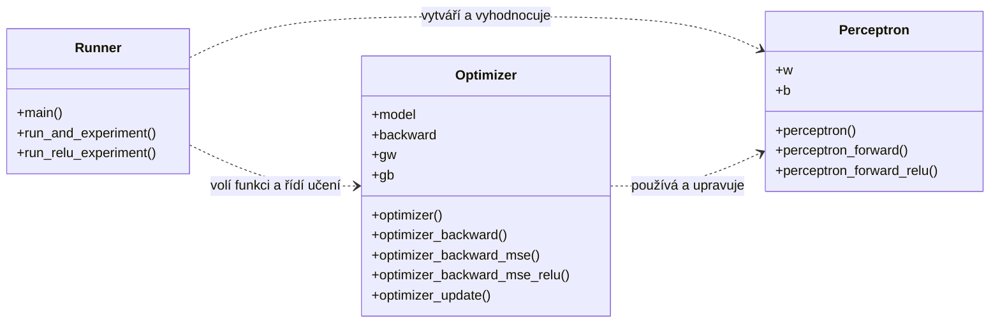
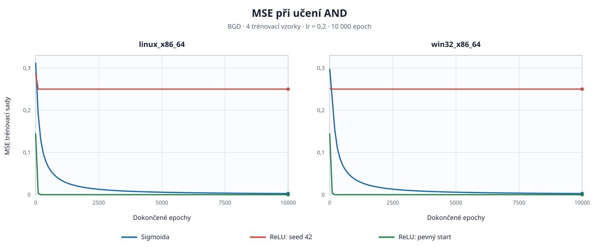

# Specifikace experimentu 002-perceptron

- **Projekt:** 002-perceptron
- **Revize:** 24
- **Stav:** dokončeno
- **Porovnávané aktivace:** sigmoida a ReLU

## 1. Cíl

Navázat na lineární regresi a ověřit model jediného neuronu.
Teoretický model připouští $n$ vstupů, ale tento experiment
používá dvě váhy pro dva vstupy určené při překladu.
Sigmoidální aktivace mění afinní výpočet na nelineární výstup.
První úlohou je naučit logickou funkci AND se dvěma
binárními vstupy. Používáme MSE a BGD; běh má
$10\,000$ epoch a rychlost učení $0{,}2$.

## 2. Teorie konceptu

Složení dvou afinních funkcí zůstává afinní:

$$
f(x)=ax+b,\qquad g(z)=cz+d,\qquad
g(f(x))=(ca)x+(cb+d).
$$

Pro $n\geq 1$ vstupů $\mathbf{x}\in\mathbb{R}^n$, váhy
$\mathbf{w}\in\mathbb{R}^n$ a bias $b\in\mathbb{R}$ počítá
jediný neuron

$$
z=\mathbf{w}^{\mathsf T}\mathbf{x}+b
  =\sum_{i=1}^{n}w_i x_i+b,\qquad
\hat y=\sigma(z),\qquad
\sigma(z)=\frac{1}{1+\mathrm{e}^{-z}}.
$$

Váhy $w_i$ a bias $b$ jsou učitelné **parametry**. Počet vstupů
$n$ určuje tvar modelu; volba aktivace a rychlosti učení patří
mezi **hyperparametry** modelu či trénování. Rychlost učení
neovlivňuje výpočet již natrénovaného neuronu.

Pro jeden vstup, $w_1=1$ a $b=0$, porovnává následující
teoretický graf afinní výstup $z=x$ a výstupy aktivací
$\hat y=\sigma(x)$ a $\hat y=\max(0,x)$.
Panely mají odlišné měřítko svislé osy.


Sigmoidální výstup má při změně $z$ monotónní průběh
tvaru S a leží mezi $0$ a $1$. Pro více vstupů se mění
$z$ podle váženého součtu; jeden neuron stále neumí vyjádřit
libovolný nelineární vztah.

## 3. Data a ztrátová funkce

První úloha vychází z pravdivostní tabulky AND, tedy $n=2$
vstupy a čtyři možné binární kombinace. Symbol $n$ značí
počet vstupů neuronu, $N$ počet vzorků v dávce:

| $x_1$ | $x_2$ | Cíl $y=x_1\land x_2$ |
|---:|---:|---:|
| 0 | 0 | 0 |
| 0 | 1 | 0 |
| 1 | 0 | 0 |
| 1 | 1 | 1 |

Pro trénovací dávku o $N>0$ vzorcích volíme střední kvadratickou chybu

$$
\operatorname{MSE}(\mathbf{w},b)
=\frac{1}{N}\sum_{k=1}^{N}(\hat y_k-y_k)^2,
\qquad
\hat y_k=\sigma\!\left(
  \sum_{i=1}^{n}w_i x_{k,i}+b
\right).
$$

AND je lineárně separovatelná: lze zvolit váhy a bias tak,
aby výstup pro $(1,1)$ převýšil výstupy ostatních kombinací.
V tomto běhu však spojitý výstup nepřevádíme na třídy.
Sigmoida zajišťuje hladký, diferencovatelný výstup, ale pro
konečné parametry nikdy nevrátí přesně $0$ ani $1$;
MSE se proto může blížit nule, aniž by jí přesně dosáhla. Ztrátu MSE volíme
pro návaznost na první experiment; binární křížovou entropii
(BCE) zatím nepoužijeme.

K trénování použijeme všechny čtyři binární kombinace,
tedy $N=4$. Runner připraví konstantní pole
`const float inputs[4][2]` a `const float targets[4]`; každá
dvojice vstupů tvoří jeden řádek a má odpovídající cíl.
Dávkové rozhraní předá obě pole a počet řádků bez kopírování.
Samostatnou validační množinu pro tuto úlohu nevytváříme.
Závěrečné vyhodnocení na stejných datech ukáže naučení
pravdivostní tabulky, nikoli zobecnění na neviděné vstupy.

## 4. Architektura programu

Perceptron uchovává dvě váhy a bias, počítá sigmoidální
výstup nebo ReLU a nezná optimalizátor. Optimizer drží nevlastněný
ukazatel na model, dva gradienty vah a gradient biasu;
vypočtené gradienty použije při aktualizaci parametrů.
Runner v souboru `main.c` spouští sigmoidální běh
`run_and_experiment` a dva běhy ReLU ve funkci
`run_relu_experiment`. Každý běh vytvoří na zásobníku
Perceptron a Optimizer, připraví konstantní trénovací
pole a vyhodnotí celou tabulku AND.



Optimizer drží ukazatel `backward` na dávkovou funkci.
Zvolená veřejná implementace spočítá hodnotu ztráty, její
derivaci i gradienty všech vah a biasu. Ztrátu vrátí;
gradienty uloží do instance Optimizer pro následnou aktualizaci.
Obě aktivace používají MSE a BGD. Další ztrátová funkce
může používat stejné volání z Runneru bez změny Perceptronu.
Nepřímé volání proběhne jednou za dávku, nikoli pro každý vzorek.

Pro tento běh mají struktury přímo pole `float w[2]`
a `float gw[2]` a po jednom `float` pro bias a jeho
gradient. Velikost je daná při překladu; jiný počet vstupů
vyžaduje změnu velikosti polí a nový překlad. Konstrukce modelu
ani optimalizátoru nevyžaduje dynamickou alokaci.

```c
Perceptron perceptron(void);
float perceptron_forward(Perceptron *self, const float x[2]);
float perceptron_forward_relu(Perceptron *self, const float x[2]);
```

Konstruktor vrací strukturu hodnotou a náhodně inicializuje
obě váhy i bias pomocí `rand()`, jehož výsledky převede
do intervalu $[-1,1]$ jako v experimentu 001. Runner před
voláním konstruktoru nastaví `srand(42)`.
Stejné semínko nezaručuje stejnou posloupnost `rand()`
v různých C runtime. Funkce `perceptron_forward`
přijímá dvojici vstupů, vypočte
$z=w_1x_1+w_2x_2+b$ a vrátí $\sigma(z)$.

Konstruktor a aktualizace navazují na experiment 001:

```c
Optimizer optimizer(Perceptron *model);
float optimizer_backward_mse(Optimizer *self,
        const float inputs[][2], const float targets[], size_t count);
float optimizer_backward_mse_relu(Optimizer *self,
        const float inputs[][2], const float targets[], size_t count);
void optimizer_update(Optimizer *self, float lr);
```

`optimizer()` vrátí strukturu hodnotou, uloží nevlastněný
ukazatel na model, nastaví funkci `backward` na veřejnou
MSE variantu a nechá gradienty nulové. Před prvním výpočtem
gradientů proto `optimizer_update()` parametry nezmění.
Pro jinou ztrátu lze po konstrukci přiřadit do `backward`
jinou veřejnou dávkovou funkci se stejným podpisem.
Jednotné volání `optimizer_backward` zajistí krátká
`static inline` funkce v hlavičce, která předá argumenty
zvolené funkci `backward`.
Dávka používá řádky po dvou hodnotách, samostatné pole
cílů a počet vzorků; data se nekopírují.

Samostatný výpočet gradientu jednoho vzorku a aktualizaci
jen jedné váhy z experimentu 001 zde nepřebíráme:
první úloha používá výhradně BGD nad celou tabulkou AND.

## 5. Gradient a řetězcové pravidlo

Pro diferencovatelnou ztrátu $L(\hat y,y)$ na jednom vzorku
platí

$$
\frac{\partial \hat y}{\partial z}
=\sigma'(z)
=\sigma(z)\bigl(1-\sigma(z)\bigr).
$$

Gradient vůči každé váze a biasu vznikne řetězením derivací:

$$
\frac{\partial L}{\partial w_i}
=\frac{\partial L}{\partial\hat y}
 \frac{\partial\hat y}{\partial z}
 \frac{\partial z}{\partial w_i}
=\frac{\partial L}{\partial\hat y}
 \sigma(z)\bigl(1-\sigma(z)\bigr)x_i,
\qquad i=1,\ldots,n,
$$

$$
\frac{\partial L}{\partial b}
=\frac{\partial L}{\partial\hat y}
 \sigma(z)\bigl(1-\sigma(z)\bigr).
$$

Pro čtvercovou ztrátu jednoho vzorku
$e_k=(\hat y_k-y_k)^2$ lze derivaci ztráty oddělit:

$$
\frac{\partial e_k}{\partial\hat y_k}
=2(\hat y_k-y_k).
$$

Optimizer ji pak řetězovým pravidlem násobí derivací
sigmoidy a příslušným vstupem. Pro zvolenou MSE trénovací
dávky se navíc sčítá přes vzorky a dělí jejich počtem:

$$
\frac{\partial\operatorname{MSE}}{\partial w_i}
=\frac{2}{N}\sum_{k=1}^{N}
(\hat y_k-y_k)\hat y_k(1-\hat y_k)x_{k,i},
\qquad i=1,\ldots,n,
$$

$$
\frac{\partial\operatorname{MSE}}{\partial b}
=\frac{2}{N}\sum_{k=1}^{N}
(\hat y_k-y_k)\hat y_k(1-\hat y_k).
$$

V blízkosti nasycení sigmoidy se její derivace blíží nule,
takže MSE může při nevhodném počátečním nastavení učit pomalu.
Zvolená funkce `backward` počítá ztrátu a průměrné
gradienty celé trénovací dávky. Výpočet derivace ztráty
může uvnitř funkce zůstat oddělený nebo se sloučit s dalšími
kroky, pokud to zlepší výkon či numerickou stabilitu.

## 6. Rozšíření o ReLU

ReLU je $\rho(z)=\max(0,z)$ a její derivace
je $0$ pro $z<0$ a $1$ pro $z>0$. V bodě
$z=0$ volí implementace derivaci $0$.
Pro celou dávku počítá Optimizer

$$
\frac{\partial\operatorname{MSE}}{\partial w_i}
=\frac{2}{N}\sum_{k=1}^{N}
\bigl(\rho(z_k)-y_k\bigr)\mathbf{1}_{z_k>0}x_{k,i},
\qquad
\frac{\partial\operatorname{MSE}}{\partial b}
=\frac{2}{N}\sum_{k=1}^{N}
\bigl(\rho(z_k)-y_k\bigr)\mathbf{1}_{z_k>0}.
$$

Symbol $\mathbf{1}_{z_k>0}$ je $1$ v aktivní oblasti
a jinak $0$. Jediný neuron s ReLU umí na binárních
vstupech AND vytvořit přesné výstupy:
pro $w_1=w_2=1$ a $b=-1$ je
$\rho(x_1+x_2-1)$ rovna $0,0,0,1$.
ReLU nemá výstup omezený shora. Pro nekladné $z$
nepřenáší gradient a neuron může uvíznout.

Přímá funkce `perceptron_forward_relu` vrací
aktivovaný výstup. Veřejná dávková funkce
`optimizer_backward_mse_relu` počítá ztrátu
a gradienty; Runner ji zvolí jednorázově v
`Optimizer.backward`. Nepřímé volání tak
zůstává jednou za dávku, nikoli uvnitř smyčky
přes vzorky. Struktury, vlastnictví dat a
paměťový režim se nemění. Výpočet ReLU
nevyžaduje exponenciálu; rychlost obou
variant nebyla měřena.

## 7. Metodika a diagnostika

Tři běhy používají tabulku AND, MSE, BGD, $10\,000$ epoch
a rychlost učení $\eta=0{,}2$. Sigmoida a první ReLU
začínají po samostatném `srand(42)` se shodnými
váhami na dané platformě. Druhá ReLU začíná
$w_1=w_2=b=0{,}1$. Runner průběžně vypisuje MSE
před aktualizací a parametry po ní. Nakonec vypíše
spojité výstupy všech čtyř vzorků a MSE trénovací
tabulky. Běhy oddělí prázdným řádkem.

Srovnáme trajektorii MSE, konečné výstupy a stav,
kdy ReLU nemá gradient pro pozitivní vzorek. Výstup
neprahuje žádný běh; validační množina není k dispozici.

## 8. Požadavky a ověření

- Konstruktor vrátí hodnotovou strukturu s parametry v
  $[-1,1]$ a opakovatelnými hodnotami při stejném seedu
  v jednom C runtime.
- Testy ověří sigmoidální i ReLU forward, analytické
  gradienty sigmoidální MSE a dávkový gradient ReLU.
- U ReLU testy pokryjí kladné i nekladné $z$, nulovou
  derivaci v $z=0$, uvíznutí neaktivního neuronu
  a použití společné funkce `optimizer_update`.
- Náhradní `backward` ověří přepínatelné rozhraní;
  update před prvním backward parametry nezmění.
- Runner vypíše tři běhy se stejnými podmínkami,
  čtyři spojité výstupy každého běhu a výslednou MSE.

## 9. Průběh a výsledky

Po $10\,000$ krocích BGD byly naměřeny tyto MSE celé
čtyřprvkové trénovací tabulky:

| Aktivace a start | Linux: před → po | Windows: před → po |
|---|---:|---:|
| Sigmoida, seed 42 | $0{,}312519 \to 0{,}002668$ | $0{,}298458 \to 0{,}002682$ |
| ReLU, seed 42 | $0{,}286766 \to 0{,}25$ | $0{,}252055 \to 0{,}25$ |
| ReLU, pevný start | $0{,}145 \to 2{,}42\cdot10^{-13}$ | $0{,}145 \to 2{,}42\cdot10^{-13}$ |

Graf ukazuje naměřené hodnoty přibližně po $100$
krocích a konečnou MSE. Panely oddělují platformy;
nejde o teoretické křivky.



Závěrečné spojité výstupy:

| Vstup | Cíl | Sigmoida Linux / Windows | ReLU seed 42 | ReLU pevný start |
|---|---:|---:|---:|---:|
| $(0,0)$ | 0 | $0{,}000250 / 0{,}000252$ | $\approx 0$ | $0$ |
| $(0,1)$ | 0 | $0{,}055890 / 0{,}056039$ | $0$ | $4{,}77\cdot10^{-7}$ |
| $(1,0)$ | 0 | $0{,}055890 / 0{,}056039$ | $0$ | $4{,}77\cdot10^{-7}$ |
| $(1,1)$ | 1 | $0{,}933477 / 0{,}933299$ | $0$ | $0{,}999999285$ |

Při dalších ručních pokusech se sigmoidou šlo
zvýšit rychlost učení až na $0{,}3$ bez
pozorovaného přestřelování. Pokles ztráty se
u malé chyby zpomaloval; úplný průběh těchto
pokusů nebyl zaznamenán.

### Sekundární zjištění: počáteční aktivace ReLU

ReLU se seedem 42 nechala na obou platformách
pozitivní vzorek $(1,1)$ v neaktivní oblasti:
počáteční $z_{11}$ bylo na Linuxu asi $-0{,}892$
a na Windows $-1{,}874$. Jeho chyba proto
nepřispívala do gradientu. Na Windows byl aktivní
jen vzorek $(0,0)$ s cílem $0$, který snižoval bias;
obě váhy zůstaly beze změny. Na Linuxu byly zpočátku
aktivní $(0,0)$ a $(0,1)$, ale po prvním kroku už
jen $(0,0)$. Další kroky snižovaly bias a $(1,1)$
zůstávalo neaktivní. Výstup pro něj zůstal nulový,
takže jeho příspěvek k MSE byl
$\frac{(1-0)^2}{4}=0{,}25$.
Pevně inicializovaná ReLU se naopak přiblížila
přesné tabulce AND. Stejný seed dal mezi Linuxem
a Windows různé počáteční parametry `rand()`;
běhy na různých platformách proto netvoří
srovnání rychlosti platforem.

U zdejších nezáporných vstupů mohou záporné
počáteční váhy zvýšit riziko, že potřebný vzorek
bude mít $z\leq0$ a nepřenese gradient přes ReLU.
Rozhoduje však celý součet
$z=\sum_i w_i x_i+b$, nikoli znaménko jednotlivé
váhy nebo biasu. Z tohoto běhu neplyne obecný zákaz
záporné inicializace ani četnost takového uvíznutí
pro jiné úlohy.

## 10. Závěr

Pro přesnou tabulku AND na čtyřech binárních vstupech
má ReLU reprezentační výhodu: konečné parametry
$w_1=w_2=1$ a $b=-1$ dávají výstupy přesně
$0,0,0,1$. Sigmoida s konečnými parametry vrací
hodnoty přísně mezi $0$ a $1$, a proto na těchto
cílech nemůže mít přesně nulovou MSE.

Naměřený běh s aktivním pevným startem této možnosti
využil a dosáhl výstupů s odchylkou řádově $10^{-6}$.
Sigmoida při stejném $N$, MSE, BGD a rychlosti učení
AND aproximovala s MSE přibližně $0{,}0027$.
Její zpomalování při malé chybě odpovídá gradientu
MSE násobenému derivací sigmoidy. ReLU se stejným
náhodným startem jako sigmoida však uvázla na
MSE $0{,}25$: pozitivní vzorek ležel v neaktivní
oblasti. Výsledek tedy ukazuje i citlivost ReLU
na inicializaci. Rychlejší pokles u pevného startu
nelze připsat jen aktivaci, protože počáteční
parametry byly jiné.

Z tohoto experimentu neplyne, že ReLU je obecně
vhodnější pro binární výstup. Její výstup není
omezen na $[0,1]$; sigmoida omezený výstup má.
Vyhodnocení navíc používá jen trénovací tabulku.
Sekundární zjištění o riziku neaktivní ReLU platí
pro podmínky tohoto experimentu.

Zjednodušení volby aktivační a ztrátové funkce v rozhraní
modulů Perceptron a Optimizer patří navazujícím
experimentům.

## 11. Vazba na zdrojový kód

- `src/perceptron.c`: inicializace a přímé výstupy
  sigmoidy i ReLU.
- `src/optimizer.c`: obě varianty dávkového
  gradientu MSE a společná aktualizace.
- `src/main.c`: tři běhy a diagnostický výpis.
- `config/*.mk`: překlad pro Linux a Windows.
- `tests/test_perceptron.c`: výstupy, gradienty,
  neaktivní ReLU a přepínatelné volání `backward`.

## Slovník pojmů

- **Afinní funkce:** vztah $ax+b$; vážený součet vstupů
  představuje afinní část neuronu.
- **Perceptron:** v tomto experimentu model jediného neuronu;
  první běh používá sigmoidální aktivaci, další dva ReLU.
  Původní perceptron používal prahovou aktivaci.
- **Aktivační funkce:** funkce použitá na afinní výstup neuronu;
  porovnáváme sigmoidální aktivaci s ReLU.
- **Sigmoida:** funkce $\sigma(z)$ s průběhem tvaru S při změně $z$.
- **ReLU:** aktivace $\max(0,z)$; kladný vstup propouští,
  záporný převádí na nulu.
- **Neaktivní neuron:** neuron s nekladným vstupem ReLU;
  při zvolené nulové derivaci nedostává z daného vzorku gradient.
- **Parametr:** váha $w_i$ nebo bias $b$ učený z dat.
- **Hyperparametr:** volba modelu nebo trénování, například
  aktivace či rychlost učení, která se neurčuje gradientem vah.
- **Řetězcové pravidlo:** způsob derivace složené funkce; zde
  propojuje derivaci ztráty, sigmoidy a váženého součtu.
- **MSE:** průměr čtverců rozdílů mezi výstupy neuronu a cíli
  vzorků v dané dávce.
- **BGD:** aktualizace parametrů jednou po výpočtu průměrného
  gradientu celé trénovací dávky.
- **Lineární separovatelnost:** možnost oddělit kombinaci
  $(1,1)$ od ostatních kombinací AND afinní rozhodovací hranicí.
- **Nasycení sigmoidy:** oblast výstupu blízko $0$ či $1$,
  kde je derivace aktivační funkce malá.
- **BCE:** binární křížová entropie, alternativní ztráta pro
  binární cíle, kterou zatím nepoužijeme.
