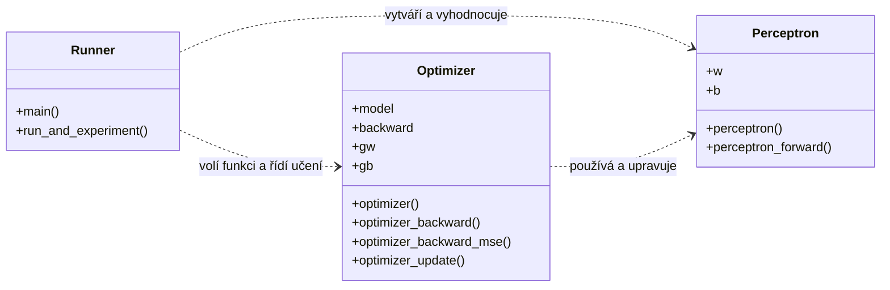

# Specifikace experimentu 002-perceptron

- **Projekt:** 002-perceptron
- **Revize:** 17
- **Stav:** sigmoidální běh implementován; návrh ReLU čeká na schválení implementace
- **Zvolená aktivační funkce:** sigmoida

## 1. Cíl

Navázat na lineární regresi a ověřit model jediného neuronu.
Teoretický model připouští $n$ vstupů, ale tento experiment
používá dvě váhy pro dva vstupy určené při překladu.
Sigmoidální aktivace mění afinní výpočet na nelineární výstup.
První úlohou je naučit logickou funkci AND se dvěma
binárními vstupy. Používáme MSE a BGD; běh má
$10\,000$ epoch a rychlost učení $0{,}2$.

## 2. Teorie konceptu

Složení dvou afinních funkcí zůstává afinní:

$$
f(x)=ax+b,\qquad g(z)=cz+d,\qquad
g(f(x))=(ca)x+(cb+d).
$$

Pro $n\geq 1$ vstupů $\mathbf{x}\in\mathbb{R}^n$, váhy
$\mathbf{w}\in\mathbb{R}^n$ a bias $b\in\mathbb{R}$ počítá
jediný neuron

$$
z=\mathbf{w}^{\mathsf T}\mathbf{x}+b
  =\sum_{i=1}^{n}w_i x_i+b,\qquad
\hat y=\sigma(z),\qquad
\sigma(z)=\frac{1}{1+\mathrm{e}^{-z}}.
$$

Váhy $w_i$ a bias $b$ jsou učitelné **parametry**. Počet vstupů
$n$ určuje tvar modelu; volba aktivace a rychlosti učení patří
mezi **hyperparametry** modelu či trénování. Rychlost učení
neovlivňuje výpočet již natrénovaného neuronu.

Pro jeden vstup, $w_1=1$ a $b=0$, porovnává následující
teoretický graf afinní výstup $z=x$ a aktivovaný výstup
$\hat y=\sigma(x)$. Panely mají odlišné měřítko svislé osy.


Sigmoidální výstup má při změně $z$ monotónní průběh
tvaru S a leží mezi $0$ a $1$. Pro více vstupů se mění
$z$ podle váženého součtu; jeden neuron stále neumí vyjádřit
libovolný nelineární vztah.

## 3. Data a ztrátová funkce

První úloha vychází z pravdivostní tabulky AND, tedy $n=2$
vstupy a čtyři možné binární kombinace. Symbol $n$ značí
počet vstupů neuronu, $N$ počet vzorků v dávce:

| $x_1$ | $x_2$ | Cíl $y=x_1\land x_2$ |
|---:|---:|---:|
| 0 | 0 | 0 |
| 0 | 1 | 0 |
| 1 | 0 | 0 |
| 1 | 1 | 1 |

Pro trénovací dávku o $N>0$ vzorcích volíme střední kvadratickou chybu

$$
\operatorname{MSE}(\mathbf{w},b)
=\frac{1}{N}\sum_{k=1}^{N}(\hat y_k-y_k)^2,
\qquad
\hat y_k=\sigma\!\left(
  \sum_{i=1}^{n}w_i x_{k,i}+b
\right).
$$

AND je lineárně separovatelná: lze zvolit váhy a bias tak,
aby výstup pro $(1,1)$ převýšil výstupy ostatních kombinací.
V tomto běhu však spojitý výstup nepřevádíme na třídy.
Sigmoida zajišťuje hladký, diferencovatelný výstup, ale pro
konečné parametry nikdy nevrátí přesně $0$ ani $1$;
MSE se proto může blížit nule, aniž by jí přesně dosáhla. Ztrátu MSE volíme
pro návaznost na první experiment; binární křížovou entropii
(BCE) zatím nepoužijeme.

K trénování použijeme všechny čtyři binární kombinace,
tedy $N=4$. Runner připraví konstantní pole
`const float inputs[4][2]` a `const float targets[4]`; každá
dvojice vstupů tvoří jeden řádek a má odpovídající cíl.
Dávkové rozhraní předá obě pole a počet řádků bez kopírování.
Samostatnou validační množinu pro tuto úlohu nevytváříme.
Závěrečné vyhodnocení na stejných datech ukáže naučení
pravdivostní tabulky, nikoli zobecnění na
neviděné vstupy.

## 4. Architektura programu

Perceptron uchovává dvě váhy a bias, počítá sigmoidální
výstup a nezná optimalizátor. Optimizer drží nevlastněný
ukazatel na model, dva gradienty vah a gradient biasu;
vypočtené gradienty použije při aktualizaci parametrů.
Runner v souboru main.c má samostatnou funkci
`run_and_experiment`, kterou zavolá `main`.
V této funkci vytvoří na zásobníku nejprve Perceptron,
pak Optimizer, připraví konstantní trénovací pole,
řídí trénování a nakonec vyhodnotí celou tabulku AND.



Optimizer drží ukazatel `backward` na dávkovou funkci.
Zvolená veřejná implementace spočítá hodnotu ztráty, její
derivaci i gradienty všech vah a biasu. Ztrátu vrátí;
gradienty uloží do instance Optimizer pro následnou aktualizaci.
První implementace používá MSE a BGD. Další ztrátová funkce
může používat stejné volání z Runneru bez změny Perceptronu.
Nepřímé volání proběhne jednou za dávku, nikoli pro každý vzorek.

Pro tento běh mají struktury přímo pole `float w[2]`
a `float gw[2]` a po jednom `float` pro bias a jeho
gradient. Velikost je daná při překladu; jiný počet vstupů
vyžaduje změnu velikosti polí a nový překlad. Konstrukce modelu
ani optimalizátoru nevyžaduje dynamickou alokaci.

```c
Perceptron perceptron(void);
float perceptron_forward(Perceptron *self, const float x[2]);
```

Konstruktor vrací strukturu hodnotou a náhodně inicializuje
obě váhy i bias pomocí `rand()`, jehož výsledky převede
do intervalu $[-1,1]$ jako v experimentu 001. Runner před
voláním konstruktoru nastaví `srand(42)`.
Stejné semínko nezaručuje stejnou posloupnost `rand()`
v různých C runtime. Funkce `perceptron_forward`
přijímá dvojici vstupů, vypočte
$z=w_1x_1+w_2x_2+b$ a vrátí $\sigma(z)$.

Konstruktor a aktualizace navazují na experiment 001:

```c
Optimizer optimizer(Perceptron *model);
float optimizer_backward_mse(Optimizer *self,
        const float inputs[][2], const float targets[], size_t count);
void optimizer_update(Optimizer *self, float lr);
```

`optimizer()` vrátí strukturu hodnotou, uloží nevlastněný
ukazatel na model, nastaví funkci `backward` na veřejnou
MSE variantu a nechá gradienty nulové. Před prvním výpočtem
gradientů proto `optimizer_update()` parametry nezmění.
Pro jinou ztrátu lze po konstrukci přiřadit do `backward`
jinou veřejnou dávkovou funkci se stejným podpisem.
Jednotné volání `optimizer_backward` zajistí krátká
`static inline` funkce v hlavičce, která předá argumenty
zvolené funkci `backward`.
Dávka používá řádky po dvou hodnotách, samostatné pole
cílů a počet vzorků; data se nekopírují.

Samostatný výpočet gradientu jednoho vzorku a aktualizaci
jen jedné váhy z experimentu 001 zde nepřebíráme:
první úloha používá výhradně BGD nad celou tabulkou AND.

## 5. Gradient a řetězcové pravidlo

Pro diferencovatelnou ztrátu $L(\hat y,y)$ na jednom vzorku
platí

$$
\frac{\partial \hat y}{\partial z}
=\sigma'(z)
=\sigma(z)\bigl(1-\sigma(z)\bigr).
$$

Gradient vůči každé váze a biasu vznikne řetězením derivací:

$$
\frac{\partial L}{\partial w_i}
=\frac{\partial L}{\partial\hat y}
 \frac{\partial\hat y}{\partial z}
 \frac{\partial z}{\partial w_i}
=\frac{\partial L}{\partial\hat y}
 \sigma(z)\bigl(1-\sigma(z)\bigr)x_i,
\qquad i=1,\ldots,n,
$$

$$
\frac{\partial L}{\partial b}
=\frac{\partial L}{\partial\hat y}
 \sigma(z)\bigl(1-\sigma(z)\bigr).
$$

Pro čtvercovou ztrátu jednoho vzorku
$e_k=(\hat y_k-y_k)^2$ lze derivaci ztráty oddělit:

$$
\frac{\partial e_k}{\partial\hat y_k}
=2(\hat y_k-y_k).
$$

Optimizer ji pak řetězovým pravidlem násobí derivací
sigmoidy a příslušným vstupem. Pro zvolenou MSE trénovací
dávky se navíc sčítá přes vzorky a dělí jejich počtem:

$$
\frac{\partial\operatorname{MSE}}{\partial w_i}
=\frac{2}{N}\sum_{k=1}^{N}
(\hat y_k-y_k)\hat y_k(1-\hat y_k)x_{k,i},
\qquad i=1,\ldots,n,
$$

$$
\frac{\partial\operatorname{MSE}}{\partial b}
=\frac{2}{N}\sum_{k=1}^{N}
(\hat y_k-y_k)\hat y_k(1-\hat y_k).
$$

V blízkosti nasycení sigmoidy se její derivace blíží nule,
takže MSE může při nevhodném počátečním nastavení učit pomalu.
Zvolená funkce `backward` počítá ztrátu a průměrné
gradienty celé trénovací dávky. Výpočet derivace ztráty
může uvnitř funkce zůstat oddělený nebo se sloučit s dalšími
kroky, pokud to zlepší výkon či numerickou stabilitu.

## 6. Metodika a diagnostika

`main` zavolá `run_and_experiment`. Funkce
v každé epoše zavolá `optimizer_backward` nad celou
čtyřřádkovou dávkou, poté aktualizuje parametry (BGD).
Pozorovací běh má $10\,000$ epoch a rychlost učení
$\eta=0{,}2$. Runner vypíše počáteční nastavení,
průběžnou ztrátu před aktualizací a váhy s biasem po ní. Po poslední epoše
vypíše pro každou kombinaci AND vstupy, cíl a přímo
spojitý výstup `perceptron_forward` bez prahování.
Nakonec vypíše MSE celé trénovací tabulky.
Samostatné běhy oddělí prázdným řádkem. Zvolený počet epoch
není zárukou dosažené přesnosti.

## 7. Požadavky a ověření

- Konstruktor vrátí hodnotovou strukturu s váhami a biasem
  v intervalu $[-1,1]$; test ověří rozsah a opakování při
  stejném semínku v jednom C runtime.
- `perceptron_forward` spočítá sigmoidální výstup ze
  dvou vstupů; test ověří známé hodnoty, monotonii
  a zachování parametrů.
- Dávková MSE funkce vrátí ztrátu a uloží gradienty do
  Optimizeru; test porovná gradienty s numerickou derivací
  a ověří krok `optimizer_update`.
- Test s náhradní funkcí `backward` ověří, že jednotný
  obal předá dávku vybranému callbacku a vrátí jeho ztrátu.
  Aktualizace před prvním výpočtem gradientů model nezmění.
- Runner během $10\,000$ epoch průběžně vypíše ztrátu
  a parametry, poté spojité výstupy na čtyřech kombinacích a MSE.
  Výsledek je pozorováním prvního běhu, bez požadavku na
  přesnou hodnotu MSE či klasifikační správnost.

## 8. Průběh a výsledky běhu

Při $10\,000$ krocích BGD klesla MSE celé trénovací tabulky:

| Platforma | MSE před učením | MSE po učení |
|---|---:|---:|
| `linux_x86_64` | $0{,}312519$ | $0{,}002668$ |
| `win32_x86_64` | $0{,}298458$ | $0{,}002682$ |

Následující graf zobrazuje naměřené hodnoty po přibližně
$100$ krocích a konečnou MSE. Nejde o teoretickou křivku.


Závěrečné spojité výstupy na stejných čtyřech vzorcích:

| $(x_1,x_2)$ | Cíl $y$ | Linux $\hat y$ | Windows $\hat y$ |
|---|---:|---:|---:|
| $(0,0)$ | 0 | $0{,}000250$ | $0{,}000252$ |
| $(0,1)$ | 0 | $0{,}055890$ | $0{,}056039$ |
| $(1,0)$ | 0 | $0{,}055890$ | $0{,}056039$ |
| $(1,1)$ | 1 | $0{,}933477$ | $0{,}933299$ |

Stejný seed 42 dal na Linuxu počáteční váhy přibližně
$(-0{,}933;-0{,}340)$ a bias $0{,}381$; na Windows
$(-0{,}989;-0{,}976)$ a bias $0{,}091$. Použité C runtime
mají odlišné posloupnosti `rand()`. Křivky tedy nezačínají
ze stejného modelu a nesrovnávají výkon platforem.

Při dalších ručních pokusech se rychlost učení dala zvýšit
až na $0{,}3$ bez pozorovaného přestřelování. Pokles ztráty
se s přibližováním výstupů k cílům zpomaloval; konkrétní
průběh těchto pokusů nebyl pro tento dokument zaznamenán.

## 9. Navržený závěr

Jediný sigmoidální neuron s BGD a MSE při těchto podmínkách
postupně přiblížil spojité výstupy pravdivostní tabulce AND.
MSE celé čtyřprvkové sady klesla na méně než $0{,}003$.
Výstupy nebyly prahovány a vyhodnocení proběhlo na trénovacích
datech; výsledek proto neprokazuje zobecnění na jiné úlohy.
Zpomalení je slučitelné s tím, že gradient MSE násobí
reziduum derivací sigmoidy, která se u výstupů blízkých
$0$ a $1$ zmenšuje. Vhodnost MSE a sigmoidy pro binární
úlohy zatím neposuzujeme bez srovnávacího běhu s jinou
aktivací či ztrátou. Závěr zatím není odsouhlasen.

## 10. Vazba na zdrojový kód

- `src/perceptron.c`: inicializace a sigmoidální výstup.
- `src/optimizer.c`: MSE, dávkové gradienty a aktualizace.
- `src/main.c`: trénovací běh a diagnostický výpis.
- `config/*.mk`: překlad pro Linux a Windows.
- `tests/test_perceptron.c`: chování modelu, gradienty
  a přepínatelné volání `backward`.

## 11. Návrh srovnání s ReLU

### Teorie a očekávání

Další otázka zní, jak změna aktivace ovlivní rychlost učení,
konečnou chybu a stabilitu při stejné úloze, MSE a BGD.
ReLU je definována jako $\rho(z)=\max(0,z)$; derivace
je $0$ pro $z<0$ a $1$ pro $z>0$. V bodě $z=0$,
kde derivace neexistuje, bude implementace používat $0$.

Pro dávku $N$ vzorků vzniknou gradienty

$$
\frac{\partial\operatorname{MSE}}{\partial w_i}
=\frac{2}{N}\sum_{k=1}^{N}
\bigl(\rho(z_k)-y_k\bigr)
\mathbf{1}_{z_k>0}x_{k,i},
\qquad
\frac{\partial\operatorname{MSE}}{\partial b}
=\frac{2}{N}\sum_{k=1}^{N}
\bigl(\rho(z_k)-y_k\bigr)
\mathbf{1}_{z_k>0}.
$$

Symbol $\mathbf{1}_{z_k>0}$ značí $1$ právě pro aktivní
část ReLU. Jeden neuron s ReLU umí na čtyřech binárních
vstupech AND vytvořit přesné výstupy: při $w_1=w_2=1$
a $b=-1$ je $\rho(x_1+x_2-1)$ rovna $0,0,0,1$.
ReLU však nemá výstup omezený shora a při $z\leq 0$
nepřenáší gradient. Počáteční váhy ze seedu 42 dávají
na obou ověřených platformách pro vzorek $(1,1)$
záporné $z$. Proto může běh se stejným seedem uvíznout.
To je zatím teoretická předpověď, ne naměřený výsledek.

### Srovnávací postup a architektura

V Runneru zůstane sigmoidální běh jako základ. Přibudou
dva běhy ReLU: první použije stejný konstruktor, seed
a počáteční váhy jako sigmoidální běh na dané platformě;
druhý použije pevné parametry v aktivní oblasti.
Pro druhý běh jsou potvrzeny počáteční parametry
$w_1=w_2=0{,}1$ a $b=0{,}1$.
Všechny běhy mají stejnou trénovací tabulku, BGD,
MSE, $\eta=0{,}2$ a $10\,000$ epoch. Výstupy
zůstanou spojité, bez klasifikačního prahu.
Srovnáme trajektorii MSE, konečné výstupy a to,
zda neaktivní ReLU zastaví učení.

Perceptron dostane přímou funkci
`perceptron_forward_relu`. Optimizer dostane veřejnou
dávkovou funkci `optimizer_backward_mse_relu`
se stejným podpisem jako současná MSE varianta;
Runner ji zvolí jednorázovým přiřazením do
`Optimizer.backward`. Tím zůstane nepřímé volání
jednou za dávku. Uvnitř smyčky přes vzorky nebude
volání aktivace přes ukazatel na funkci. Původní
sigmoidální funkce a aktualizace parametrů zůstanou
samostatné. Model i gradienty zůstanou na zásobníku,
bez další dynamické paměti.

Tato volba zvětší zdrojový kód o specializovanou větev,
ale zachová přímé výpočty v časté smyčce. Výpočet
ReLU nevyžaduje exponenciálu; z toho samotného
nevyvozujeme tvrzení o rychlosti bez měření.
Jednotkové testy ověří výstup ReLU na obou stranách
nuly, konvenci nulové derivace, dávkové gradienty
pro aktivní vzorky a chování při neaktivním neuronu.
Po implementaci doplníme naměřené výsledky a graf.

## Slovník pojmů

- **Afinní funkce:** vztah $ax+b$; vážený součet vstupů
  představuje afinní část neuronu.
- **Perceptron:** v tomto experimentu model jediného neuronu;
  současný běh používá sigmoidální aktivaci, navržený běh ReLU.
  Původní perceptron používal prahovou aktivaci.
- **Aktivační funkce:** funkce použitá na afinní výstup neuronu;
  současná je sigmoida, pro srovnání je navržena ReLU.
- **Sigmoida:** funkce $\sigma(z)$ s průběhem tvaru S při změně $z$.
- **ReLU:** aktivace $\max(0,z)$; kladný vstup propouští,
  záporný převádí na nulu.
- **Neaktivní neuron:** neuron s nekladným vstupem ReLU;
  při zvolené nulové derivaci nedostává z daného vzorku gradient.
- **Parametr:** váha $w_i$ nebo bias $b$ učený z dat.
- **Hyperparametr:** volba modelu nebo trénování, například
  aktivace či rychlost učení, která se neurčuje gradientem vah.
- **Řetězcové pravidlo:** způsob derivace složené funkce; zde
  propojuje derivaci ztráty, sigmoidy a váženého součtu.
- **MSE:** průměr čtverců rozdílů mezi výstupy neuronu a cíli
  vzorků v dané dávce.
- **BGD:** aktualizace parametrů jednou po výpočtu průměrného
  gradientu celé trénovací dávky.
- **Lineární separovatelnost:** možnost oddělit kombinaci
  $(1,1)$ od ostatních kombinací AND afinní rozhodovací hranicí.
- **Nasycení sigmoidy:** oblast výstupu blízko $0$ či $1$,
  kde je derivace aktivační funkce malá.
- **BCE:** binární křížová entropie, alternativní ztráta pro
  binární cíle, kterou zatím nepoužijeme.
