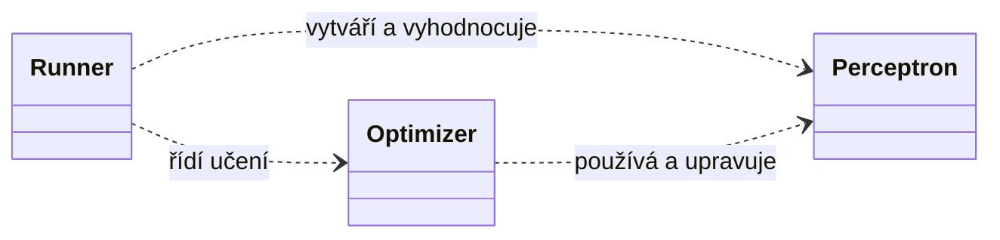

# Specifikace experimentu 002-perceptron

- **Projekt:** 002-perceptron
- **Revize:** 6
- **Stav:** rozpracovaný návrh; implementace nebyla schválena
- **Zvolená aktivační funkce:** sigmoida

## 1. Cíl

Navázat na lineární regresi a ověřit model jediného neuronu
s libovolným počtem vstupů a odpovídajících vah. Sigmoidální
aktivace mění afinní výpočet na nelineární výstup. První úlohou
je naučit logickou funkci AND se dvěma binárními vstupy. Pro učení
volíme MSE; postup optimalizace a podmínky ověření ještě určíme.

## 2. Teorie konceptu

Složení dvou afinních funkcí zůstává afinní:

$$
f(x)=ax+b,\qquad g(z)=cz+d,\qquad
g(f(x))=(ca)x+(cb+d).
$$

Pro $n\geq 1$ vstupů $\mathbf{x}\in\mathbb{R}^n$, váhy
$\mathbf{w}\in\mathbb{R}^n$ a bias $b\in\mathbb{R}$ počítá
jediný neuron

$$
z=\mathbf{w}^{\mathsf T}\mathbf{x}+b
  =\sum_{i=1}^{n}w_i x_i+b,\qquad
\hat y=\sigma(z),\qquad
\sigma(z)=\frac{1}{1+\mathrm{e}^{-z}}.
$$

Váhy $w_i$ a bias $b$ jsou učitelné **parametry**. Počet vstupů
$n$ určuje tvar modelu; volba aktivace a rychlosti učení patří
mezi **hyperparametry** modelu či trénování. Rychlost učení
neovlivňuje výpočet již natrénovaného neuronu.

Pro jeden vstup, $w_1=1$ a $b=0$, porovnává následující
teoretický graf afinní výstup $z=x$ a aktivovaný výstup
$\hat y=\sigma(x)$. Panely mají odlišné měřítko svislé osy.

Sigmoidální výstup má při změně $z$ monotónní průběh
tvaru S a leží mezi $0$ a $1$. Pro více vstupů se mění
$z$ podle váženého součtu; jeden neuron stále neumí vyjádřit
libovolný nelineární vztah.

## 3. Data a ztrátová funkce

První úloha používá úplnou pravdivostní tabulku AND, tedy $n=2$
vstupy a $N=4$ vzorky:

| $x_1$ | $x_2$ | Cíl $y=x_1\land x_2$ |
|---:|---:|---:|
| 0 | 0 | 0 |
| 0 | 1 | 0 |
| 1 | 0 | 0 |
| 1 | 1 | 1 |

Pro tyto vzorky volíme střední kvadratickou chybu

$$
\operatorname{MSE}(\mathbf{w},b)
=\frac{1}{N}\sum_{k=1}^{N}(\hat y_k-y_k)^2,
\qquad
\hat y_k=\sigma\!\left(
  \sum_{i=1}^{n}w_i x_{k,i}+b
\right).
$$

AND je lineárně separovatelná: jediný neuron může po zavedení
rozhodovacího prahu rozlišit všechny čtyři kombinace. Sigmoida
zajišťuje hladký, diferencovatelný výstup, ale pro konečné
parametry nikdy nevrátí přesně $0$ ani $1$; MSE se proto může
blížit nule, aniž by jí přesně dosáhla. Ztrátu MSE volíme
pro návaznost na první experiment; binární křížovou entropii
(BCE) zatím nepoužijeme.

Úplná tabulka nemá další dosud neviděnou binární kombinaci.
Ověření správnosti AND proto odlišíme od tvrzení o zobecnění
na jiná data.

## 4. Architektura programu

Perceptron uchovává váhy a bias, počítá sigmoidální výstup
a nezná optimalizátor. Optimizer používá model k výpočtu
gradientů a aktualizaci parametrů. Runner v souboru main.c
vytváří model a optimalizátor, řídí učení a vyhodnocení AND.

Konkrétní podpisy funkcí, způsob předání modelu a vlastnictví
dat zatím nejsou určeny. Symboly tříd proto zatím neobsahují
metody ani atributy.

## 5. Gradient a řetězcové pravidlo

Pro diferencovatelnou ztrátu $L(\hat y,y)$ na jednom vzorku
platí

$$
\frac{\partial \hat y}{\partial z}
=\sigma'(z)
=\sigma(z)\bigl(1-\sigma(z)\bigr).
$$

Gradient vůči každé váze a biasu vznikne řetězením derivací:

$$
\frac{\partial L}{\partial w_i}
=\frac{\partial L}{\partial\hat y}
 \frac{\partial\hat y}{\partial z}
 \frac{\partial z}{\partial w_i}
=\frac{\partial L}{\partial\hat y}
 \sigma(z)\bigl(1-\sigma(z)\bigr)x_i,
\qquad i=1,\ldots,n,
$$

$$
\frac{\partial L}{\partial b}
=\frac{\partial L}{\partial\hat y}
 \sigma(z)\bigl(1-\sigma(z)\bigr).
$$

Pro čtvercovou ztrátu jednoho vzorku
$e_k=(\hat y_k-y_k)^2$ lze derivaci ztráty oddělit:

$$
\frac{\partial e_k}{\partial\hat y_k}
=2(\hat y_k-y_k).
$$

Optimizer ji pak řetězovým pravidlem násobí derivací
sigmoidy a příslušným vstupem. Pro zvolenou MSE celé
tabulky se navíc sčítá přes vzorky a dělí jejich počtem:

$$
\frac{\partial\operatorname{MSE}}{\partial w_i}
=\frac{2}{N}\sum_{k=1}^{N}
(\hat y_k-y_k)\hat y_k(1-\hat y_k)x_{k,i},
\qquad i=1,\ldots,n,
$$

$$
\frac{\partial\operatorname{MSE}}{\partial b}
=\frac{2}{N}\sum_{k=1}^{N}
(\hat y_k-y_k)\hat y_k(1-\hat y_k).
$$

V blízkosti nasycení sigmoidy se její derivace blíží nule,
takže MSE může při nevhodném počátečním nastavení učit pomalu.
Zda budeme gradient vyhodnocovat po vzorcích nebo po celé
tabulce, zatím není rozhodnuto. Oddělená funkce pro
derivaci ztráty je možná; konkrétní rozhraní a případné
spojení výpočtů kvůli výkonu vybereme při návrhu Optimizeru.

## 6. Otevřené návrhové otázky

Před implementací společně určíme způsob aktualizace gradientů,
inicializaci, rozhraní ztrátové funkce, klasifikační práh a
podmínky ověření. Následně doplníme metodiku a měřitelné
požadavky experimentu.

## Slovník pojmů

- **Afinní funkce:** vztah $ax+b$; vážený součet vstupů
  představuje afinní část neuronu.
- **Perceptron:** v tomto experimentu model jediného neuronu se
  sigmoidální aktivací; původní perceptron používal prahovou aktivaci.
- **Aktivační funkce:** funkce použitá na afinní výstup neuronu;
  zde je zvolena sigmoida.
- **Sigmoida:** funkce $\sigma(z)$ s průběhem tvaru S při změně $z$.
- **Parametr:** váha $w_i$ nebo bias $b$ učený z dat.
- **Hyperparametr:** volba modelu nebo trénování, například
  aktivace či rychlost učení, která se neurčuje gradientem vah.
- **Řetězcové pravidlo:** způsob derivace složené funkce; zde
  propojuje derivaci ztráty, sigmoidy a váženého součtu.
- **MSE:** průměr čtverců rozdílů mezi výstupy neuronu a cíli
  čtyř kombinací AND.
- **Lineární separovatelnost:** možnost oddělit kombinaci
  $(1,1)$ od ostatních kombinací AND afinní rozhodovací hranicí.
- **Rozhodovací práh:** mez, která převede spojitý výstup
  sigmoidy na jednu ze dvou tříd.
- **Nasycení sigmoidy:** oblast výstupu blízko $0$ či $1$,
  kde je derivace aktivační funkce malá.
- **BCE:** binární křížová entropie, alternativní ztráta pro
  binární cíle, kterou zatím nepoužijeme.
