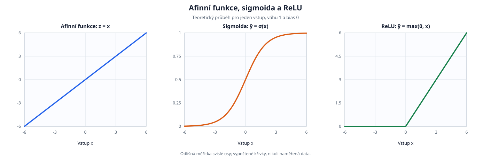
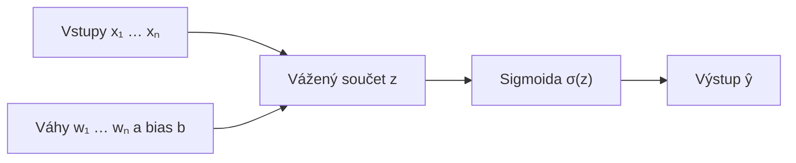

# Specifikace experimentu 002-perceptron

- **Projekt:** 002-perceptron
- **Revize:** 4
- **Stav:** rozpracovaný návrh; implementace nebyla schválena
- **Zvolená aktivační funkce:** sigmoida

## 1. Cíl

Navázat na lineární regresi a ověřit model jediného neuronu
s libovolným počtem vstupů a odpovídajících vah. Sigmoidální
aktivace mění afinní výpočet na nelineární výstup. Konkrétní
úlohu a podmínky ověření ještě společně určíme.

## 2. Teorie konceptu

Složení dvou afinních funkcí zůstává afinní:

$$
f(x)=ax+b,\qquad g(z)=cz+d,\qquad
g(f(x))=(ca)x+(cb+d).
$$

Pro $n\geq 1$ vstupů $\mathbf{x}\in\mathbb{R}^n$, váhy
$\mathbf{w}\in\mathbb{R}^n$ a bias $b\in\mathbb{R}$ počítá
jediný neuron

$$
z=\mathbf{w}^{\mathsf T}\mathbf{x}+b
  =\sum_{i=1}^{n}w_i x_i+b,\qquad
\hat y=\sigma(z),\qquad
\sigma(z)=\frac{1}{1+\mathrm{e}^{-z}}.
$$

Váhy $w_i$ a bias $b$ jsou učitelné **parametry**. Počet vstupů
$n$ určuje tvar modelu; volba aktivace a rychlosti učení patří
mezi **hyperparametry** modelu či trénování. Rychlost učení
neovlivňuje výpočet již natrénovaného neuronu.

Pro jeden vstup, $w_1=1$ a $b=0$, porovnává následující
teoretický graf afinní výstup $z=x$ a aktivovaný výstup
$\hat y=\sigma(x)$. Panely mají odlišné měřítko svislé osy.

Sigmoidální výstup má při změně $z$ monotónní průběh
tvaru S a leží mezi $0$ a $1$. Pro více vstupů se mění
$z$ podle váženého součtu; jeden neuron stále neumí vyjádřit
libovolný nelineární vztah.

## 3. Průchod jedním neuronem

Konkrétní programové rozhraní a vlastnictví dat zatím nejsou
určeny.

## 4. Gradient a řetězcové pravidlo

Pro diferencovatelnou ztrátu $L(\hat y,y)$ na jednom vzorku
platí

$$
\frac{\partial \hat y}{\partial z}
=\sigma'(z)
=\sigma(z)\bigl(1-\sigma(z)\bigr).
$$

Gradient vůči každé váze a biasu vznikne řetězením derivací:

$$
\frac{\partial L}{\partial w_i}
=\frac{\partial L}{\partial\hat y}
 \frac{\partial\hat y}{\partial z}
 \frac{\partial z}{\partial w_i}
=\frac{\partial L}{\partial\hat y}
 \sigma(z)\bigl(1-\sigma(z)\bigr)x_i,
\qquad i=1,\ldots,n,
$$

$$
\frac{\partial L}{\partial b}
=\frac{\partial L}{\partial\hat y}
 \sigma(z)\bigl(1-\sigma(z)\bigr).
$$

Tvar členu $\frac{\partial L}{\partial\hat y}$ určíme
až po výběru ztrátové funkce. V blízkosti nasycení sigmoidy
se $\sigma'(z)$ blíží nule, takže se může učení zpomalit.

## 5. Otevřené návrhové otázky

Před implementací společně určíme data, ztrátovou funkci,
optimalizaci, rozhraní a způsob ověření. Následně doplníme
metodiku a měřitelné podmínky experimentu.

## Slovník pojmů

- **Afinní funkce:** vztah $ax+b$; vážený součet vstupů
  představuje afinní část neuronu.
- **Perceptron:** v tomto experimentu model jediného neuronu se
  sigmoidální aktivací; původní perceptron používal prahovou aktivaci.
- **Aktivační funkce:** funkce použitá na afinní výstup neuronu;
  zde je zvolena sigmoida.
- **Sigmoida:** funkce $\sigma(z)$ s průběhem tvaru S při změně $z$.
- **Parametr:** váha $w_i$ nebo bias $b$ učený z dat.
- **Hyperparametr:** volba modelu nebo trénování, například
  aktivace či rychlost učení, která se neurčuje gradientem vah.
- **Řetězcové pravidlo:** způsob derivace složené funkce; zde
  propojuje derivaci ztráty, sigmoidy a váženého součtu.
