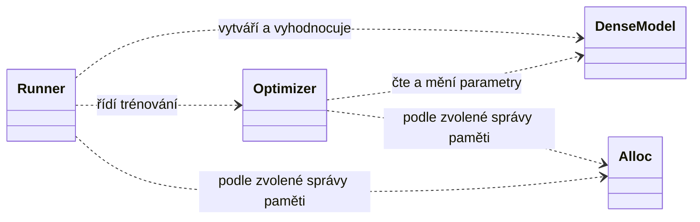

# Specifikace experimentu 003-dense

- **Projekt:** `003-dense`
- **Revize:** pracovní návrh 2
- **Stav:** rozpracováno, návrh architektury a implementace čekají na rozhodnutí vlastníka

## Cíl a rozsah

Navázat na afinní model z `001-LinearRegression` a na neuron s aktivací,
dávkovou ztrátou a gradientem z `002-perceptron`. Ověřit matematiku
vícevrstvého hustě propojeného modelu v jazyce C bez frameworku a rozšířit
architekturu trénování o výpočet a ukládání gradientů více vrstev.
Rychlost a spotřebu paměti měřit na stejných datech, přesnosti a hardwaru
jako případný referenční program, než z nich vyvodíme závěr.

Potvrzené volby jsou aktivace ReLU a střední kvadratická chyba (MSE),
stejně jako v běhu ReLU experimentu `002-perceptron`. Konkrétní úloha,
tvar modelu, způsob inicializace a kritérium úspěchu zůstávají otevřené.
První verze cílí na Linux x86-64.

## Konceptuální matematika

Jeden neuron počítá skalární součin svých vstupů a vah, přičte
vlastní bias a na afinní výsledek použije ReLU. Hustá vrstva $l$
s $n_{l-1}$ vstupy a $n_l$ neurony uspořádá váhy neuronů do řádků
matice $W^{(l)}\in\mathbb{R}^{n_l\times n_{l-1}}$. Bias každého
neuronu tvoří složku sloupcového vektoru
$\mathbf b^{(l)}\in\mathbb{R}^{n_l\times 1}$. Pro sloupcový vstup
$\mathbf a^{(0)}=\mathbf x\in\mathbb{R}^{n_0\times 1}$ počítá

$$
\mathbf z^{(l)}=W^{(l)}\mathbf a^{(l-1)}+\mathbf b^{(l)},
\qquad
\mathbf a^{(l)}=\operatorname{ReLU}\!\left(\mathbf z^{(l)}\right),
\qquad
\operatorname{ReLU}(z)=\max(0,z).
$$

Násobení matice a sloupcového vektoru vytvoří
$n_l$ afinních výsledků; ReLU se použije na každou složku zvlášť.
Zápis vstupu jako sloupce určuje orientaci rozměrů, nemění jeho hodnoty.
Afinní vrstvy bez nelineární aktivace se složí do jediné afinní funkce.

Pro $N>0$ vzorků a $q=n_L$ výstupů definujeme MSE jako průměr
čtvercových chyb přes vzorky i výstupní složky:

$$
\operatorname{MSE}=\frac{1}{Nq}\sum_{k=1}^{N}
\sum_{j=1}^{q}\left(a_{k,j}^{(L)}-y_{k,j}\right)^2.
$$

Pro jeden výstup ($q=1$) je to stejná definice jako v experimentu 002.
Zpětné šíření potřebuje vedle násobení maticí derivaci ReLU.
Stejně jako v experimentu 002 volíme v bodě $z=0$ hodnotu derivace
nula. Pro ztrátu $L$ jednoho vzorku definujeme
$\boldsymbol\delta^{(l)}=\partial L/\partial\mathbf z^{(l)}$.
Na výstupu a ve skryté vrstvě dává řetězové pravidlo

$$
\boldsymbol\delta^{(L)}=\frac{2}{q}
\left(\mathbf a^{(L)}-\mathbf y\right)
\odot\mathbf 1_{\mathbf z^{(L)}>0},
$$

$$
\boldsymbol\delta^{(l)}=
\left((W^{(l+1)})^{\mathsf T}\boldsymbol\delta^{(l+1)}\right)
\odot\mathbf 1_{\mathbf z^{(l)}>0},
$$

$$
\frac{\partial L}{\partial W^{(l)}}=
\boldsymbol\delta^{(l)}(\mathbf a^{(l-1)})^{\mathsf T},
\qquad
\frac{\partial L}{\partial\mathbf b^{(l)}}=
\boldsymbol\delta^{(l)}.
$$

Pro dávku se gradient MSE získá zprůměrováním těchto příspěvků
jednotlivých vzorků. Indikátor $\mathbf 1_{\mathbf z>0}$ má v aktivních
složkách hodnotu jedna, jinak nula.

## Návaznost a otevřená architektura

Z předchozích experimentů přebíráme oddělení modelu, optimalizátoru,
Runneru a jednotkových testů. Runner vlastní data a řídí běh. Model počítá
predikci, optimalizátor počítá gradient a mění parametry. Přesné rozhraní,
vlastnictví pracovních polí a způsob popisu rozměrů vrstev zatím nejsou
určené. Knihovna `lib/alloc` je dostupná pro pracovní paměť, která se
nevejde na zásobník.

## Varianty k rozhodnutí

| Volba | Přesnost a ověření | Čas a paměť | Složitost a riziko |
|---|---|---|---|
| Malá síť s pevnými rozměry při překladu | Jednodušší ruční kontrola gradientů a reprodukovatelná úloha | Bez popisu vrstev za běhu, pracovní pole mohou být malá | Změna topologie vyžaduje překlad; hrozí řešení příliš úzce svázané s jednou sítí |
| Rozměry vrstev určené při běhu | Stejná matematika, lze porovnat více topologií | Parametry a pracovní pole potřebují správu paměti, vznikají indexové výpočty | Vyšší nároky na kontrolu rozměrů, vlastnictví a selhání alokace |
| Jeden vzorek po druhém s akumulací gradientu dávky | Snadná kontrola každého příspěvku | Pracovní aktivace rostou s modelem, nikoli s počtem vzorků; méně možností pro dávkovou optimalizaci | Jednodušší životnost polí, více průchodů výpočtem |
| Aktivace celé dávky v pracovních polích | Vhodné pro porovnání dávkových výpočtů | Paměť roste s velikostí dávky; potenciál pro lepší využití procesoru až po měření | Složitější indexování a správa pracovních polí |

Žádná varianta dosud není vybrána. Před implementací je potřeba určit
úlohu a data, topologii, přesnost čísel, inicializaci,
režim dávky a způsob uložení parametrů i mezivýsledků. Volba ovlivní
testy gradientů, případnou referenční implementaci a měření.

## Plán ověření

- Ručně vypočtený dopředný průchod a gradient malé sítě.
- Numerická kontrola gradientů konečným rozdílem v bodech, kde jsou
  zvolené aktivace diferencovatelné.
- Test aktualizace parametrů, rozměrů a selhání alokace podle vybrané
  architektury.
- Měření výsledné ztráty na zvolené úloze a času i vrcholové paměti
  za reprodukovatelných podmínek.

## Závěr

Zatím nelze hodnotit přesnost, výkon ani paměť. Metoda, experimentální
podmínky a kritérium úspěchu čekají na rozhodnutí vlastníka.

## Slovník

- **Hustá vrstva:** Vrstva, v níž každý výstupní neuron používá všechny
  výstupy předchozí vrstvy.
- **Aktivace:** Nelineární funkce použitá na afinní výstup vrstvy.
- **Gradient:** Derivace ztráty podle parametru, která určuje lokální směr
  jeho změny při trénování.
- **Zpětné šíření:** Výpočet gradientů od výstupu k dřívějším vrstvám
  pomocí řetězového pravidla.
- **Dávka:** Skupina vzorků, jejichž příspěvky tvoří jednu aktualizaci
  parametrů.
