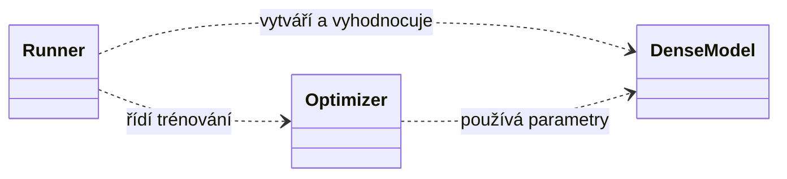

# Specifikace experimentu 003-dense

- **Projekt:** `003-dense`
- **Revize:** pracovní návrh 3
- **Stav:** rozpracováno; matematické vztahy a architektura se budou odvozovat společně

## Cíl

Navázat na afinní model z `001-LinearRegression` a na neuron z
`002-perceptron`. Cílem je pochopit a ověřit výpočet více spolupracujících
neuronů, později jejich trénování a vhodnou architekturu programu v C bez
frameworku. Výkon a spotřebu paměti vyhodnotíme měřením za srovnatelných
podmínek; zatím o nich netvrdíme žádnou výhodu.

Zamýšlenou ověřovací úlohou je XOR, protože jeden neuron s afinním vstupem
a rozhodovacím prahem neumí správně rozlišit všechny čtyři kombinace.
AND může sloužit jako kontrolní úloha navazující na experiment 002.
Zkouška na pravdivostní tabulce ověří naučení těchto čtyř vstupů, ne
zobecnění na neviděná data.

Prozatím potvrzenými prvky jsou aktivační funkce ReLU a střední
kvadratická chyba (MSE) jako v experimentu 002. Přesná podoba sítě,
trénování a podmínky experimentu čekají na společné odvození.

## Dosud probraný výpočet

Jeden neuron přijímá vektor vstupů. Každému vstupu přiřadí vlastní váhu,
vypočte skalární součin, přičte vlastní bias a získanou hodnotu předá
aktivační funkci. ReLU vrací tuto hodnotu, pokud je kladná, jinak nulu.

Pokud více neuronů zpracuje stejný vstup, každý má své váhy a svůj bias.
Jejich výstupem je vektor s jednou hodnotou za každý neuron. Váhy lze
uspořádat do matice tak, že jeden řádek obsahuje váhy jednoho neuronu.
Pro vstup zapsaný jako sloupcový vektor pak jeden společný maticový
součin spočítá skalární součiny všech neuronů. K výslednému sloupci se
přičte sloupec jejich biasů a na každou složku se použije ReLU.

Tento popis zatím určuje dopředný výpočet jedné vrstvy. Zápis vstupu jako
sloupce určuje uspořádání rozměrů, nikoli změnu hodnot vstupu.

## Postup dalšího odvozování

1. Zapsat výpočet jednoho neuronu na konkrétních číslech a ověřit jeho
   výstup před ReLU i po ní.
2. Položit vedle sebe dva neurony nad stejným vstupem a z jejich
   skalárních součinů společně sestavit maticový zápis. U každého členu
   zkontrolovat rozměr a význam.
3. Teprve potom spojit výstup jedné vrstvy se vstupem další. Na malém
   příkladu určit, jak se mění výstup modelu.
4. Odvodit MSE a změnu její hodnoty při změně jediné váhy. Následně
   odvodit gradienty skryté vrstvy a jejich použití při aktualizaci.
5. Po odsouhlasení matematiky rozhodnout o topologii, reprezentaci dat,
   vlastnictví paměti a rozhraních programu. Poté stanovit testy a
   měřitelné kritérium úspěchu.

Vzorce pro gradienty a rozhodnutí o konkrétní implementaci doplníme až
po jejich odvození s vlastníkem projektu. Numerická kontrola gradientů
může později ověřit správnost odvozených vztahů.

## Architektura k dopracování

Z experimentu 002 známe oddělení Runneru, modelu a optimalizátoru.
Ještě není rozhodnuto, jak budou reprezentované vrstvy, kdo bude
vlastnit mezivýsledky a zda budou rozměry určené při překladu nebo běhu.
Tyto volby mají dopad na složitost programu, výpočetní čas i paměť.

## Závěr

Experiment zatím nemá výsledky. Následujícím krokem je společně odvodit
maticový zápis jedné vrstvy na malém číselném příkladu.

## Slovník

- **Neuron:** Výpočetní jednotka s vlastními vahami a biasem, která
  předává svůj afinní výsledek aktivační funkci.
- **Hustá vrstva:** Skupina neuronů, z nichž každý používá všechny
  hodnoty stejného vstupního vektoru.
- **Bias:** Vlastní přičítaná hodnota neuronu před aktivací.
- **ReLU:** Aktivace, která záporné a nulové hodnoty převádí na nulu.
- **MSE:** Průměr druhých mocnin rozdílů mezi výstupem a požadovanou
  hodnotou.
