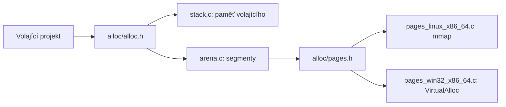

# Specifikace knihovny alloc

- **Projekt:** `lib/alloc`
- **Stav dokumentu:** návrh specifikace; závěr testování čeká na odsouhlasení
- **Zdroj pravdy:** tento Markdown soubor
- **Datum:** 2026-11-25
- **Revize:** 2

## 1. Účel a hranice

Knihovna poskytuje projektům v čistém C malý alokační mechanismus bez volání `malloc`, `calloc`, `realloc` a `free`. Má zásobníkový alokátor nad pamětí volajícího a arenu nad virtuální pamětí OS. Cílovými ověřenými hostitelskými platformami jsou `linux_x86_64` a `win32_x86_64`.

Specifikace neřeší paměť zařízení CUDA, souběžné volání z více vláken, garanci vrácení paměti OS po jednotlivém bloku ani obecný náhradní alokátor při vyčerpání kapacity.

## 2. Pojmy

| Pojem | Význam |
|---|---|
| `Alloc` | Společné rozhraní operací `new`, `delete`, `resize`, `reset`, `finalize`. |
| Stack | Alokátor nad bufferem, jehož vlastníkem je volající. |
| Arena | Alokátor vlastnící řetěz segmentů získaných od OS. |
| Aktivní blok | Poslední blok zásobníku nebo poslední blok aktuálního segmentu areny. |
| LIFO | Poslední získaný blok lze vrátit jako první. |
| `max_align_t` | Požadované zarovnání vracených adres pro běžné C objekty. |

## 3. Teorie a očekávané vlastnosti

Zásobníkový alokátor ukládá bloky postupně za sebe. Posun ukazatele je levný, ale uvolnění staršího bloku nemůže bezpečně přesunout živé bloky nad ním. Proto může okamžitě vrátit jen poslední blok; reset zahodí všechny bloky najednou. Arena rozšiřuje tento princip o nové segmenty, když se aktuální zaplní. Její výhodou je jednoduchá alokace mnoha objektů se společnou životností, nevýhodou možnost nevyužité paměti do resetu.

Vracená adresa musí být zarovnána na `max_align_t`. Výpočet velikosti bloku a zarovnání musí kontrolovat přetečení typu `size_t`, protože přetečení by mohlo způsobit zápis mimo vyhrazený buffer. `resize` posledního bloku lze provést na místě, pokud se vejde. Přesun staršího bloku vyžaduje nový blok a kopii původního obsahu. Tyto principy neurčují platformní způsob získání paměti ani případnou paralelizaci.

## 4. Architektura a vlastnictví

- `alloc_stack(buffer, capacity)` vrací hodnotu `Alloc_Stack`. Volající vlastní buffer i strukturu a musí je udržet při životě déle než alokované bloky. Konstruktor zarovná začátek použitelné části bufferu. Kompatibilní `alloc_stack_new(capacity, buffer)` umístí strukturu na začátek bufferu.
- `alloc_arena_new(segment_size)` vrací ukazatel na arenu přidělenou OS. Při `segment_size == 0` používá počáteční velikost segmentu 4096 bajtů. Velký jednotlivý požadavek může vytvořit větší segment.
- `alloc_reset` zásobníku nastaví pozici na začátek; reset areny uvolní všechny segmenty, ale ponechá samotnou arenu použitelnou. `alloc_finalize` zásobník jen resetuje a arenu uvolní včetně její vlastní struktury.
- Platformní soubor používá na Linuxu `mmap`/`munmap` a na Windows `VirtualAlloc`/`VirtualFree`. Veřejná logika v `stack.c` a `arena.c` neobsahuje podmíněné větvení podle OS.

Volající nesmí používat ukazatel po jeho uvolnění, resetu nebo finalizaci. `alloc_finalize` smí pro živou arenu zavolat právě jednou. Funkce přijímají alokátor, který blok vytvořil. API s prefixem `alloc_` je preferované; původní krátké názvy zůstávají kompatibilní.

## 5. Semantika operací a chyb

| Operace | Zásobník | Arena |
|---|---|---|
| `alloc_new(size)` | Vrátí zarovnaný blok, nebo `NULL` při nedostatku místa či přetečení. | Použije aktuální segment nebo získá další; při chybě vrátí `NULL`. |
| `alloc_delete(pointer)` | Vrátí místo jen pro aktivní blok. | Vrátí místo jen pro aktivní blok aktuálního segmentu. |
| `alloc_resize(pointer, size)` | Aktivní blok změní na místě, pokud se vejde; jinak alokuje a kopíruje. | Stejná smlouva, případně přes nový segment. |
| `alloc_reset()` | Zneplatní všechny bloky, zachová buffer. | Zneplatní všechny bloky a uvolní segmenty. |
| `alloc_finalize()` | Resetuje alokátor; buffer zůstává volajícímu. | Uvolní segmenty i arenu. |

Nulová požadovaná velikost spotřebuje minimální slot. `alloc_resize(NULL, size)` se chová jako nová alokace. `alloc_resize(pointer, 0)` se pokusí blok uvolnit a vrací `NULL`; starší blok se kvůli LIFO ihned nevrátí. Při neúspěchu změny nenulové velikosti zůstává původní blok platný. Pokud se blok přesune, starý blok zabírá místo až do pozdějšího resetu či finalizace.

## 6. Implementační a výkonnostní rozhodnutí

Každý blok má interní hlavičku s původní pozicí a požadovanou velikostí. Velikosti se zaokrouhlují k hranici zarovnání s kontrolou přetečení. Arena eviduje segmenty v jednosměrném seznamu a nový přidává jako aktivní. Získání a vrácení segmentu je odděleno do platformních souborů. Objektové soubory a archiv pro různé platformy jsou v `.cache/<platform>/`.

Implementace je sekvenční; nemá zámky ani sdílený paralelní stav. Případná optimalizace pro více vláken by vyžadovala samostatné alokátory na pracovníka nebo synchronizaci, novou smlouvu vlastnictví a měření režie. Nejde o změnu principu zásobníku či areny. Tato verze nemá výkonnostní benchmark, proto se z teoreticky levného posunu ukazatele nevyvozuje naměřené zrychlení.

## 7. Normativní požadavky

| ID | Požadavek |
|---|---|
| AL-001 | Každá úspěšná alokace musí vrátit adresu zarovnanou na `max_align_t`. |
| AL-002 | Při nedostatku kapacity nebo přetečení výpočtu velikosti musí operace vrátit `NULL` bez poškození živého bloku. |
| AL-003 | Samostatné uvolnění smí zkrátit pouze aktivní LIFO blok; starší blok musí zůstat platný do resetu. |
| AL-004 | `resize` musí zachovat nejméně `min(stará, nová)` bajtů obsahu. |
| AL-005 | Reset musí zneplatnit všechny bloky a umožnit další alokace. |
| AL-006 | Finalizace areny musí vrátit všechny její OS segmenty a vlastní strukturu. |
| AL-007 | Implementace nesmí volat `malloc`, `calloc`, `realloc` ani `free`. |
| AL-008 | Linux a Windows musí používat vlastní OS vrstvu a oddělené výstupní adresáře. |
| AL-009 | Cíl `make test` musí spustit jednotkové testy a vrátit chybu při selhání. |

## 8. Akceptační scénáře

| ID | Požadavky | Vstup / podmínka | Očekávaný výsledek | Stav |
|---|---|---|---|---|
| AL-T01 | AL-001 | Nezarovnaný buffer zásobníku a běžná alokace | Zarovnaná adresa, čitelný a zapisovatelný blok | Provedeno na obou platformách. |
| AL-T02 | AL-003, AL-004 | Uvolnění staršího bloku, změna velikosti vrchního bloku | Starší uvolnění neubere kapacitu; aktivní blok se změní na místě | Provedeno na obou platformách. |
| AL-T03 | AL-004 | Zvětšení staršího bloku a kontrola obsahu | Nová adresa, zachovaný původní obsah | Provedeno na obou platformách. |
| AL-T04 | AL-002, AL-005 | Nadměrný požadavek, reset a opětovná alokace | `NULL` bez poškození dat; po resetu lze alokovat | Provedeno na obou platformách. |
| AL-T05 | AL-006, AL-008 | Arena s malým segmentem a požadavek větší než segment | Nový segment, platná data, úspěšná finalizace | Provedeno na obou platformách. |
| AL-T06 | AL-001 až AL-006 | Kontrola paměťových chyb sanitizerem | Žádné hlášené porušení paměti ani nedefinované chování | Provedeno jen na Linuxu. |
| AL-T07 | AL-007 | Statická kontrola volání v `src/` | Žádné volání standardních funkcí `malloc`, `calloc`, `realloc`, `free` | Provedeno; bez nálezu. |
| AL-T08 | AL-008 | Sestavení obou platforem v jednom stromu | Oddělené objekty a archivy v `.cache/<platform>/` | Provedeno. |
| AL-T09 | AL-009 | Spuštění `make test` pro každou platformu | Pět úspěšných případů, nulový návratový kód | Provedeno na obou platformách. |

Vstupy testu jsou pevné bajtové vzory a velikosti z `tests/test_alloc.c`; nepoužívá dataset, síť ani náhodný seed. Metrikami jsou návratový kód testu, zachování obsahu, správné zarovnání a hlášení sanitizerů. Spotřeba paměti ani propustnost se zatím neměřily.

## 9. Skutečné výsledky a interpretace

Dne 2026-11-25 prošly testy se sdíleným modulem `lib/unit` znovu na Windows a v Linuxu WSL Arch; obě sady vykázaly pět úspěchů a žádné selhání. Dne 2026-11-24 prošel `mingw32-make PLATFORM=win32_x86_64 -j4 test` na Windows s MSYS2 MinGW-w64 GCC a `make -j4 test` v Linuxu WSL Arch. Obě sady vypsaly `5 passed, 0 failed`. Samostatný linuxový překlad a běh stejné sady s `-fsanitize=address,undefined` také prošel bez hlášení sanitizerů. Sestavení používá `-Wall -Wextra -Werror -pedantic`.

Pozorování podporují správné zarovnání, LIFO smlouvu, kopírování při přesunu bloku a reset na testovaných vstupech. Neprokazují bezpečnost při souběžném přístupu, chování pro libovolný chybný ukazatel ani výkonnost proti systémovému alokátoru.

## 10. Známé hranice, otevřené body a závěr

- Starší blok se samostatně nevrací; pro dlouho žijící promíchané objekty mohou zůstávat nevyužité bajty do resetu.
- CUDA paměť zařízení vyžaduje vlastní rozhraní a platformní implementaci; není součástí této verze.
- Otevřený bod AL-OP-01: Před používáním ve více vláknech stanovit model vlastnictví a synchronizace.
- Otevřený bod AL-OP-02: Před tvrzením o výkonu doplnit benchmark, zátěžové vzory a měření paměti.

**Návrh závěru testování k odsouhlasení:** Knihovna je použitelná pro sekvenční experimenty na Linuxu a Windows, pokud životnost bloků odpovídá LIFO nebo skupinovému resetu. Pozorované testy podporují tuto smlouvu a Linux navíc prošel kontrolou sanitizerů. Není doložen přínos ve výkonu, vláknová bezpečnost ani použitelnost pro CUDA paměť zařízení. Tento závěr není zatím odsouhlasen vlastníkem repozitáře.

## 11. Vazba na kód a údržba

| Oblast | Zdroj |
|---|---|
| Veřejná smlouva | `include/alloc/alloc.h`, `include/alloc/stack.h`, `include/alloc/arena.h` |
| Zásobníkový alokátor | `src/stack.c` |
| Arena a OS rozhraní | `src/arena.c`, `include/alloc/pages.h` |
| Platformní paměť | `src/pages_linux_x86_64.c`, `src/pages_win32_x86_64.c` |
| Akceptační testy | `tests/test_alloc.c`, `tests/main.c`, `../unit/src/unit.c`, `../unit/include/unit/unit.h` |
| Překlad | `Makefile`, `config/linux_x86_64.mk`, `config/win32_x86_64.mk` |

Každá změna vlastnictví, zarovnání, chování `resize`/`reset`, OS vrstvy nebo podporovaných platforem musí změnit tuto specifikaci a příslušné testy. Potvrzené odchylky se uchovají do opravy. Závěr se označí jako odsouhlasený až po výslovné shodě s vlastníkem.

Hlavičky knihovny se překládají s `-Iinclude`; sdílený testovací modul s `-I../unit/include`. Přesun knihovny vyžaduje změnu překladové cesty, nikoli logických názvů v direktivách `#include`. Testovací modul se nepřipojuje k produkčnímu archivu.

## 12. Vysvětlující slovník odborných pojmů

- **Alokátor:** Objekt implementující společné rozhraní `Alloc`, přes které projekt získává a spravuje bloky paměti.
- **Zásobníkový alokátor:** Alokátor nad bufferem volajícího, který umí okamžitě vrátit jen nejnovější blok.
- **Arena:** Alokátor, který zde získává od operačního systému více segmentů a uvolňuje je společně při resetu nebo finalizaci.
- **LIFO:** Pravidlo „poslední dovnitř, první ven“ určující, který blok lze vrátit bez přesouvání ostatních dat.
- **Aktivní blok:** Poslední blok zásobníku nebo aktuálního segmentu areny, který lze uvolnit či změnit na místě, pokud to dovolí kapacita.
- **Segment:** Souvislá oblast virtuální paměti použitá arenou pro více bloků; větší požadavek může dostat vlastní segment.
- **Zarovnání:** Umístění adresy bloku na hranici požadovanou typem `max_align_t`, aby šel bezpečně použít pro běžné C objekty.
- **Přetečení `size_t`:** Překročení rozsahu typu při výpočtu velikosti; alokátor jej musí zachytit před zápisem do paměti.
- **Virtuální paměť OS:** Hostitelská paměť získaná přes `mmap` v Linuxu nebo `VirtualAlloc` ve Windows; nejde o CUDA paměť zařízení.
- **Sanitizer:** Překladová instrumentace použitá v linuxovém testu ke zjištění chyb přístupu do paměti a nedefinovaného chování.
