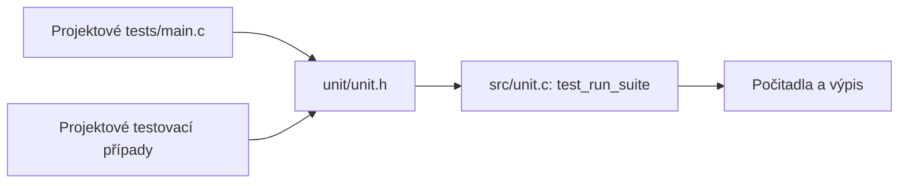

# Specifikace sdílené knihovny unit

- **Projekt:** `lib/unit`
- **Stav dokumentu:** návrh; závěr testování čeká na odsouhlasení
- **Datum:** 2026-11-25
- **Revize:** 1

## 1. Účel a rozsah

Knihovna sdílí jednoduchý testovací mechanismus mezi projekty bez kopírování
`unit.c` a `unit.h`. Obsahuje definice případů, sady, asertivních maker a
funkci pro spuštění jedné sady. Projekt si ponechává vlastní testy a `tests/main.c`.
Knihovna není součástí produkčních binárních souborů.

## 2. Teorie testovacího postupu

Jednotkový test je deterministická funkce, která vrací úspěch nebo neúspěch.
Sada je posloupnost pojmenovaných případů. Spouštěč provede každý případ a
zvýší počitadlo úspěchů či selhání. Proces projektu ukončí nenulovým kódem,
pokud bylo některé počitadlo selhání zvýšeno. To samo neprokazuje úplnost testů.

## 3. Architektura a rozhraní

`TestFunction` má signaturu `bool (char *error, size_t error_size)`.
`TestCase` obsahuje jméno a funkci, `TestSuite` jméno, pole případů a počet.
`TEST_ASSERT` a `TEST_ASSERT_MSG` uloží důvod a vrátí `false`.
`test_run_suite` přijímá platnou sadu a dvě počitadla; pro neplatný ukazatel
nebo chybějící pole případů vrátí `false` bez provedení testů.
Projekt vlastní pole případů, sadu i počitadla. Pomocný modul nic dynamicky
nealokuje. Formátovací výpis používá standardní C I/O.

## 4. Překlad a platformy

Veřejná hlavička leží v `include/unit/unit.h`, implementace v `src/unit.c`.
Překlad používá `-I` ukazující na adresář `include/`; zdroj uvádí vždy
`#include "unit/unit.h"`. Po přesunu knihovny se změní překladová cesta,
nikoli logický název hlavičky. Linux a Windows mají vlastní konfigurační soubor,
objekty a binární soubory v `.cache/$(PLATFORM)/`.

## 5. Požadavky a akceptace

| ID | Požadavek | Ověření |
|---|---|---|
| UN-001 | Přesně jednou spustit každý případ a aktualizovat počitadla. | UN-T01: úspěch, selhání a chybějící funkce. |
| UN-002 | Odmítnout neplatné vstupy spouštěče. | UN-T02: nulové ukazatele a chybějící pole. |
| UN-003 | Udržet platformní výstupy oddělené. | UN-T03: překlad a běh na obou platformách. |

## 6. Výsledky, omezení a navržený závěr

Dne 2026-11-25 prošly příkazy `make PLATFORM=linux_x86_64 -j4 test` v WSL Arch
+a `mingw32-make PLATFORM=win32_x86_64 -j4 test` na Windows. Vlastní test
modulu ověřil jeden úspěch, dvě očekávaná selhání, jejich počitadla a odmítnutí
neplatných ukazatelů. Celý testovací proces skončil kódem 0. Tím byly
provedeny UN-T01, UN-T02 a UN-T03. Testy spouštěče neověřují obsah
standardního výstupu bajt po bajtu ani kvalitu projektových testů. **Návrh závěru:** Pomocný modul je vhodný pro malé
deterministické sady v tomto repozitáři, pokud testovací proces vrací chybu při
nenulovém počtu selhání. Závěr zatím není odsouhlasen vlastníkem.

## 7. Vazba na zdrojové soubory

| Část | Soubor |
|---|---|
| Veřejné rozhraní | `include/unit/unit.h` |
| Spouštěč sady | `src/unit.c` |
| Vlastní ověření | `tests/main.c` |
| Překlad | `Makefile`, `config/linux_x86_64.mk`, `config/win32_x86_64.mk` |

## 8. Vysvětlující slovník odborných pojmů

- **Jednotkový test:** Zde malá funkce ověřující jednu vlastnost komponenty.
- **Testovací případ:** Jméno a ukazatel na testovací funkci v `TestCase`.
- **Testovací sada:** Pole případů s počtem a názvem v `TestSuite`.
- **Aserce:** Kontrola podmínky, která při selhání zaznamená důvod testu.
- **Spouštěč:** Funkce `test_run_suite`, která prochází případy a sčítá výsledky.
- **Překladová cesta:** Argument `-I`, kterým se najde logická hlavička bez závislosti zdrojového kódu na fyzické cestě knihovny.
